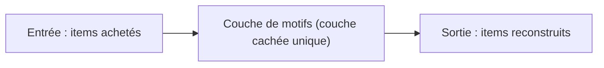

#dmv-pattern_mining_vs_deep_learning

# Définition

Un **auto-encodeur de motifs** est un [[Auto-encodeur|auto-encodeur]] à **une seule couche cachée**, dont l'entrée et la sortie sont **binaires** : la couche cachée capture les motifs, et le réseau apprend ainsi un petit ensemble de motifs à partir duquel chaque transaction se reconstruit.

Un auto-encodeur apprend une représentation de faible dimension de son entrée : il apprend à encoder cette entrée, puis à décoder à partir de cette représentation de faible dimension, et cette représentation doit capturer les motifs des données d'entrée.

Dans l'auto-encodeur de motifs, l'entrée est une [[Items, itemsets et base de transactions|transaction]], c'est-à-dire un vecteur binaire d'items achetés, et la sortie est un vecteur binaire de même forme, celui des items reconstruits.

# Modèle

Le réseau comporte trois étages :

- l'**entrée (items)** : un vecteur binaire des items achetés ;
- la **couche de motifs** : l'unique couche cachée, qui capture les motifs ;
- la **sortie (items)** : le vecteur binaire des items reconstruits.

| Étape | Rôle | Notation |
| :-: | --- | :-: |
| Entrée | donnée binaire (transaction) | $\mathbf{x}$ |
| Encodeur | compression vers l'espace latent | $g_\phi$ |
| Goulot d'étranglement | représentation comprimée de faible dimension | $\mathbf{z}$ |
| Décodeur | reconstruction depuis l'espace latent | $f_\theta$ |
| Sortie | entrée reconstruite | $\mathbf{x}'$ |

L'objectif de reconstruction est que la sortie reproduise l'entrée :

$$\mathbf{x} \approx \mathbf{x}'$$

Idéalement, l'entrée et la sortie sont identiques.

La passe avant s'écrit avec l'encodeur $f_E$ et le décodeur $f_D$ : une entrée binaire $s \in \{0,1\}^m$ est encodée dans la couche de motifs, qui compte $k$ neurones, puis décodée vers une sortie de dimension $m$. La passe avant complète est la composition du [[Décodage d'une couche de motifs|décodage]] et de l'[[Encodage d'une transaction en motifs|encodage]] :

$$\text{passe avant} = f_D\left(f_E(s)\right)$$

# Interprétation

Le goulot d'étranglement interdit la copie : la couche cachée est trop petite pour transmettre la transaction telle quelle, donc le réseau doit la décomposer.

Comme la sortie doit reproduire les items d'entrée, chaque neurone de la couche cachée est conduit à représenter un [[Couche de motifs|motif]], c'est-à-dire un ensemble d'items qui apparaissent ensemble, et le décodage recompose la transaction à partir des motifs reconnus.

Chaque neurone de la couche de motifs se lit donc comme un itemset : la couche entière fournit l'ensemble de motifs à partir duquel le réseau reconstruit les transactions.

# Exemple

Base de quatre transactions sur cinq items binaires $a_1, \dots, a_5$, écrite en matrice transactions $\times$ items :

| Transaction | $a_1$ | $a_2$ | $a_3$ | $a_4$ | $a_5$ |
| :-: | :-: | :-: | :-: | :-: | :-: |
| $t_1$ | 1 | 1 | 0 | 0 | 0 |
| $t_2$ | 1 | 1 | 0 | 1 | 1 |
| $t_3$ | 1 | 0 | 1 | 1 | 1 |
| $t_4$ | 0 | 0 | 0 | 1 | 1 |

Chaque ligne est un exemple d'entrée du réseau, chaque colonne un item : la transaction $t_1$ contient les items $a_1$ et $a_2$, la transaction $t_2$ contient $a_1$, $a_2$, $a_4$ et $a_5$.

Sur cette base, un motif candidat est par exemple $\{a_1, a_2\}$, présent dans $t_1$ et $t_2$ mais absent de $t_3$ et $t_4$ : c'est le genre d'ensemble d'items que la couche cachée doit apprendre à repérer pour reconstruire les lignes.

# Remarque

L'auto-encodeur de motifs est un cas particulier de l'[[Auto-encodeur]] : mêmes encodeur et décodeur autour d'un goulot d'étranglement, mais une entrée et une sortie binaires et une seule couche cachée, dont les neurones portent les motifs.

Le réseau opère ainsi entièrement dans l'espace binaire des matrices de transactions, tout en trouvant de bons ensembles de motifs. L'astuce centrale alterne deux espaces : l'espace binaire pour la définition des motifs et la reconstruction des données, l'espace continu pour l'optimisation, ce que détaille la [[Boucle d'apprentissage de l'auto-encodeur de motifs|boucle d'apprentissage]] de l'auto-encodeur de motifs.

Dans la représentation de l'architecture, les nœuds d'entrée et de sortie, qui portent les items, sont reliés par la couche de motifs : quelques nœuds et connexions y sont actifs en bleu, les autres atténués en gris.

Cette mise en évidence est conjonctive : un neurone de motifs ne s'active que si tous les items du motif sont présents dans l'entrée, si bien que la couche signale des motifs entiers et non des items isolés.
