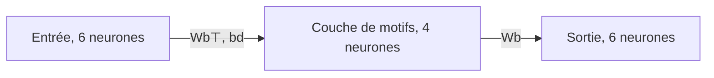

#dmv-pattern_mining_vs_deep_learning

# Exemple

La base $D$ rassemble des échantillons binaires sur six items, au sens d'une [[Items, itemsets et base de transactions|base de transactions]], et le réseau qui l'apprend est un [[Auto-encodeur de motifs|auto-encodeur]] de forme $6 \to 4 \to 6$ : six neurones d'entrée, quatre neurones de motifs, six neurones de sortie.

| Échantillon | item 1 | item 2 | item 3 | item 4 | item 5 | item 6 |
|---|:---:|:---:|:---:|:---:|:---:|:---:|
| $s_1$ | 1 | 1 | 1 | 1 | 0 | 0 |
| $s_2$ | 1 | 1 | 1 | 1 | 1 | 1 |
| $s_3$ | 1 | 1 | 0 | 0 | 0 | 1 |
| $s_4$ | 1 | 1 | 0 | 0 | 0 | 1 |
| $s_5$ | 0 | 0 | 0 | 0 | 1 | 1 |
| $s_6$ | 1 | 1 | 0 | 0 | 0 | 1 |

La passe avant traverse le réseau en deux temps, l'encodage par la matrice transposée puis le décodage par la même matrice relue dans l'autre sens :

**Poids continus.** La matrice $W$ compte quatre lignes, une par neurone de motif, et six colonnes, une par item de la base. Ses coefficients sont continus, donc dérivables, et ce sont eux que la [[Poids binaires et optimisation différentiable|passe arrière]] corrige.

$$W = \begin{bmatrix} 0.02 & 0.01 & 0.00 & 0.01 & 0.95 & 0.91 \\ 0.78 & 0.81 & 0.92 & 0.82 & 0.03 & 0.00 \\ 0.03 & 0.04 & 0.07 & 0.05 & 0.01 & 0.00 \\ 0.93 & 0.90 & 0.03 & 0.01 & 0.07 & 0.87 \end{bmatrix}$$

**Poids binarisés.** La binarisation arrondit chaque coefficient de $W$ : les valeurs proches de $1$ deviennent $1$ et celles proches de $0$ deviennent $0$, ce qui fait de chaque ligne une appartenance d'items.

$$W_b = \begin{bmatrix} 0 & 0 & 0 & 0 & 1 & 1 \\ 1 & 1 & 1 & 1 & 0 & 0 \\ 0 & 0 & 0 & 0 & 0 & 0 \\ 1 & 1 & 0 & 0 & 0 & 1 \end{bmatrix}$$

Chaque ligne de $W_b$ se lit comme l'ensemble des items qu'elle met à $1$ :

- ligne 1 : items 5 et 6, motif $\{5, 6\}$ ;
- ligne 2 : items 1 à 4, motif $\{1, 2, 3, 4\}$ ;
- ligne 3 : aucun item à $1$, aucun motif ;
- ligne 4 : items 1, 2 et 6, motif $\{1, 2, 6\}$.

La couche porte ainsi trois [[Couche de motifs|motifs]], qui forment l'ensemble appris :

$$P = \{\{5,6\},\{1,2,3,4\},\{1,2,6\}\}$$

**Biais.** Chaque neurone de motif reçoit un biais continu, ramené sur une valeur entière par discrétisation à la fin de la passe arrière.

$$b = \begin{bmatrix} -1.1 \\ -2.9 \\ -1.0 \\ -2.1 \end{bmatrix}$$

$$b_d = \begin{bmatrix} -1 \\ -2 \\ -1 \\ -2 \end{bmatrix}$$

**Encodage de l'échantillon $s_1$.** L'[[Encodage d'une transaction en motifs|encodage]] projette l'échantillon sur les quatre neurones de motifs : les poids binaires comptent, pour chaque neurone, combien d'items de son motif figurent dans l'échantillon.

$$s_1 W_b^{\top} = (0,\ 4,\ 0,\ 2)$$

Le biais discrétisé s'ajoute composante par composante, puis le résultat est borné dans $[0,1]$ par la [[Fonction de bornage dans un intervalle|fonction de bornage]] et arrondi à l'entier le plus proche.

$$s_1 W_b^{\top} + b_d^{\top} = (-1,\ 2,\ -1,\ 0)$$

Seul le deuxième neurone atteint $1$, d'où le code de l'échantillon dans la couche de motifs :

$$y_1 = (0,\ 1,\ 0,\ 0)$$

**Décodage.** Le [[Décodage d'une couche de motifs|décodage]] relit la ligne du motif actif dans $W_b$ et reconstruit l'échantillon.

$$y_1 W_b = (1,\ 1,\ 1,\ 1,\ 0,\ 0)$$

L'échantillon $s_1$ est reconstruit à l'identique : la transaction estimée est égale à la transaction d'entrée.

**Déroulé sur la base.** Le même calcul, répété sur chaque échantillon, donne les neurones actifs et la reconstruction suivants.

| Échantillon | Items présents | Neurones actifs | Reconstruction |
|---|---|---|---|
| $s_1$ | $\{1,2,3,4\}$ | 2 | $\{1,2,3,4\}$ |
| $s_2$ | $\{1,2,3,4,5,6\}$ | 1, 2 et 4 | $\{1,2,3,4,5,6\}$ |
| $s_3$ | $\{1,2,6\}$ | 4 | $\{1,2,6\}$ |
| $s_4$ | $\{1,2,6\}$ | 4 | $\{1,2,6\}$ |
| $s_5$ | $\{5,6\}$ | 1 | $\{5,6\}$ |
| $s_6$ | $\{1,2,6\}$ | 4 | $\{1,2,6\}$ |

Chaque échantillon du tableau est reconstruit exactement, et le réseau n'emploie que trois motifs de tailles 2, 4 et 3 pour cela.

# Remarque

La matrice $W_b$ compte quatre lignes, donc quatre neurones de motifs, alors que $P$ ne liste que trois motifs. La troisième ligne est nulle : le troisième neurone ne porte aucun motif.
Son biais vaut $-1$ et ses poids sont tous nuls, si bien que sa pré-activation vaut toujours $-1$, ramenée à $0$ par bornage : ce neurone reste inactif sur tout échantillon, et son activation n'ajouterait de toute façon aucun item à la reconstruction.
Ce neurone est donc une place laissée libre par l'apprentissage, et la couche ne porte que trois motifs pour quatre neurones.

La règle du biais négatif veut que le biais d'un neurone de motif vaille moins la taille de son motif, ce qui vise à réserver la réponse du neurone à la présence de tous les items du motif.
Les biais de l'exemple ne suivent pas cette règle, et le seuil qu'ils fixent se lit sur le compte des items présents, qui doit atteindre $1 - b_d$ :

- motif $\{5, 6\}$, de taille 2, avec $b_d = -1$ : seuil de 2 items, donc détection exacte, mais biais différent de $-2$ ;
- motif $\{1, 2, 3, 4\}$, de taille 4, avec $b_d = -2$ : seuil de 3 items, le neurone répond donc aussi à un échantillon auquel manque un item du motif ;
- motif $\{1, 2, 6\}$, de taille 3, avec $b_d = -2$ : seuil de 3 items, donc détection exacte, mais biais différent de $-3$ ;
- neurone sans motif, avec $b_d = -1$, dont le seuil n'a pas d'objet.

La règle littérale se heurte de plus au seuil de l'arrondi : avec $b_d = -4$ sur le motif de quatre items, le compte décalé plafonnerait à $0$ et l'arrondi le ramènerait à $0$, si bien que le neurone ne s'activerait jamais. Le détecteur exact d'un motif de taille $p$ demande $b_d = 1 - p$ : deux des trois motifs de l'exemple le vérifient, celui de taille 4 non, et son seuil tombe un item trop bas.
Le biais continu ne suit pas davantage la taille des motifs, et les valeurs discrétisées sont ses arrondis par excès ($-1.1$ donne $-1$, $-2.9$ donne $-2$, $-1.0$ donne $-1$, $-2.1$ donne $-2$).
