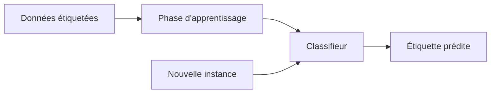

#dmv-xai

# Définition

L'**apprentissage supervisé** est une famille de modèles entraînés sur des données annotées, capables de prédire les étiquettes de nouvelles instances.

La nature de ces étiquettes fixe la tâche :

- si les étiquettes sont des classes, la tâche est une **classification** ;
- si les étiquettes sont des quantités, la tâche est une **régression**.

# Modèle

Un modèle supervisé s'obtient par une phase d'apprentissage, puis sert à prédire l'étiquette d'une instance inédite.

Les données étiquetées, idéalement nombreuses, alimentent la phase d'apprentissage ; celle-ci produit un classifieur, lequel reçoit ensuite l'instance inédite et lui attribue une étiquette.

# Exemple

Les exemples étiquetés portent les étiquettes **Cat**, **Dog** et **Fish**.

Les exemples étiquetés passent par la phase d'apprentissage, qui en tire un classifieur ; une nouvelle image soumise à ce classifieur reçoit la réponse « That is a cat ».

# Remarque

La chaîne espère un grand nombre d'exemples étiquetés, sans que ce soit une garantie.

L'apprentissage supervisé est un cas particulier de l'[[Place de l'apprentissage automatique parmi les disciplines]]. Le classifieur produit relève d'une famille de modèles, par exemple un [[Modèle linéaire]] ou un [[Arbre de décision]].
