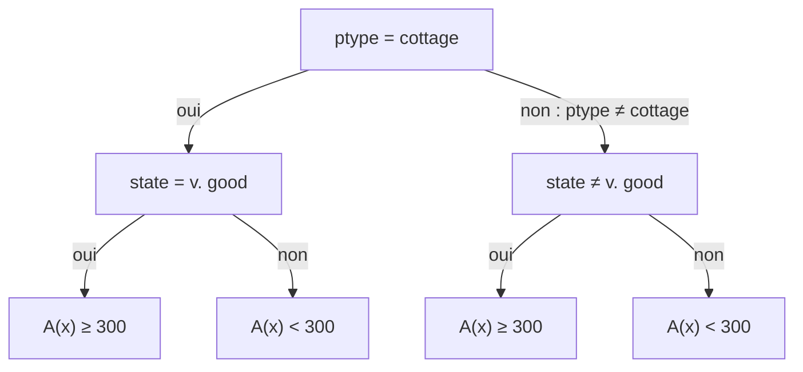
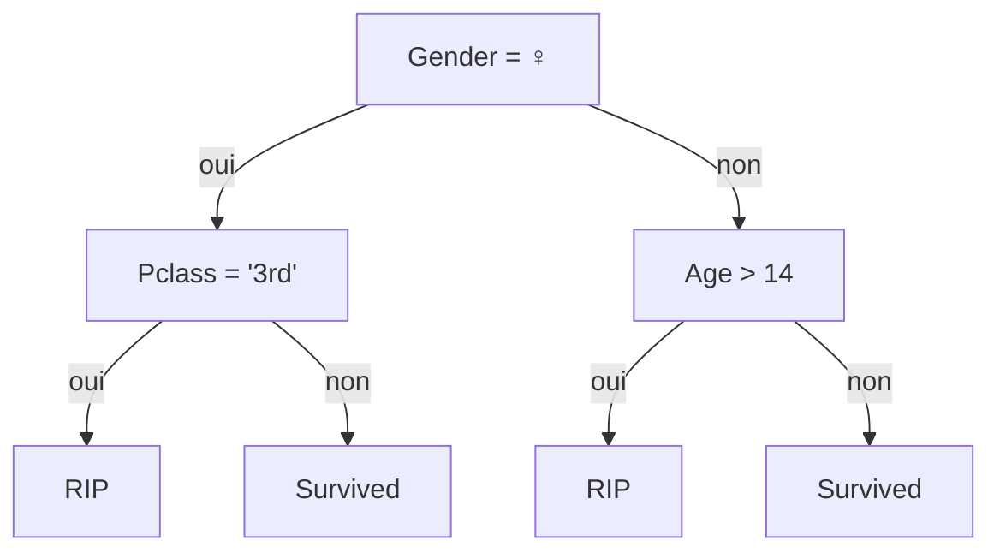

#dmv-xai

# Modèle

Un arbre de décision décide par une suite de tests : chaque nœud interne teste un attribut, chaque arc porte une issue de ce test, chaque feuille porte la prédiction. Le chemin qui mène de la racine à une feuille est une règle, et le modèle entier se lit comme la réunion de ces règles.

L'arbre ci-dessous décide si la quantité $A(x)$ atteint 300, selon le type du bien et son état.

Deux de ces chemins se résument par une règle chacun, sous le type cottage. La branche « oui » du test sur l'état donne

$$\hat{E}:\ \text{ptype}=\text{cottage} \;\land\; \text{state}=\text{v. good} \;\rightarrow\; A(x) \ge 300$$

Sa branche « non » vaut pour l'état opposé et donne

$$\bar{E}:\ \text{ptype}=\text{cottage} \;\land\; \text{state}\ne\text{v. good} \;\rightarrow\; A(x) < 300$$

# Exemple

Un arbre de trois tests prédit le sort d'un passager, selon deux issues seulement, RIP et Survived.

L'arbre mêle deux tests catégoriels, le genre puis la classe, et un test de seuil sur une variable numérique, l'âge. Un passager de genre ♀ est trié par sa classe : en troisième classe la feuille prédit RIP, ailleurs Survived. Un passager de genre ♂ passe par le test d'âge : au-delà de 14 ans la feuille prédit RIP, sinon Survived.

# Algorithme

Les arbres découpent l'espace des données gloutonnement : à chaque étape, un test partage la région courante, et le partage suivant s'applique à l'une des régions obtenues, sans revenir sur le test déjà posé.

L'espace est occupé par six points, distingués par leur teinte. Un premier test sur variety le sépare en deux moitiés : à gauche, sous variety = Grenache, deux points rouges et un point orange ; à droite, sous variety ≠ Grenache, un point orange et deux points verts. Aucune des deux moitiés n'est homogène.

Le second test porte sur stage, séparément dans chaque moitié.

| Région | Second test | Points |
| --- | --- | --- |
| variety = Grenache | stage = b.veraison | deux points rouges |
| variety = Grenache | stage ≠ b.veraison | un point orange |
| variety ≠ Grenache | stage ≠ b.closure | un point orange |
| variety ≠ Grenache | stage = b.closure | deux points verts |

Les quatre régions obtenues sont homogènes : chacune ne contient que des points d'une seule teinte, et le découpage s'arrête là.

# Interprétation

L'arbre est lui-même son explication : aucune boîte noire n'est à sonder, comme le décrit l'[[Interprétabilité]]. Une prédiction se justifie par un seul chemin, celui de l'observation ; seuls les attributs testés sur ce chemin comptent, les autres sont ignorés pour cette observation.

Le choix des tests reste local : chaque split est retenu pour la région qu'il partage, et un split postérieur ne rattrape pas un partage antérieur malencontreux. L'arbre se réécrit ensuite en une liste de [[Règles, listes et ensembles de décision|règles]], une par chemin, lisibles sans outil ; les [[Substituts globaux par arbre et par règles|substituts globaux]] et les [[Méthodes d'ensemble et machines à vecteurs de support|ensembles d'arbres]] s'appuient sur la même forme.

# Remarque

- Quelques méthodes d'apprentissage d'arbres sont CART, ID3 et C4.5 ; leurs variantes se répartissent entre arbres clairsemés, arbres optimaux et arbres de régression.
- Un test se lit avec sa négation : la branche « non » du test state = v. good correspond exactement à state ≠ v. good, et non au niveau good privé du préfixe. La négation d'un test ne désigne pas un autre niveau du même attribut.
- Les règles énoncées ne couvrent que le sous-arbre du type cottage : le sous-arbre de droite développe les mêmes tests sur $A(x)$, mais sous ptype ≠ cottage, condition que la branche « non » de la racine doit porter explicitement.
- La lecture des couleurs d'un découpage demande une convention explicite : les six points sont les mêmes dans les deux panneaux, et une teinte atténuée sur un point ne crée pas une classe de plus.
- L'arbre s'apprend sur des données étiquetées, comme le rappelle l'[[Apprentissage à partir de données étiquetées]].
- Chaque chemin se réécrit en règle valable pour une instance, forme que reprennent les [[Règles locales d'explication]].
- Sur une série temporelle, les [[Shapelets]] fournissent de la même manière des features lisibles à un classifieur simple.
