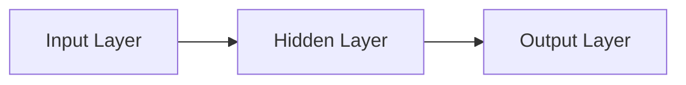
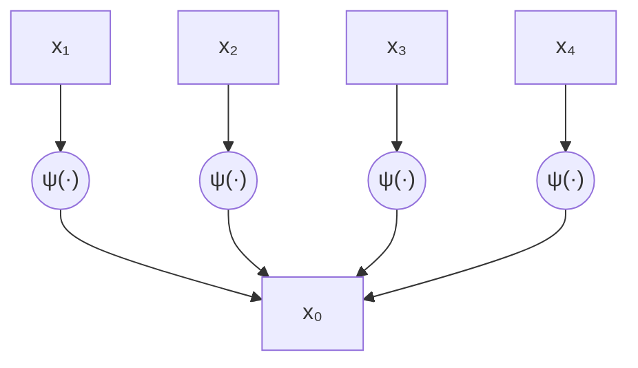
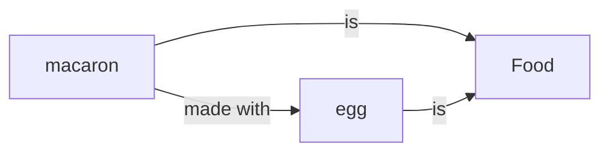

#dmv-xai

# Définition

Un réseau de neurones est une architecture qui empile des couches de [[Neurone formel|neurones formels]] : la couche d'entrée reçoit l'observation, une ou plusieurs couches cachées la transforment, la couche de sortie produit la classe prédite.

Un réseau **feed-forward** est une architecture à propagation directe :

- la couche d'entrée porte les variables décrivant l'observation ;
- une ou plusieurs couches cachées s'intercalent entre l'entrée et la sortie ;
- chaque neurone d'une couche est connecté à tous les neurones de la couche suivante, par des connexions denses ;
- le sens de circulation est unique, de l'entrée vers la sortie.

# Modèle

Cinq architectures se distinguent par leur topologie.

- **Réseau feed-forward** : empilement de couches denses, à propagation directe.
- **Graph** : réseau à structure de graphe, où un nœud agrège les messages de ses voisins.
- **Transformers** : encodeur et décodeur empilés, à mécanisme d'attention.
- **LSTM** : cellule récurrente à portes.
- **VAE** : autoencodeur variationnel, dont l'espace latent joue le rôle de goulot d'étranglement.

Sur le réseau feed-forward, les couches se lisent directement :

| Couche | Neurones |
|---|---|
| Input Layer | 4 neurones (bleus) |
| Hidden Layer | 4 neurones (verts) |
| Output Layer | 4 neurones (orange) |

Le réseau à structure de graphe relie un nœud central $x_0$ à ses voisins $x_1$ (bas), $x_2$ (haut gauche), $x_3$ (haut droite) et $x_4$ (bas droite) ; chaque arête porte une fonction de message $\psi(\cdot)$, et les messages sont agrégés vers $x_0$.

Le transformer empile un encodeur et un décodeur, dont les blocs s'enchaînent dans un ordre fixe.

| Bloc | Composants |
|---|---|
| Encodeur | Input Embedding + Positional Encoding, Multi-Head Attention, Add&Norm, Feed Forward, Add&Norm |
| Décodeur | Output Embedding + Positional Encoding, Masked Multi-Head Attention, Add&Norm, Multi-Head Attention croisée avec l'encodeur, Add&Norm, Feed Forward, Add&Norm, Linear, Softmax |
| Sortie | Output Probabilities |

La cellule LSTM reçoit $c_{t-1}$, $h_{t-1}$ et $x_t$ ; des portes $\sigma$ (sigmoïde) décident d'oublier, de mémoriser et de sortir, un candidat $\tanh$ propose une valeur, et la mise à jour combine multiplications et additions pour produire $c_t$ et $h_t$.

Le VAE place un encodeur qui mène de l'entrée $X$ au code $h$, puis un décodeur qui mène de $h$ à $X'$, l'espace latent $h$ servant de goulot d'étranglement.

La légende des schémas associe à chaque élément un rôle.

| Élément | Rôle |
|---|---|
| Layer | bloc orange |
| Componentwise | cercle jaune |
| Copy | flèche courbe |
| Concatenate | flèche coudée |

# Interprétation

Un réseau de neurones doit apprendre des représentations numériques latentes de son entrée, appelées [[Plongement|plongements]] : *embeddings* de mots, de n-grams ou d'entités de graphe de connaissances (KGE).

Un plongement attache un vecteur à un terme ou à une entité : deux textes qui doivent recevoir le même traitement se voient attribuer des vecteurs proches, et c'est ce vecteur, et non un attribut nommé de l'entrée, qui alimente les couches suivantes. Un plongement de mot, de n-gram ou d'entité est ainsi appris par le réseau lui-même, en même temps que les poids qui le consomment.

Ces vecteurs peuvent être ramenés à deux dimensions par réduction de dimension : ACP, t-SNE, UMAP. L'[[Analyse en composantes principales|analyse en composantes principales]] en est la version linéaire.

# Exemple

Un réseau convolutif enchaîne les étapes suivantes sur une image :

- Input
- Convolutions
- Subsampling
- Feature maps
- Convolutions
- Subsampling
- Fully connected
- Output

Un graphe de connaissances représente l'entité « macaron » par ses liens : macaron *is* Food, macaron *made with* egg, egg *is* Food.

La matrice de plongements associe à chaque terme un vecteur de six coordonnées numériques.

| Terme | 1 | 2 | 3 | 4 | 5 | 6 |
|---|---|---|---|---|---|---|
| M | 0.23 | -0.18 | 1.95 | 0.17 | -2.41 | -1.06 |
| \|AI\| | 0.19 | -0.01 | 1.72 | 0.3 | -1.11 | -1.58 |
| data | -0.01 | -0.11 | 1.86 | 0.22 | -1.63 | -1.49 |
| egg | 3.10 | -2.87 | 1.86 | 1.02 | -0.38 | 1.88 |
| macaron | 2.05 | -1.71 | -0.25 | 0.02 | -0.09 | 0.94 |

Le nuage de points d'une projection à deux dimensions porte les cinq étiquettes ML, AI, data, egg et macaron ; l'axe vertical s'interprète comme l'axe data / AI et l'axe horizontal comme l'axe egg / macaron.

Deux définitions servent d'exemple de textes à plonger, l'une sur la discipline, l'autre sur le macaron :

- ML is a subfield of AI that is concerned with generalizing from observed data
- A macaron is a sweet meringue-based confection made with egg white

# Remarque

Un réseau de neurones illustre le modèle « boîte noire » : la complexité de certains modèles en apprentissage automatique en fait des boîtes noires, et un réseau entièrement connecté est représenté enfermé dans une bulle dont la pointe désigne le classifieur, la flèche vers celui-ci venant du chat.

La raison tient à la représentation elle-même : la décision s'appuie sur des vecteurs numériques latents appris, dont les coordonnées ne portent pas de nom, ce qui rend la décision difficile à interpréter directement et motive l'étude de l'[[Interprétabilité]]. Les [[Réseaux de neurones contrefactuels|réseaux de neurones contrefactuels]] sont une réponse à cette opacité : l'explication y est produite par conception, au sein de l'architecture.
