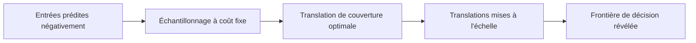

#dmv-xai

# Définition

Un **contrefactuel global** est un contrefactuel construit pour un groupe d'instances et non pour une instance isolée : la modification d'entrée proposée se généralise à l'ensemble du jeu de données, au lieu d'être recalculée séparément pour chaque instance.

# Modèle

Le contrefactuel est décrit par une règle de recours (*recourse rule*), ou par un vecteur de translation $\delta$ appliqué aux entrées d'un groupe.

Soit $x_j$ une instance prédite négativement et $k_j$ le facteur d'échelle qui lui est propre : la version contrefactuelle s'écrit

$$x_j' = x_j + k_j\,\delta$$

La translation fixe unique correspond au cas $k_j = 1$ pour toutes les instances :

$$x' = x + \delta$$

La construction optimise trois quantités.

- la **couverture** : part des instances du groupe pour lesquelles la modification produit effectivement un contrefactuel
- la **distance d'édition**, qui mesure le coût de la modification entre l'instance d'origine et sa version contrefactuelle
- la **complexité** de la règle de recours

# Algorithme

GLOBE-CE procède en trois temps.

1. Échantillonnage à coût fixe : l'algorithme de génération d'exemples $G$ tire une direction au hasard à un coût fixé.
2. Translation de couverture optimale : la direction $\delta$ retenue est celle qui couvre le plus grand nombre d'instances prédites négativement.
3. Translations mises à l'échelle : chaque instance reçoit le multiple $k_j\,\delta$ qui lui convient, ce qui révèle la frontière de décision et augmente la couverture à coût moyen plus faible.

# Interprétation

Le contrefactuel global ne relève pas de l'[[Explication locale]] : il ne porte pas sur le même objet qu'un contrefactuel local.

- un contrefactuel local fournit un recours propre à une seule instance
- un contrefactuel global fournit une direction de modification partagée par un groupe, déclinée ensuite par instance

La construction part d'un ensemble d'entrées prédites négativement dont ni la frontière de décision ni le recours propre à chaque instance ne sont connus.

Le gain tient à la couverture : une direction unique laisse hors d'atteinte une partie des instances prédites négativement, alors que la direction optimale combinée aux mises à l'échelle individuelles les couvre toutes. La frontière de décision, inconnue au départ, devient lisible à l'arrivée, puisqu'elle est dessinée par l'ensemble des points déplacés.

Les contrefactuels globaux forment une des familles d'[[Explication globale]], et généralisent l'[[Explication contrefactuelle]] d'une instance à un groupe.

# Exemple

Appliquée à des réseaux de neurones de graphes (GNN), la méthode GCFExplainer produit, sur des graphes moléculaires, des contrefactuels locaux propres à chaque graphe d'entrée, puis un contrefactuel global unique, valable pour l'ensemble des graphes du groupe.

L'algorithme GLOBE-CE se lit sur quatre panneaux successifs.

| Panneau | Objet | Résultat |
| --- | --- | --- |
| Entrées prédites négativement | nuage d'instances, frontière de décision inconnue | aucun recours connu par instance |
| Échantillonnage à coût fixe | quatre directions tirées au hasard par l'algorithme $G$ | couvertures de 84 %, 42 %, 1,8 % et 0 % |
| Translation de couverture optimale | direction $\delta$ retenue | 84 % de couverture |
| Translations mises à l'échelle | multiple $k_j\,\delta$ par instance | 100 % de couverture, à coût moyen inférieur à celui d'une translation fixe unique |

# Remarque

La mise à l'échelle par instance domine la translation fixe unique : elle atteint 100 % de couverture à coût moyen inférieur, là où la direction $\delta$ retenue n'en couvre que 84 %. Aucune compensation entre couverture et coût ne s'y lit. La tension que la construction arbitre est celle des trois quantités optimisées, couverture, distance d'édition et complexité de la règle de recours ; la mise à l'échelle conserve une direction commune et n'ajuste que l'amplitude du déplacement instance par instance.

Une courbe de dépendance partielle décrit, elle aussi, le comportement du modèle sur une population, variable par variable : voir le [[Graphique de dépendance partielle]].
