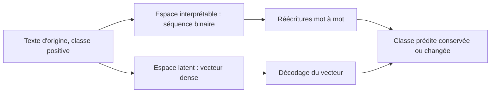

#dmv-xai

# Définition

Un **contrefactuel pour le texte** est une réécriture d'un texte dont la classe prédite change : au texte d'origine classé positif se substitue une version modifiée que le modèle classe autrement. La perturbation ne porte pas sur des variables numériques mais sur les mots du document, et la difficulté propre à cette modalité est de produire une phrase qui reste une phrase.

# Modèle

Le texte est d'abord encodé, et le choix de l'espace d'encodage commande la manière de le perturber.

- l'**espace interprétable**, dit transparent lorsqu'il désigne le vecteur de perturbation, représente le texte par une séquence binaire de mots, par exemple $[1\ 1\ 1\ 1\ 1]$ : chaque position indique la présence ou l'absence d'un mot du texte d'origine, et la perturbation se lit mot par mot.
- l'**espace latent** représente le texte par un vecteur dense, par exemple $[0.33\ 0.59\ \ldots\ 0.99\ 0.30]$ : aucune coordonnée ne correspond à un mot identifiable, et la perturbation se lit dans un espace de plongement.

Trois contraintes pèsent sur la réécriture obtenue.

- les **mots substituables** : la perturbation agit sur les mots du texte d'origine, chaque mot retiré ou remplacé passant à $0$ ; les mots introduits ne sont pas représentés, si bien que le code ne dit rien du mot substitué.
- la **grammaire** : la suite de mots produite doit rester une phrase bien formée, contrainte absente d'un contrefactuel tabulaire où chaque variable est indépendante.
- la **plausibilité** : le texte produit doit se lire comme un texte naturel, et non comme un vecteur décodé.

# Exemple

Le texte d'origine, de classe prédite positive, est *This is a good article*. Sa perturbation donne une séquence binaire dans l'espace transparent et un vecteur dense dans l'espace latent.

| Espace | Vecteur |
| --- | --- |
| Transparent | $[1\ 1\ 1\ 1\ 1]$ |
| Latent | $[0.33\ 0.59\ \ldots\ 0.99\ 0.30]$ |

## Espace interprétable

Quatre séquences binaires sont proposées, chacune annotée d'un cercle ou d'une croix. Les réécritures encerclées conservent la classe positive du texte d'origine ; les barrées passent au négatif et sont les contrefactuels.

| Vecteur | Réécriture | Classe prédite |
| --- | --- | --- |
| $[1\ 1\ 1\ 0\ 1]$ | This is a poor article | ✗ |
| $[1\ 1\ 1\ 0\ 0]$ | This is a bad work | ✗ |
| $[0\ 1\ 1\ 1\ 1]$ | There is a good article | ○ |
| $[1\ 1\ 1\ 0\ 1]$ | This is a nice article | ○ |

Deux réécritures de classes opposées, *This is a poor article* et *This is a nice article*, portent le même vecteur $[1\ 1\ 1\ 0\ 1]$ : le code note que le mot *good* a été remplacé, mais pas par quel mot.

## Espace latent

Quatre vecteurs denses sont proposés, avec les mêmes annotations.

| Vecteur | Réécriture | Classe prédite |
| --- | --- | --- |
| $[0.43\ 0.58\ \ldots\ 0.97\ 0.30]$ | This paper is not good | ✗ |
| $[0.35\ 0.61\ \ldots\ 0.90\ 0.36]$ | This is a bad work | ✗ |
| $[0.30\ 0.59\ \ldots\ 0.92\ 0.33]$ | This article is nice | ○ |
| $[0.36\ 0.69\ \ldots\ 0.95\ 0.31]$ | There is a good article | ○ |

## Passage d'un espace à l'autre

Un même contenu se décode différemment selon l'espace où il est représenté.

| Espace | Vecteur | Texte |
| --- | --- | --- |
| Espace interprétable | $[1\ 1\ 0\ 1]$ | A really boring book |
| Espace latent | $[0.33\ 0.59\ \ldots\ 0.99\ 0.3]$ | A book truly boring |

Le vecteur binaire se lit sur la phrase d'origine, le mot *boring* y étant barré pour marquer la coordonnée passée à $0$. La séquence se décode en une phrase fluide, alors que le vecteur latent se décode en une phrase dont l'ordre des mots n'est plus celui de l'anglais courant.

# Interprétation

Les deux espaces échangent lisibilité et contrôle.

- l'espace interprétable garde une lecture mot à mot : la réécriture s'écrit directement en mots et reste une phrase, mais son code ne retient que les mots du texte d'origine, de sorte que le mot substitué y est invisible et que deux réécritures de classes opposées peuvent partager le même vecteur.
- l'espace latent déplace le texte dans un espace de plongement, où les quatre vecteurs obtenus sont tous distincts, mais le décodage ne garantit plus la grammaticalité, comme le montre la phrase *A book truly boring*.

Le choix de l'espace fixe ainsi la contrainte réellement traitée : dans l'espace interprétable, la difficulté est de choisir les mots à substituer sans casser la phrase ; dans l'espace latent, elle est de retrouver un texte plausible après décodage. C'est la même exigence de plausibilité que pour toute [[Explication contrefactuelle]], mais étendue à la syntaxe, et non plus seulement aux valeurs prises par les variables.

# Remarque

Les méthodes de génération de contrefactuels textuels se rangent sur un axe continu, du plus transparent au plus opaque.

| Degré de transparence | Méthodes |
| --- | --- |
| le plus transparent | SEDC, existante |
| | Grow. Net, proposée |
| | Grow. Lang, PCIG, MICE, proposées |
| | Polyjuice, Tailor, GYC, existantes |
| le plus opaque | xSPELLS, cfGAN, Dec. Bound., existantes |

Les méthodes proposées pour la comparaison occupent le milieu de l'axe, les méthodes existantes en occupent les deux bords : la position sur l'axe ne départage donc pas les deux familles.

Le spectre recoupe celui des [[Algorithmes de génération de contrefactuels]] et, plus largement, la lecture par [[Représentation interprétable]] : plus la représentation de la perturbation est lisible, plus la contrefactualité est contrôlable, et plus la génération est contrainte. Sur du texte, un substitut local comme [[LIME]] échantillonne lui aussi des voisinages en supprimant des mots, mais pour estimer une contribution et non pour proposer une réécriture.
