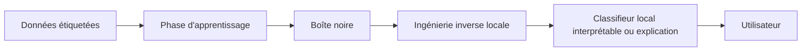

#dmv-xai

# Définition

Une **explication locale** est l'explication fournie par un modèle substitut qui rend compte de la boîte noire « in the vicinity of an individual instance » : elle porte sur une instance unique, et le substitut ne reproduit le comportement de la boîte noire qu'au voisinage de cette instance.

# Interprétation

L'explication locale et l'[[Explication globale]] décrivent la même boîte noire à deux échelles.

- une explication locale justifie la sortie produite pour une instance donnée
- une explication globale rend compte de toutes les sorties possibles de la boîte noire

Le montage est celui de l'**ingénierie inverse locale** (*local reverse engineering*) : un jeu de données étiquetées sert à apprendre la boîte noire, puis l'ingénierie inverse locale s'applique à la boîte noire et au voisinage de l'instance pour en tirer un classifieur local interprétable, dont la lecture est remise à l'utilisateur.

Ce qu'un utilisateur en attend tient à cette échelle : il reçoit, pour la prédiction qu'il a sous les yeux, les éléments du substitut local qui la justifient, sans description du modèle entier.

# Remarque

Plusieurs familles de méthodes d'explication locale sont détaillées à part.

- les approximations linéaires apprises sur des perturbations de l'instance : [[LIME]]
- les règles délimitant une région de l'espace des variables où le classifieur se comporte comme sur l'instance : [[Règles locales d'explication]]
- l'attribution aux variables obtenue par rétropropagation du gradient : [[Méthodes d'attribution par gradients]]
- l'attribution construite sur la théorie des jeux, à partir de la [[Valeur de Shapley]] : [[SHAP]]

Le caractère local est une contrainte de validité : le substitut ne décrit le modèle que près de l'instance expliquée, et sa fidélité ailleurs n'est pas garantie. Dans la [[Taxonomie des techniques d'explicabilité]], la portée est d'ailleurs la dimension qui sépare les explications locales des explications globales. À l'inverse, agréger des explications locales prises sur de nombreuses instances produit certaines explications globales, comme l'[[Importance des variables par agrégation]].

Les formes contrefactuelles répondent à la même question par une autre voie : l'[[Explication contrefactuelle]] énonce la modification d'entrée, l'[[Apprentissage de contrefactuels]] l'obtient par construction, les [[Réseaux de neurones contrefactuels]] l'intègrent au modèle et les [[Algorithmes de génération de contrefactuels]] la recherchent après coup.

La forme de l'explication suit la modalité des données, comme le montrent les [[Formes d'explication selon la modalité des données]], et ce que la [[Représentation interprétable]] retient conditionne la lecture du résultat.

Une explication locale s'évalue avec les [[Critères et métriques d'évaluation d'une explication]], et deux méthodes se comparent selon le [[Protocole de comparaison d'explications]].

Les formes globales obtenues par agrégation sont les [[Contrefactuels globaux]], les courbes du [[Graphique de dépendance partielle]] et les [[Substituts globaux par arbre et par règles]].
