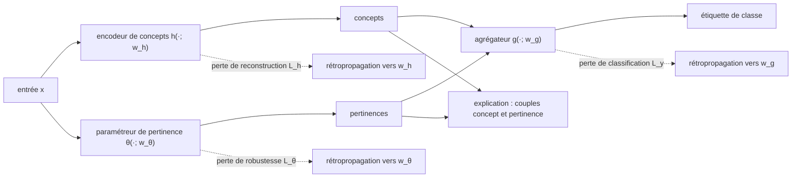

#dmv-xai

# Définition

Une **explication par concepts** décrit la prédiction d'un modèle au moyen d'un petit nombre de variables intermédiaires interprétables, les concepts, et de la pertinence de chacun d'eux pour la décision.

Un **concept** est une variable de base interprétable : un encodeur de concepts transforme l'entrée en un petit ensemble de telles variables.

Un **prototype** est l'exemple représentatif qui définit un concept : l'explication d'un réseau de neurones par concepts comporte une caractérisation des concepts au moyen des prototypes qui les définissent.

Ces approches sont dites **auto-explicatives** : elles apprennent à prédire et à expliquer en même temps, dans une seule architecture.

# Algorithme

Le réseau auto-explicatif SENN repose sur trois composants : un encodeur de concepts, un paramétreur de pertinence dépendant de l'entrée, et une fonction d'agrégation.

- entrée $x$
- encodeur de concepts $h(\cdot; w_h)$, qui produit les concepts
- paramétreur de pertinence $\theta(\cdot; w_\theta)$, qui produit les pertinences
- agrégateur $g(\cdot; w_g)$, qui produit l'étiquette de classe
- explication $\{(h(x)_i,\theta(x)_i)\}_{i=1}^{k}$
- perte de reconstruction $\mathcal{L}_h$
- perte de classification $\mathcal{L}_y$
- perte de robustesse $\mathcal{L}_\theta$
- gradient de la perte de reconstruction $\dfrac{\partial \mathcal{L}_h}{\partial w_h}$
- gradient de la perte de classification $\dfrac{\partial \mathcal{L}_y}{\partial w_g}$
- gradient de la perte de robustesse $\dfrac{\partial \mathcal{L}_\theta}{\partial w_\theta}$

# Interprétation

La perte de robustesse imposée au paramétreur pousse le modèle complet à se comporter localement comme une fonction linéaire de $h(x)$, de paramètres $\theta(x)$ : les concepts et les pertinences s'interprètent alors immédiatement.

Le réseau impose ainsi la linéarité locale et apprend des concepts de haut niveau dans une seule architecture.

# Exemple

Sur MNIST, une même prédiction d'un classifieur d'images reçoit deux familles d'explications : les explications classiques fondées sur l'entrée, dont LIME, et l'explication par concepts du SENN.

| Bloc | Colonnes | Ce qui est montré |
|---|---|---|
| Entrée | Input | l'image de test, un 9 puis un 2 |
| Explications fondées sur l'entrée | Saliency, Grad*Input, Int.Grad., e-LRP, Occlusion, LIME | une carte par pixel, les valeurs positives en rouge |
| Explication par concepts | SENN | une barre de pertinence par concept, de valeurs négatives à positives, pour les cinq concepts C1 à C5 |
| Prototypes | Cpt 1 à Cpt 5 | les vignettes des prototypes qui définissent chaque concept |

Pour chaque image de test, une grille de cinq lignes sur cinq colonnes accompagne le bloc SENN : chaque ligne correspond à un concept C1 à C5, et ses cinq vignettes Cpt 1 à Cpt 5 sont des prototypes de chiffres entiers. Ces colonnes ne varient pas toutes de la même façon. Cpt 2 affiche un 0 sur les dix lignes et Cpt 3 un 7 sur les dix lignes : ces deux prototypes sont identiques d'une ligne à l'autre comme d'une image à l'autre. Cpt 1 est un trait fin sur chaque ligne, avec un seul tracé recourbé à la huitième. Cpt 4 vaut 0, 2, 0, 2, 0 sur les cinq lignes du 9 et 2, 2, 2, 0, 2 sur celles du 2 : il change d'une ligne à l'autre et d'une image à l'autre. Cpt 5 vaut 6, 7, 6, 4, 6 sur les cinq lignes du 9 et 6 sur les cinq lignes du 2 : il ne varie donc que dans la première image.

Sur un problème de reconnaissance d'oiseaux, ProtoPNNet explique sa décision en montrant un prototype étiqueté avec la même classe que la prédiction :

- à gauche, une image de test de bruant des prés
- dans la deuxième colonne, la même image de test avec une boîte englobante produite par le modèle : le contenu de la boîte est considéré par le modèle comme ressemblant à la partie prototypique de la même ligne, en troisième colonne
- dans la troisième colonne, les parties prototypiques apprises par l'algorithme
- dans la quatrième colonne, les images d'origine de ces parties prototypiques
- à droite, les cartes d'activation qui indiquent à quel point chaque partie prototypique ressemble à une partie de l'oiseau de test

# Remarque

Une explication fondée sur l'entrée situe les contributions au niveau des pixels, alors qu'une explication par concepts porte sur un petit nombre de variables intermédiaires et sur les prototypes qui les définissent : elle nomme les grandeurs qui pèsent sur la décision et montre à quoi elles ressemblent.

Le prototype est lui-même un exemple, ce qui rapproche ces méthodes des [[Méthodes à base d'exemplaires]] ; les concepts forment une représentation intermédiaire interprétable, apprise avec le modèle et disponible d'emblée, là où une [[Représentation interprétable]] se construit après coup à partir de l'entrée.

L'explication par concepts relève de la famille conceptuelle des analyses internes d'un modèle, étudiée avec les [[Familles d'analyses internes d'un modèle]] ; elle se distingue des attributions par pixel obtenues par [[Méthodes d'attribution par gradients]] et par [[LIME]], qui restent au niveau de l'entrée.

Les parties prototypiques sont apprises par l'algorithme et montrées telles quelles ; les images sources de la quatrième colonne servent à les rattacher à des parties d'oiseaux reconnaissables.

Sur une série temporelle, les [[Shapelets]] tiennent ce rôle de parties prototypiques, segments appris montrés tels quels.
