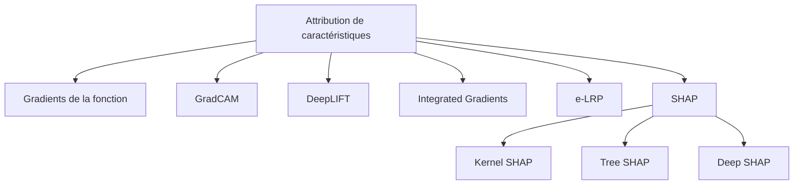
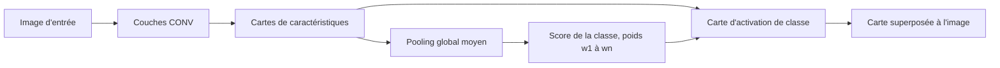

#dmv-xai

# Définition

Les méthodes d'attribution par gradients expliquent une prédiction locale en répartissant l'écart entre cette prédiction et une sortie de référence sur les caractéristiques de l'instance. Le panorama des méthodes voisines d'attribution de caractéristiques comprend :

- les gradients de la fonction
- GradCAM
- DeepLIFT
- Integrated Gradients
- e-LRP
- SHAP
  - Kernel SHAP
  - Tree SHAP
  - Deep SHAP

Deux familles sont distinguées dans ce panorama :

- les méthodes dépendantes du modèle (*model dependent*)
- les méthodes fondées sur des règles de rétropropagation (*based on back-propagation rules*)

# Propriétés

La **complétude** est la propriété qui contraint l'ensemble des attributions d'une instance : la somme des contributions, pondérées par les valeurs des caractéristiques, reconstitue l'écart entre la prédiction et la sortie de référence.

$$\sum_{1 \le i \le d} \hat{\alpha}_i \hat{x}[i] = \Delta f(x) = f(x) - f(x_\emptyset)$$

- $d$ est le nombre de caractéristiques de l'instance
- $\hat{\alpha}_i$ est le gradient moyen le long du chemin, et $\hat{\alpha}_i \hat{x}[i]$ la contribution attribuée à la caractéristique $i$
- $\hat{x}[i]$ est la valeur de la caractéristique $i$ dans l'instance
- $x_\emptyset$ est l'entrée de référence, dont la sortie $f(x_\emptyset)$ sert de point de départ
- $\Delta f(x)$ est l'écart entre la prédiction $f(x)$ et cette sortie de référence

Chaque terme de la somme est donc le produit du gradient par la valeur de la caractéristique : c'est la forme dite du gradient multiplié par l'entrée.

# Algorithme

**Integrated Gradients** construit l'attribution en intégrant le gradient le long du segment qui va de l'entrée de référence $x_\emptyset$ à l'instance $x$, avec $\Delta x = x - x_\emptyset$ et un paramètre de chemin $\gamma$ parcourant $[0, 1]$.

$$\alpha_{g,i} = \Delta x_i \times \int_0^1 \frac{\partial f(x_\emptyset + \gamma \Delta x)}{\partial x_i} \, \mathrm{d}\gamma$$

L'attribution de la caractéristique $i$ est l'écart $\Delta x_i$ multiplié par la moyenne du gradient partiel par rapport à cette caractéristique, prise sur tous les points du chemin. L'intégrale cumule ainsi l'effet de la caractéristique lorsque l'on passe progressivement de la référence à l'instance, et la somme des attributions vérifie la complétude.

# Modèle

**GradCAM** produit des cartes d'activation de classe (*class activation maps*) à partir d'un réseau de neurones utilisé pour la classification d'images.

- un réseau convolutif (CONV) extrait des cartes de caractéristiques à partir de l'image d'entrée
- un pooling global moyen (GAP) réduit chaque carte de caractéristiques à une valeur scalaire
- chaque valeur est pondérée par un poids $w_i$ propre à la classe, puis combinée pour produire le score de la classe (ici « Australian terrier »)
- la carte d'activation de classe est obtenue par combinaison linéaire pondérée des cartes de caractéristiques

$$\text{Class Activation Mapping} = w_1 A_1 + w_2 A_2 + \dots + w_n A_n$$

où $A_i$ désigne la $i$-ème carte de caractéristiques et $w_i$ le poids associé à la classe cible.

Le résultat est une carte d'activation de classe superposée à l'image, qui met en évidence les régions discriminantes pour la classe prédite.

# Exemple

Une grille de cartes de saillance compare dix méthodes sur neuf prédictions du même modèle de vision.

Colonnes, une par prédiction du modèle :

- 5
- 6
- 3
- dog
- deer
- deer
- puck
- shower cap
- seashore

Lignes, une par méthode :

- Original
- LIME
- $\varepsilon$-LRP
- IntGrad
- DeepLift
- SmoothGrad
- XRAI
- GradCam
- GradCam++
- RISE

Chaque cellule est une carte de saillance : le rouge marque une contribution positive et le bleu une contribution négative, tandis que GradCam, GradCam++ et RISE emploient une échelle arc-en-ciel. La comparaison porte ainsi sur la localisation des régions mises en avant par chaque méthode, pour une même image et une même prédiction.

# Remarque

Dans l'attribution d'Integrated Gradients, la dérivée partielle est prise par rapport à la caractéristique $x_i$, et non par rapport au paramètre de chemin $\gamma$ : la forme $\partial f / \partial x_i$ mesure la sensibilité de la fonction à la caractéristique, alors qu'une dérivée en $\gamma$ ne décrirait que la variation le long du chemin. Le facteur $\Delta x_i$ reporte ensuite cette sensibilité sur l'écart effectivement parcouru par la caractéristique.

La somme de complétude porte sur les $d$ caractéristiques, de $i = 1$ à $i = d$ ; les bornes sous le symbole de sommation doivent rester explicites pour que la portée de la somme soit lisible.

Les méthodes d'attribution par gradients se distinguent des autres familles d'[[Explication locale]] : [[LIME]] apprend une approximation linéaire sur des perturbations de l'instance, les [[Règles locales d'explication]] délimitent une région de l'espace des variables, et [[SHAP]] attribue les contributions par la théorie des jeux, avec la [[Valeur de Shapley]] comme fondement. La grille de cartes de saillance montre que ces familles ne localisent pas de la même façon les régions déterminantes : la [[Représentation interprétable]] sur laquelle elles s'appuient, pixels ou cartes de caractéristiques, conditionne la lecture des cartes.

Ces cartes relèvent des analyses internes du modèle, classées avec les [[Familles d'analyses internes d'un modèle]].
