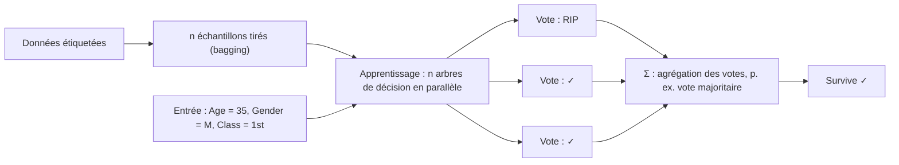
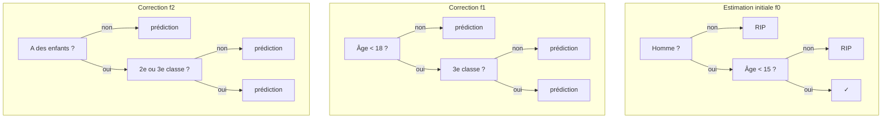

#dmv-xai

# Définition

Une méthode d'ensemble entraîne plusieurs modèles et agrège leurs décisions en une décision finale unique.

- Le bagging tire $n$ sacs d'échantillons et ajuste $n$ arbres de décision, dont les prédictions sont ensuite combinées : c'est le principe de la forêt aléatoire.
- Le boosting part d'une estimation initiale et lui ajoute des corrections successives, chacune portée par un nouvel estimateur.
- La machine à vecteurs de support n'agrège pas de modèles : elle sépare les classes par une frontière, linéaire dans le cas représenté.

# Algorithme

Une forêt aléatoire se construit en trois temps : tirer $n$ sacs d'échantillons sur les données étiquetées, ajuster $n$ arbres de décision en parallèle, puis agréger leurs votes. Chaque arbre produit une prédiction ; la fonction d'agrégation, par exemple le vote majoritaire noté $\Sigma$, combine ces prédictions en une décision finale.

Un boosting, lui, s'écrit comme une somme : à l'estimation initiale s'ajoutent les corrections, et la réponse est la somme de tous les termes.

$$f(x) = f_0(x) + f_1(x) + f_2(x) + \cdots$$

# Exemple

Le sort d'un passager du Titanic s'estime par gradient boosting, en trois arbres successifs. L'estimateur initial $f_0$ teste d'abord le sexe, puis l'âge ; les estimateurs de correction $f_1$ et $f_2$ testent l'âge, la classe et la présence d'enfants, et leurs feuilles portent des prédictions représentées par des histogrammes.

La réponse finale est l'estimation initiale augmentée de la correction 1, de la correction 2, et ainsi de suite.

Une machine à vecteurs de support résout la même question par une frontière. Sur un nuage de points où l'axe horizontal porte l'âge et l'axe vertical le genre, avec ♀ en haut et ♂ en bas, une droite oblique, qui monte avec l'âge, traverse le nuage : les coches vertes dominent au-dessus d'elle et les pierres tombales « RIP » en dessous, mais les deux marques figurent de part et d'autre, une pierre tombale au milieu des coches et plusieurs coches du côté des pierres tombales. La frontière s'écrit

$$\text{Gender} = \alpha \times \text{age} + \beta$$

et sépare les deux classes selon l'âge et le genre.

# Interprétation

Ces trois familles comptent parmi les modèles opaques, par opposition aux modèles interprétables comme l'[[Arbre de décision]]. La décision d'une forêt aléatoire se disperse dans $n$ arbres et une agrégation de votes, celle d'un boosting dans une somme de corrections successives, celle d'une machine à vecteurs de support dans une frontière tracée sur les descripteurs : aucune ne se lit comme un petit ensemble de règles. Le comportement de ces modèles s'étudie donc après coup, notamment par l'[[Importance des variables par agrégation]] des contributions des arbres.

# Remarque

La frontière représentée est linéaire. Une machine à vecteurs de support peut aussi séparer les classes dans un espace de dimension supérieure au moyen d'un noyau, qui remplace le produit scalaire entre observations ; la frontière reste linéaire dans cet espace, mais apparaît courbe dans l'espace d'origine.
