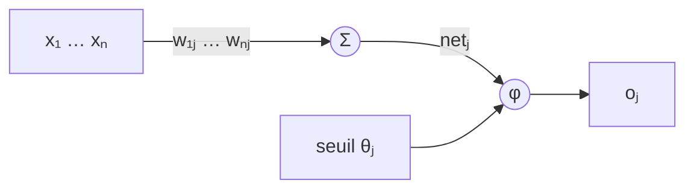

#dmv-xai

# Définition

Un neurone formel est l'unité de calcul élémentaire d'un réseau : il forme une somme pondérée de ses entrées, décale cette somme de son seuil, puis applique une fonction d'activation au résultat.

Pour des entrées $x_1, \dots, x_n$ et des poids $w_{1j}, \dots, w_{nj}$,

$$net_j = \sum_i w_{ij} x_i,$$

et la sortie du neurone $j$ est

$$o_j = \varphi(net_j - \theta_j),$$

où $\varphi$ est la fonction d'activation et $\theta_j$ le seuil du neurone.

# Modèle

Les éléments du calcul se lisent sur le neurone.

| Élément | Rôle |
|---|---|
| $x_1, \dots, x_n$ | entrées (*inputs*) |
| $w_{1j}, \dots, w_{nj}$ | poids (*weights*) |
| $\sum$ | somme pondérée (*transfer function*) |
| $net_j$ | entrée nette (*net input*) |
| $\varphi$ | fonction d'activation (*activation function*) |
| $\theta_j$ | seuil (*threshold*) |
| $o_j$ | sortie (*activation*) |

Chaque entrée est multipliée par son poids, les produits sont sommés dans $net_j$, le seuil est retranché, et $\varphi$ transforme le tout en sortie $o_j$. Un neurone n'a donc que deux étages : une combinaison affine des entrées, puis une transformation non linéaire de ce résultat.

# Propriétés

La fonction d'activation $\varphi$ fixe l'allure de la réponse du neurone. Trois fonctions sont retenues : la sigmoïde, ReLU et GELU.

La sigmoïde est une courbe en S, bornée entre $0$ et $1$ :

$$\varphi(z) = \frac{1}{1 + e^{-z}}.$$

Les autres non-linéarités, **ReLU** et **GELU**, sont quasi confondues pour $z > 0$ et plates pour $z < 0$.

Avec la sigmoïde, seule l'activation courbe la réponse : avant elle, le neurone ne calcule qu'une forme affine des entrées.

# Interprétation

Le seuil se réécrit comme un biais, terme constant ajouté à la somme pondérée et égal à l'opposé du seuil. Avec $b_j = -\theta_j$,

$$net_j - \theta_j = \sum_i w_{ij} x_i + b_j.$$

Le neurone est la brique dont l'empilement en couches construit un réseau, décrit dans [[Architectures et représentations des réseaux]].

Avec la sigmoïde pour activation, le neurone calcule exactement un [[Lien logistique comme modèle interprétable|modèle logistique]] : le score est la somme pondérée, et la sigmoïde le ramène dans l'intervalle des probabilités. Le modèle logistique est donc un neurone à activation sigmoïde.

# Remarque

Dès que les neurones s'enchaînent, le modèle devient une « boîte noire » : les poids et les activations internes rendent la décision difficile à interpréter directement, ce qui motive l'étude de l'[[Interprétabilité]].

Le neurone de motif est un neurone formel à activation en échelon et à biais négatif : voir [[Couche de motifs]].
