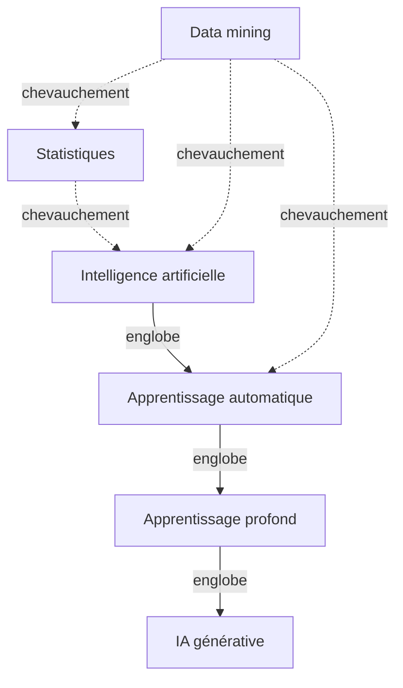

#dmv-xai

# Définition

L'apprentissage automatique (*machine learning*) est le sous-domaine de l'[[Intelligence]] artificielle qui étudie les méthodes permettant de **généraliser** à partir de données, par exemple :

- prédire le risque de défaut à partir du profil de nouveaux demandeurs de crédit
- détecter des objets dans des images et des vidéos
- recommander des films aux utilisateurs
- générer du texte et des images

Les ordinateurs **apprennent des modèles** à partir des données. L'[[Apprentissage à partir de données étiquetées|apprentissage à partir de données étiquetées]] en est un cas.

# Interprétation

La position de l'apprentissage automatique parmi les disciplines voisines se lit sur un emboîtement de cercles : l'intelligence artificielle englobe l'apprentissage automatique, qui englobe l'apprentissage profond, qui englobe l'IA générative. Deux cercles extérieurs, les statistiques et le data mining, recoupent partiellement cet emboîtement sans lui être subordonnés.

Le schéma se lit de la manière suivante :

- l'inclusion décroissante enchaîne l'intelligence artificielle, l'apprentissage automatique, l'apprentissage profond puis l'IA générative, cette dernière occupant la position la plus interne
- le cercle des statistiques recoupe celui de l'intelligence artificielle, sans atteindre celui de l'apprentissage automatique
- le cercle du data mining recoupe ceux des statistiques, de l'intelligence artificielle et de l'apprentissage automatique
- ni les statistiques ni le data mining ne sont donc des subdivisions de l'apprentissage automatique : les statistiques recoupent l'intelligence artificielle seulement, le data mining déborde du seul domaine de l'apprentissage automatique

# Remarque

La généralisation visée est une capacité à produire une réponse correcte sur des cas nouveaux à partir de cas déjà rencontrés : c'est l'[[Apprentissage par l'expérience|apprentissage par l'expérience]], qui permet de savoir faire plus que ce qui a été appris au sens strict. Les modèles obtenus par cette voie posent la question de leur [[Interprétabilité]].

Les champs liés à l'apprentissage automatique forment un ensemble de disciplines voisines : l'apprentissage automatique, les statistiques, le data mining, la data science et le big data.

- l'apprentissage automatique est relié aux statistiques et au data mining
- les statistiques sont reliées à la data science
- le data mining et la data science sont tous deux reliés au big data

Le big data occupe une position de jonction : il est le seul champ relié à la fois au data mining et à la data science, sans lien direct avec l'apprentissage automatique ni avec les statistiques.

La [[Modélisation statistique et apprentissage automatique|modélisation statistique]] est un sous-ensemble de l'apprentissage automatique, qui l'englobe : le cadre statistique restreint l'exploration à un type particulier de fonctions et se ramène à l'estimation de densité. Les procédures d'estimation de ce cadre relèvent de l'[[Inférence statistique]].

La notion elle-même, l'apprentissage par l'expérience et ses disciplines voisines sont traitées dans [[Apprentissage automatique et disciplines voisines]].
