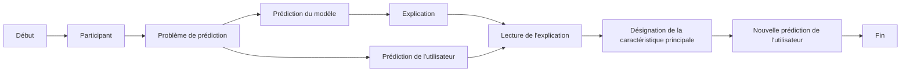

#dmv-xai

# Définition

Protocole expérimental comparant la compréhension des explications fournies à un utilisateur.

Le déroulement oppose une prédiction humaine à une prédiction machine, puis mesure la confiance, la compréhension et la perception finale.

# Modèle

Le protocole croise deux branches issues du même problème de prédiction : une branche utilisateur et une branche machine. La branche machine produit la prédiction du modèle et l'explication associée ; la branche utilisateur fait formuler une première prédiction, puis lire cette explication avant de désigner la caractéristique la plus importante et de formuler une nouvelle prédiction.

La branche machine alimente la même étape de lecture de l'explication que la branche utilisateur : l'explication générée par le modèle est lue par le participant avant qu'il n'indique la caractéristique la plus importante et ne formule une nouvelle prédiction.

# Algorithme

Le protocole se déroule en trois phases.

1. **Introduction** : présentation du participant et de la machine.
2. **Task Round (4 fois)** : répétition du cycle prédiction, explication, nouvelle prédiction, quatre fois.
3. **Post Questionnaires** : évaluation finale de la confiance et de la compréhension.

Chaque étape du cycle porte une ou deux mesures, la fin du protocole en portant deux.

| Étape | Mesure | Catégorie |
|---|---|---|
| Après la prédiction de l'utilisateur | User' Prediction Confidence (1) | Confiance |
| Après la lecture de l'explication | Immediate Explanation Understanding | Compréhension |
| Après la désignation de la caractéristique principale | Precision Recall | Performance |
| Après la nouvelle prédiction | User' Prediction Confidence (2) | Confiance |
| Après la nouvelle prédiction | Follow Prediction | Performance |
| Après la fin | Final Trust, Final Understanding | Confiance et compréhension |

Trois populations sont étudiées.

- **Lay users** : utilisateurs non experts.
- **AI practitioners** : praticiens de l'intelligence artificielle.
- **Professionals** : professionnels du domaine.

# Exemple

## Explication locale du score

Une [[Explication locale|explication locale]] du score se présente ici en cascade, du facteur de plus forte contribution au plus faible.

| Facteur | Réponse | Contribution |
|---|---|---|
| Un membre de la famille est en surpoids | **Non** | -12 % |
| Consommation de nourriture entre les repas | **Parfois** | -10 % |
| Consommation fréquente d'aliments très caloriques | **Non** | -6 % |
| Transport utilisé | **Transports publics** | -4 % |
| Suivi de la consommation de calories | **Oui** | -2 % |
| Autres facteurs | ensemble des autres réponses | +1 % |

Les paliers de l'échelle sont *insuffisance pondérale*, *santé normale*, *surpoids* et *obésité* ; la prédiction du modèle vaut 17 %, ce qui correspond à une prédiction d'insuffisance pondérale.

La lecture suit l'ordre de la cascade.

- D'abord, comme aucun membre de la famille de l'individu ne souffre de surpoids, le score diminue de 12 %.
- Ensuite, l'individu consommant parfois de la nourriture entre les repas, le score diminue de 10 %.
- Puis l'absence de consommation fréquente d'aliments très caloriques diminue le score de 6 %.
- L'usage des transports publics diminue le score de 4 %.
- Le suivi de la consommation de calories diminue le score de 2 %.

La combinaison de toutes les autres réponses augmente le score de 1 %, et la valeur finale atteint 17 %, soit une prédiction d'insuffisance pondérale.

## Confiance cumulée de l'explication

| Segment | Facteur | Confiance atteinte |
|---|---|---|
| Bleu | Un membre de la famille est en surpoids : oui | 51 % |
| Orange | Âge entre 23 et 26 | 71 % |
| Vert | Fréquence de l'activité physique par semaine : aucune | 88 % |

La confiance se lit sur une échelle allant de 20 % à 100 %. Les segments se cumulent : le segment bleu, « un membre de la famille est en surpoids : oui », porte la confiance à 51 %, le segment orange, « âge entre 23 et 26 », l'élève à 71 %, et le segment vert, « fréquence de l'activité physique par semaine : aucune », à 88 %. Chaque valeur est donc une confiance atteinte cumulée, et non la contribution isolée d'un facteur. La confiance croît avec le nombre de facteurs énumérés.

## Évaluation sur un cas

Un autre dispositif, distinct du protocole précédent, illustre une évaluation d'explication. Le cas porte sur une dose d'insuline. La situation courante réunit trois unités d'alcool prévues, cinq verres d'eau bus et six heures de sommeil, et le système conseille une dose plus faible.

> Your planned alcohol intake is more than 1 unit.
>
> If this would have been 1 unit or less, the system would have advised a normal dose.

L'explication prend la forme de situations passées comparables, du type décrit par les [[Méthodes à base d'exemplaires|méthodes à base d'exemplaires]].

| Situation comparable passée | Situation courante | Situation comparable passée |
|:--|:--|:--|
| **Consommation d'alcool prévue** 3 unités | **Consommation d'alcool prévue** 3 unités | **Consommation d'alcool prévue** 1 unité |
| **Eau bue depuis le début de la journée** 5 verres | **Eau bue depuis le début de la journée** 5 verres | **Eau bue depuis le début de la journée** 4 verres |
| **Heures de sommeil** 7 heures | **Heures de sommeil** 6 heures | **Heures de sommeil** 6,5 heures |
| **Le système conseille une dose plus faible** | **Le système conseille une dose plus faible** | **Le système conseille une dose normale** |
| Ici, la consommation d'alcool prévue valait 3 unités et le système conseillait aussi une dose plus faible ; ce conseil a eu un effet positif sur la glycémie. | | Ici, la consommation d'alcool prévue valait 1 unité et le système conseillait une dose normale ; ce conseil a eu un effet positif sur la glycémie. |

La phase de test se décompose en trois étapes.

- **Étape 1** : « What do you think the model will predict? », sur une échelle de 0 à 3 par pas de 0,1, puis « How confident are you that the model will predict this? » de 1 à 5, 1 signifiant que le modèle prédira probablement autre chose et 5 que le participant est confiant dans cette prédiction.
- **Étape 2** : la prédiction attendue par le participant et la prédiction réellement produite par le modèle sont affichées, puis « How confident are you that the model got it right? » de 1 à 5, 1 signifiant que le participant est confiant que le modèle s'est trompé et 5 qu'il est confiant que le modèle a raison.
- **Étape 3** : les deux mêmes prédictions sont rappelées, puis le participant donne sa propre prédiction et indique sa confiance de 1 à 5 dans cette prédiction, 1 signifiant que le participant juge probable de s'être trompé et 5 qu'il est confiant que sa prédiction est juste. La même étape demande aussi « What do you think this apartment actually sold for? », question qui ne porte pas sur le scénario de la dose d'insuline.

# Remarque

Le protocole mesure la confiance avant la lecture de l'explication, puis après le cycle complet : entre les deux prises s'intercalent la lecture de l'explication, la désignation de la caractéristique principale et la formulation d'une nouvelle prédiction, si bien que l'écart entre les deux confiances agrège ces trois étapes et ne peut pas être rapporté à la seule explication.

Le protocole compare des explications : la branche utilisateur reste identique d'une passation à l'autre et seule la forme de l'explication lue change, à modèle fixé, ce qui rapporte les écarts de compréhension, de confiance et de performance à cette forme. La branche machine fixe le modèle : faire varier le modèle lui-même revient à comparer des modèles expliqués et non plus des formes d'explication.

La mesure **Follow Prediction** porte sur le fait que la nouvelle prédiction du participant suit celle du modèle ; elle complète **Precision Recall**, qui porte sur la caractéristique que le participant désigne comme la plus importante après avoir lu l'explication.

Les trois populations étudiées évitent de conclure sur un public particulier : un résultat obtenu auprès de praticiens de l'intelligence artificielle ne se transporte pas directement à des utilisateurs non experts ni à des professionnels du domaine.

Le protocole applique les mesures de l'[[Évaluation de la compréhension et de la confiance|évaluation centrée sur l'utilisateur]], confiance et compréhension, auxquelles il ajoute deux mesures de performance ; la [[Critères et métriques d'évaluation d'une explication|grille d'évaluation d'une explication]] sépare les critères qui se calculent de ceux qui se mesurent sur la personne.
