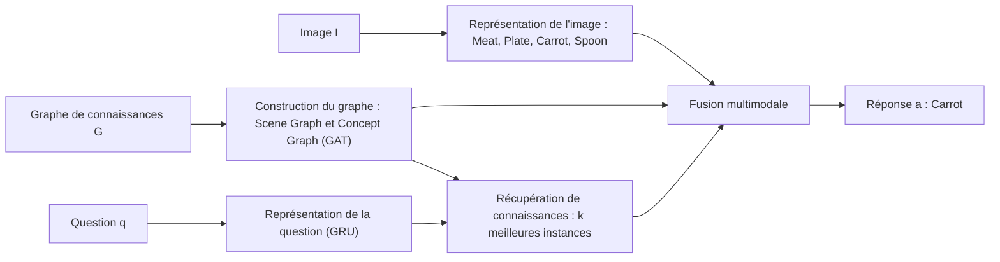

#dmv-xai

# Interprétation

Plusieurs avenues de recherche restent ouvertes, et la première porte sur la possibilité même d'automatiser la production d'une explication.

- Peut-on parler d'explicabilité automatique ?
- Les modèles d'attribution linéaire sont-ils plus interprétables que les arbres de décision ou les [[Règles, listes et ensembles de décision|listes de règles]] ?
- Sous quelle forme les explications sont-elles transmises aux humains ?
- Que donnent les études utilisateurs ?
- Quelles représentations visuelles employer pour les explications ?
- Qu'en est-il des explications causales post hoc ?
- Comment prendre en compte le profil de l'utilisateur ?
- Comment expliquer fidèlement et efficacement les systèmes multimodaux ?
- Peut-on parler d'attribution de « source », par exemple pour les grands modèles de langage ou pour les plongements de graphes de connaissances et de bases de données ?

Deux familles de travaux nourrissent ces questions. Certains travaux apprennent, dans les réseaux de neurones, des motifs d'activation qui corrèlent avec certaines sorties : l'explication porterait alors sur ce qui s'active avec la réponse. Les systèmes multimodaux, eux, combinent une image, une question et un graphe de connaissances, et la question posée est de les expliquer à la fois fidèlement et efficacement.

La comparaison entre formes d'explication n'est pas tranchée : un [[Modèle linéaire|modèle d'attribution linéaire]] expose un poids par variable, un arbre ou une liste de règles expose des seuils et des conjonctions de conditions. Rien n'établit encore qu'une forme soit plus interprétable qu'une autre dans l'absolu.

Les études utilisateurs, qui mesurent la compréhension et la confiance, relèvent de l'[[Évaluation de la compréhension et de la confiance]].

# Exemple

## Explication linéaire contre liste de règles

Trois panneaux montrent un même modèle de décision et l'explication qui en est donnée.

- panneau (a) : explication linéaire ;
- panneau (b) : explication linéaire ;
- panneau (c) : explication fondée sur des règles, $30 < \text{age} < 35$ et $200 \le \text{salary} < 500$.

Le plan est décrit par le salaire et par l'âge. La légende distingue le contour de la boîte noire, l'explication linéaire et l'explication fondée sur des règles.

## Dialogue interactif

Le système TalkToModel reçoit une demande en langage naturel, la traduit en opérations exécutables, les exécute, puis met le résultat en forme. Quatre étapes s'enchaînent.

1. L'utilisateur saisit sa demande dans l'interface : « Applicant 358 wants to know why they were denied a loan. Could you tell me? » ou « What could they do to change this? »
2. Le système analyse la saisie et la traduit en forme exécutable : importance des variables du demandeur 358, puis explication contrefactuelle du filtre précédent.
3. Le système exécute les opérations.
4. Le système met les résultats en forme et les renvoie : « They were denied because of their income and credit score » ou « Increase credit score by 30 and income by \$1,000 ».

Selon la demande, la réponse prend l'une ou l'autre forme : l'importance des variables du demandeur pour la première saisie, une explication contrefactuelle pour la seconde.

## Questions visuelles augmentées par un graphe de connaissances

Le système combine une image $I$, une question $q$, ici « What vegetable is on the lowermost portion of the plate? », et un graphe de connaissances $\mathcal{G}$.

- **Représentation de l'image** : extraction de régions visuelles étiquetées *Meat*, *Plate*, *Carrot* et *Spoon*.
- **Représentation de la question** : encodage de la question par un réseau récurrent à portes (GRU).
- **Construction du graphe** : construction d'un graphe de scène (*Scene Graph*) et d'un graphe de concepts (*Concept Graph*), tous deux traités par des réseaux attentionnels sur graphe (GAT).
- **Récupération de connaissances** : représentation du langage, puis similarité cosinus, pour récupérer les $k$ meilleures instances de connaissances.
- **Fusion multimodale** : fusion des représentations visuelle, de graphe et de question pour prédire la réponse $a$, ici *Carrot*.

Les trois modalités ne se montrent pas de la même façon : les formes d'explication propres à chacune sont décrites dans [[Formes d'explication selon la modalité des données]].

# Remarque

XAI et IA interprétable sont-ils la même chose ? Les deux appellations se recouvrent largement : XAI, souvent confondue avec *Interpretable AI*, ou *Explainable Machine Learning* (XML), désigne un système d'intelligence artificielle sur lequel des humains peuvent conserver une supervision intellectuelle, ou les méthodes qui permettent cette supervision. La définition complète et sa discussion figurent dans [[Explicabilité]].

L'appellation s'écrit XAI, en capitales, comme dans *Explainable AI* ; la graphie « xAI » est une erreur fréquente.

L'interprétabilité compte en apprentissage automatique et en intelligence artificielle pour des raisons humaines, éthiques, légales et techniques. Certains modèles sont interprétables par conception, d'autres exigent d'ouvrir la boîte noire a posteriori, et la clé de cette ouverture est le *reverse engineering* : reconstruire un modèle interprétable à partir de la boîte noire. C'est par cette ouverture de la boîte noire que l'[[Interprétabilité]] rejoint les questions ouvertes ci-dessus.
