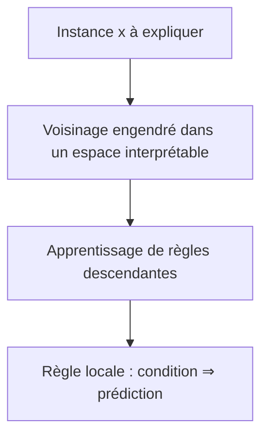
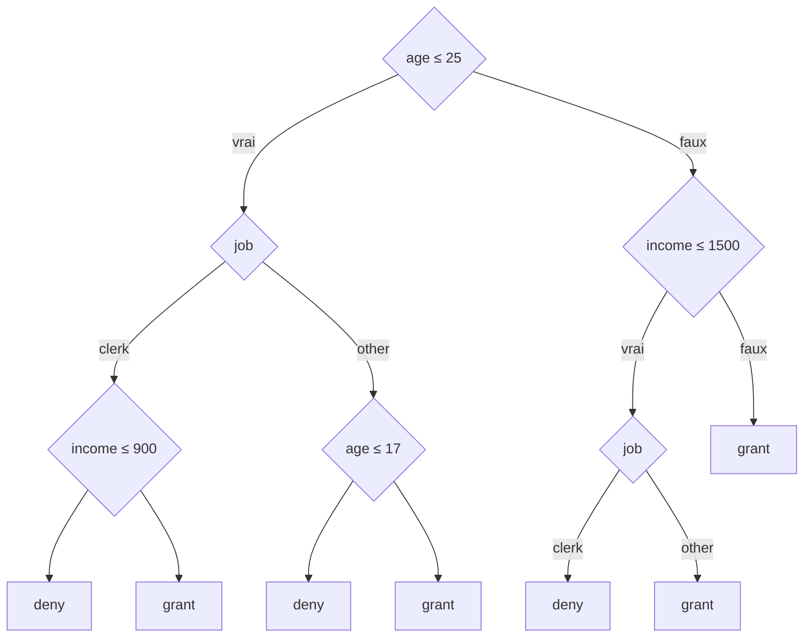

#dmv-xai

# Définition

Une **règle locale d'explication** est une règle if-then dont la condition définit une région de l'espace des caractéristiques autour d'une instance donnée, et dont la conclusion est la prédiction que le modèle conserve dans cette région. Une telle région s'appelle une **ancre** : c'est une région de l'espace des caractéristiques dans laquelle un classifieur se comporte comme sur une instance d'intérêt.

Formellement, une ancre $A$ s'écrit comme une conjonction de conditions sur les variables, suivie de la classe prédite :

$$\text{age} \in (20,\,40) \;\land\; \text{salary} \in (200,\,500) \;\Rightarrow\; \star$$

où $\star$ désigne la classe prédite par le modèle pour l'instance expliquée. La condition décrit une région et non un point : la règle ne fixe pas les valeurs exactes des variables, elle n'en fixe que des bornes.

# Algorithme

La règle locale n'est pas lue dans le modèle : elle est apprise sur un voisinage de l'instance, en interrogeant le modèle boîte noire.

L'algorithme Anchors génère des « voisins » dans un espace interprétable et apprend les règles de façon descendante (*top-down*).

L'algorithme LORE utilise des algorithmes génétiques pour garantir un voisinage plus représentatif :

- il produit des « friends » et des « enemies » de l'instance cible ;
- les opérateurs de perturbation sont le croisement (*cross-over*) et la mutation.

# Exemple

## Anchor pour une prédiction de sentiment

Deux phrases sont classées par un réseau LSTM : *This movie is not bad.* est positive et *This movie is not very good.* est négative. L'explication de chaque prédiction est une règle sur les mots présents :

| Règle | Prédiction |
|---|---|
| {"not", "bad"} | Positive |
| {"not", "good"} | Negative |

[[LIME]] expliquerait les mêmes prédictions par un poids par mot ; l'ancre, elle, énonce la conjonction de mots qui suffit à fixer la classe.

Poids LIME des termes de *This movie is not bad.* :

| Terme | Poids |
|---|---|
| bad | 0.24 |
| not | 0.10 |
| movie | 0.00 |
| This | 0.00 |

Poids LIME des termes de *This movie is not very good.* :

| Terme | Poids |
|---|---|
| not | 0.38 |
| good | 0.20 |
| very | 0.08 |
| movie | 0.03 |

## Anchor pour une image (« beagle »)

Sur une photographie de beagle en laisse, la patte levée, l'ancre « beagle » retient uniquement les régions du chien (tête, corps, pattes) et masque le reste de l'image : ces régions suffisent à déclencher la prédiction « beagle ».

## Arbre de décision de LORE

Les explications de LORE prennent la forme d'[[Arbre de décision|arbres de décision]], qui encodent aussi des [[Explication contrefactuelle|explications contrefactuelles]]. Sur une décision de crédit, l'arbre suivant explique le refus d'un demandeur :

La branche suivie par l'instance est la règle locale qui l'explique ; les branches voisines montrent ce qu'il faudrait changer pour que la décision bascule vers `grant`, d'où l'encodage conjoint des contrefactuels.

## Voisins de LORE : croisement et mutation

Le croisement combine deux parents sur des variables entières (âge, revenu) et sur les variables catégorielles :

| Individu | age | job | income | label |
|---|---|---|---|---|
| parent 1 | 25 | clerk | 10k | yes |
| parent 2 | 30 | other | 5k | no |
| children 1 | 25 | other | 5k | yes |
| children 2 | 30 | clerk | 10k | no |

La mutation modifie une ou plusieurs valeurs d'un individu : l'âge passe de 25 à 27 et le revenu de 10k à 7k, le métier et l'étiquette restant `clerk` et `yes` :

| Individu | age | job | income | label |
|---|---|---|---|---|
| parent | 25 | clerk | 10k | yes |
| children | 27 | clerk | 7k | yes |

# Propriétés

Sur une distribution de référence $D$ et une instance $x$, la qualité d'une ancre $A$ se mesure par deux quantités en tension.

La **fidélité** (ou précision) est la probabilité que le modèle prédise, sur un point tiré dans la région de l'ancre, la même classe que sur l'instance expliquée :

$$\mathrm{précision}(A) = \mathbb{P}\big(f(Z) = f(x) \mid Z \in A\big)$$

La **couverture** est la probabilité qu'un point de la distribution tombe dans la région de l'ancre :

$$\mathrm{couverture}(A) = \mathbb{P}(Z \in A)$$

où $f$ est le modèle expliqué et $Z \sim D$. Les deux quantités se compensent : une condition plus longue (par exemple fixer `job = clerk` en plus de la tranche d'âge) rend la règle plus fidèle mais réduit la part d'instances qu'elle décrit ; une condition plus courte la rend plus générale et moins exacte. Une ancre utile est celle qui reste fidèle avec la couverture la plus grande possible.

# Remarque

- Une règle locale est une forme d'[[Explication locale]] : elle porte sur une prédiction individuelle et non sur le modèle entier.
- Une règle locale n'est valable que dans sa région. Hors de l'ancre, elle n'énonce rien : deux instances proches peuvent recevoir des règles différentes.
- Une règle de modèle global, telle qu'un chemin d'arbre ou une règle extraite d'un [[Règles, listes et ensembles de décision|ensemble de décision]], décrit le modèle sur tout son domaine et se lit directement dans le modèle. Une règle locale est au contraire apprise sur un échantillon de voisinage : sa validité dépend de la représentativité de ce voisinage.
- Le voisinage doit être représentatif : c'est la raison d'être des algorithmes génétiques de LORE, qui peuplent la région de « friends » (même classe) et d'« enemies » (classe opposée) au lieu de tirer des points uniformément.
- Les [[Substituts globaux par arbre et par règles|substituts globaux]] généralisent cette démarche en apprenant un modèle interprétable sur l'ensemble des données ; la règle locale en est la version restreinte à une instance.
- Les attributions obtenues par rétropropagation désignent les variables déterminantes d'une même instance, voir les [[Méthodes d'attribution par gradients]].
