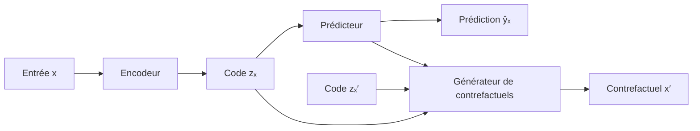
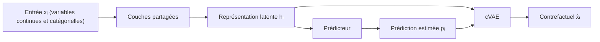

#dmv-xai

# Définition

Un **réseau de neurones contrefactuel** est un réseau auto-explicatif dont l'apprentissage associe la prédiction et la production d'une explication : CounterNet apprend à prédire et à expliquer au moyen d'instances contrefactuelles, au cours d'un même entraînement de bout en bout.

L'explication est ainsi une [[Explication contrefactuelle]] **produite par conception** : elle ne résulte pas d'une méthode appliquée après coup au modèle entraîné.

# Modèle

CounterNet contient trois composants :

- un **encodeur** (bleu) qui transforme l'entrée $x$ en un vecteur latent dense $z_x$ ;
- un **réseau prédicteur** (jaune) qui produit la prédiction $\hat{y}_x$ à partir de $z_x$ et de $p_x$ ;
- un **générateur de contrefactuels** (orange) qui produit l'instance contrefactuelle $x'$ à partir de $z_x$, de $p_x$ et de $z_{x'}$.

Le schéma détaille l'encodeur et le décodeur d'un [[Auto-encodeur]] : l'encodeur reçoit l'**Input Layer X** et le compresse en un code $h$, puis le décodeur repart de ce code $h$ pour produire l'**Output Layer X'**.

L'entraînement de cet auto-encodeur minimise la perte de reconstruction

$$L(\theta,\phi) := \mathbb{E}_{x \sim \mu_{ref}}\left[d\left(x, D_\theta(E_\phi(x))\right)\right]$$

où $E_\phi$ est l'encodeur de paramètres $\phi$, $D_\theta$ le décodeur de paramètres $\theta$, $d$ une distance entre l'entrée et sa reconstruction, et $\mu_{ref}$ la distribution de référence des entrées.

VCNet poursuit le même objectif avec des auto-encodeurs variationnels conditionnels (cVAE) : il apprend et explique au moyen d'instances contrefactuelles réalistes, en une seule fois. Son architecture comporte trois blocs :

- des **couches partagées** qui transforment l'entrée $x_i$ en une représentation latente $h_i$ ;
- un **prédicteur** qui produit la prédiction $\hat{p}_i$ à partir de $h_i$ ;
- un **auto-encodeur variationnel conditionnel** qui sert de générateur de contrefactuels au moment du test.

Dans le cVAE, la représentation $h_i$ est concaténée à la prédiction $\hat{p}_i$, un encodeur probabiliste en tire une moyenne $\mu$ et un écart-type $\sigma$, une variable latente $z_i$ est échantillonnée, puis un décodeur probabiliste reconstruit l'instance $\hat{x}_i$ à partir de $z_i$ et de $\hat{p}_i$.

# Exemple

Une explication contrefactuelle produite par CounterNet sur une prédiction de revenu au seuil de 50k fait passer une instance d'une prédiction « moins de 50k » à « plus de 50k ».

| Instance | Age | Hours per week | workclass | Education | Marital | Job | Race | Gender | Predicted |
|---|---|---|---|---|---|---|---|---|---|
| $x$ | 26 | 48 | Private | HS-grad | Married | Sales | White | Male | $< 50k$ |
| $x'$ | 27.3 | 33.5 | Private | Doctorate | Married | Sales | White | Male | $> 50k$ |
| $x''$ | 26 | 33.5 | Private | Doctorate | Married | Sales | White | Male | $> 50k$ |

L'instance contrefactuelle s'obtient en deux temps :

$$x \xrightarrow{\text{Explainer}} x' \xrightarrow{\text{Round-off}} x''$$

L'explication $x'$ relève l'âge à 27.3, abaisse les heures hebdomadaires à 33.5 et remplace le diplôme par un doctorat, ce qui suffit à faire basculer la prédiction. L'arrondi $x''$ ramène l'âge à 26 tout en conservant les heures et le diplôme modifiés, donc la bascule de prédiction.

# Interprétation

L'intérêt du montage tient à ce que la prédiction et son explication sortent du même réseau : le prédicteur fournit l'étiquette, le générateur fournit l'instance contrefactuelle, et l'entraînement conjoint aligne les deux sorties au lieu de les produire séparément.

La recherche du contrefactuel se fait dans l'espace latent : $z_x$ code l'entrée, $p_x$ porte la sortie probabiliste du prédicteur, et $z_{x'}$ code l'instance contrefactuelle visée. Le décodeur ramène ensuite cette représentation vers l'espace des variables d'origine.

L'arrondi final rend l'explication utilisable : les valeurs continues sont ramenées à des modalités ou à des granularités admissibles, sans perte de la bascule de prédiction. VCNet va plus loin en exigeant des contrefactuels **réalistes**, ce que vise la génération par cVAE.

Les cVAE capturent les distributions de classes du prédicteur, ce qui rend ces distributions visibles et interprétables.

| Vue | Contenu |
|---|---|
| Espace latent du modèle de base | Nuage de points en deux dimensions, classes se recouvrant partiellement |
| Espace latent après entraînement joint | Nuage de points où les classes forment des amas distincts |
| $z, 3$ | Grille de chiffres « 3 » générés à partir de variables latentes |
| $z, 4$ | Grille de chiffres « 4 » générés à partir de variables latentes |

La comparaison des deux espaces latents montre l'effet de l'entraînement joint : les classes se séparent, et les grilles $z, 3$ et $z, 4$ illustrent la génération conditionnelle de chiffres à partir de variables latentes.

# Remarque

Le décodeur de l'auto-encodeur reconstruit l'entrée, comme le montrent les paires « image originale » et « reconstruction » : la reconstruction n'est pas le contrefactuel, qui est produit par le générateur dédié.

Le réseau contrefactuel est une architecture parmi les [[Architectures et représentations des réseaux]] : il empile des couches denses, mais sa sortie est double, prédiction et explication. Il relève de l'[[Apprentissage de contrefactuels]] et fournit une [[Explication locale]], propre à l'instance traitée.

Les schémas de CounterNet colorient le générateur de contrefactuels en orange ou en gris selon la variante, et la boîte jaune y désigne tantôt le prédicteur, tantôt le code $h$ ; les libellés retenus ici sont ceux de la variante explicite.

La recherche d'un contrefactuel par optimisation, sans générateur entraîné, est l'objet des [[Algorithmes de génération de contrefactuels]] ; l'explication vaut alors pour une instance, là où les [[Contrefactuels globaux]] visent des groupes d'instances.
