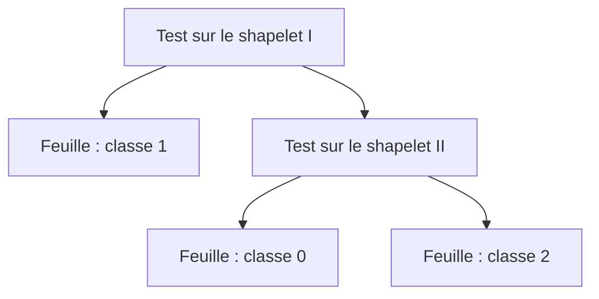

#dmv-xai

# Définition

Un shapelet est un segment représentatif d'une [[Données séquentielles|série temporelle]] qui caractérise une classe : il sert d'attribut aux modèles d'apprentissage automatique.

# Modèle

Un dictionnaire de shapelets réunit des segments de référence $s_1, \dots, s_p$, chacun associé à une classe et à un seuil $d_{th}$. Une série $T$ de longueur $n$ est transformée en un vecteur de $p$ features, chaque feature mesurant la distance entre la série et un segment de référence de longueur $m$ :

$$d_{s}(T) = \min_{1 \le j \le n-m+1} \sqrt{\sum_{k=1}^{m} \left(s_k - T_{j+k-1}\right)^2}$$

Le minimum porte sur toutes les positions $j$ où un segment de longueur $m$ tient dans la série : la feature retient la meilleure correspondance, et non un alignement fixé d'avance.

$$f(T) = \left(d_{s_1}(T), \dots, d_{s_p}(T)\right)$$

Un [[Arbre de décision]] consomme ces features et les compare aux seuils du dictionnaire :

$$d_{s}(T) \le d_{th}$$

Chaque test de l'arbre se lit comme une question sur la présence du motif : la branche franchie dit si la série contient un segment suffisamment proche du segment de référence.

# Interprétation

Le modèle reste lisible à deux niveaux. Chaque feature a un sens concret, la proximité de la série à un segment donné, et le classifieur n'emploie que des comparaisons de ces proximités à des seuils fixes.

L'explication est portée par le modèle lui-même : la méthode est auto-explicative, aucune étape postérieure à la prédiction ne vient la produire.

L'explication d'une prédiction prend ainsi la forme d'un constat sur le contenu de la série : elle appartient à une classe parce qu'elle contient un segment proche d'un motif qui caractérise cette classe. Cette [[Représentation interprétable]] reste attachée à des portions identifiables du signal. Par rapprochement, le segment de référence joue le rôle d'un prototype au sens des [[Explications par concepts et prototypes]] : dans ces dernières, le prototype est l'exemple représentatif d'un concept d'un réseau auto-explicatif ; ici, c'est un motif de série comparé par distance, et non l'exemple d'un concept interne au modèle.

# Exemple

Un problème de pointes de projectile à trois classes se résout par un dictionnaire de deux shapelets et un arbre de deux tests.

| Classe d'origine | Segment de référence | Shapelet | Seuil $d_{th}$ |
| --- | --- | --- | --- |
| Clovis | portion médiane du profil, tracée en rouge | I | 11.24 |
| Avonlea | portion médiane du profil, tracée en rouge | II | 85.47 |

Les deux shapelets du dictionnaire sont les deux tests de l'arbre : ils portent les identifiants I et II, non les classes. Clovis et Avonlea sont les classes dont chaque segment est issu.

L'arbre enchaîne les deux tests et ses feuilles portent les classes 1, 0 et 2. Deux shapelets suffisent donc à séparer trois classes : le premier test isole une classe, le second raffine le partage laissé par le premier. La lecture d'une prédiction tient en deux phrases, la proximité au segment I puis, à défaut, la proximité au segment II. La figure ne donne pas la correspondance entre les classes d'origine Clovis et Avonlea et les numéros des feuilles.

# Remarque

Un shapelet n'est utile à l'explication que s'il ressemble à un segment réellement présent dans les séries. Les approches ultérieures visent ainsi des shapelets plus réalistes, dont l'aspect se suit au fil de l'apprentissage.

| Époque | Aspect du shapelet |
| --- | --- |
| 20 | oscillations haute fréquence, d'amplitude faible, étrangères au profil de la série |
| 200 | segment lisse et presque plat, posé au creux de la courbe |
| 800 | segment qui épouse la courbe et amorce la montée vers le pic |
| 8000 | segment qui coïncide avec le pic de la série |

Le shapelet, tracé en bleu plein sur la série en gris pointillé, passe d'un artefact oscillant, qu'aucune série ne contient, à un motif effectivement présent dans les données. Un segment de référence qui ne ressemble à rien d'observable rend la question posée par l'arbre invérifiable pour l'utilisateur, alors qu'un segment fidèle au signal rend la même question immédiatement lisible.
