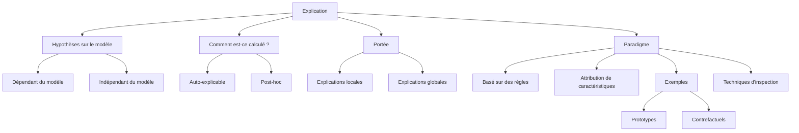

#dmv-xai

# Définition

Une explication **post-hoc** consiste à concevoir une couche d'interprétation entre le modèle et l'utilisateur humain : « Design an interpretation layer between the model and the human user ».

Le montage correspondant enchaîne les données étiquetées, la phase d'apprentissage, la boîte noire, l'interpréteur, puis l'utilisateur humain. La boîte noire est rétro-conçue vers un modèle interprétable, et c'est ce modèle interprétable qui est présenté à l'utilisateur.

# Modèle

Les techniques d'[[Explicabilité]] se rangent dans une taxonomie à quatre dimensions, chacune prenant un petit nombre de valeurs.

| Dimension | Valeurs |
|---|---|
| Hypothèses sur le modèle | dépendant du modèle ; indépendant du modèle |
| Comment est-ce calculé ? | auto-explicable ; post-hoc |
| Portée | explications locales ; explications globales |
| Paradigme | basé sur des règles ; attribution de caractéristiques ; exemples (prototypes, contrefactuels) ; techniques d'inspection |

La hiérarchie complète place ces quatre dimensions au même niveau sous la racine « Explication » ; seule la branche des exemples se subdivise à son tour.

# Interprétation

Chaque technique se situe par une valeur sur chacune des quatre dimensions : elle est dépendante ou indépendante du modèle, auto-explicable ou post-hoc, locale ou globale, et son explication relève de l'un des quatre paradigmes.

Les quatre familles de techniques sont donc les valeurs de la dimension « Paradigme » :

- **basé sur des règles** : l'explication est un ensemble de règles
- **attribution de caractéristiques** : l'explication porte sur la contribution des variables d'entrée
- **exemples** : l'explication est un cas, soit un **prototype**, soit un **contrefactuel**
- **techniques d'inspection** : l'explication provient de l'examen direct des réponses du modèle

Une technique post-hoc se décrit ensuite par sa portée et son paradigme : la branche post-hoc se lit comme la succession « portée, puis paradigme ». La portée sépare les [[Explication locale|explications locales]], qui portent sur le voisinage d'une instance, des [[Explication globale|explications globales]], qui combinent des explications locales de nombreuses instances ; chaque portée se décline ensuite selon les quatre paradigmes.

Les techniques d'inspection recouvrent le tracé et l'examen des corrélations entre les variables d'entrée et les classes de sortie : l'explication ne résume pas le modèle, elle en montre le comportement sur les données. Ce paradigme se détaille en familles d'analyses internes du modèle, décrites avec les [[Familles d'analyses internes d'un modèle]].

# Remarque

Les quatre dimensions sont de même niveau : le paradigme n'est pas une subdivision du mode de calcul et se lit indépendamment de lui.

Les deux valeurs du mode de calcul sont parallèles : une technique post-hoc n'est pas une sous-catégorie des techniques auto-explicables, et réciproquement.

La portée et le mode de calcul ne disent rien de la forme matérielle de l'explication : celle-ci suit la modalité des données, comme le détaillent les [[Formes d'explication selon la modalité des données]]. La frontière avec l'[[Interprétabilité]] passe par la représentation : un modèle dont la représentation se lit directement n'a pas besoin d'une technique post-hoc.
