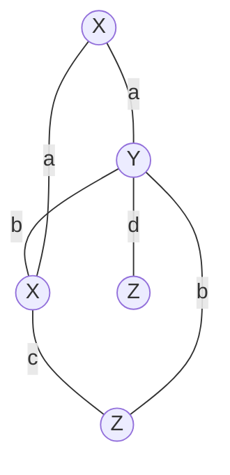

#dmv-graph_mining

# Définition

Le code en profondeur d'abord d'un graphe, appelé code DFS, est le code fondé sur la construction du graphe par un parcours en profondeur d'abord.

Parmi tous les parcours possibles, c'est le plus petit code DFS qui est le [[Code canonique d'un graphe|code canonique]] du graphe, selon l'[[Ordre et code DFS minimal|ordre défini sur ces codes]].

Chaque arête $e=(u,v)$ ajoutée au graphe au cours de ce parcours est représentée par un élément du code :

$$(u, v, l(u), l(e), l(v))$$

où $u$ et $v$ sont les extrémités de l'arête, numérotées dans l'ordre de leur découverte par le parcours, $l(u)$ et $l(v)$ leurs étiquettes de sommet et $l(e)$ l'étiquette de l'arête.

# Exemple

Le graphe suivant, étiqueté sur les sommets et sur les arêtes, donne le code formé des six éléments ci-dessous.

| Élément |
| :---: |
| $(0, 1, X, a, Y)$ |
| $(1, 2, Y, b, X)$ |
| $(2, 0, X, a, X)$ |
| $(2, 3, X, c, Z)$ |
| $(3, 1, Z, b, Y)$ |
| $(1, 4, Y, d, Z)$ |

Les sommets sont numérotés $0, 1, 2, 3, 4$ dans l'ordre du parcours : $X$, puis $Y$, puis $X$, puis $Z$, puis $Z$. Le premier élément décrit l'arête de l'arbre de parcours qui mène du sommet $0$ au sommet $1$ ; les éléments suivants décrivent les arêtes rencontrées ensuite, y compris celles qui rejoignent deux sommets déjà découverts.

# Remarque

Le code dépend du sommet de départ et de l'ordre dans lequel les arêtes sont parcourues : un même graphe admet donc plusieurs codes DFS, et son code canonique est le plus petit d'entre eux. La comparaison de ces codes et l'[[Élagage par codes canoniques|élagage]] qui en découle reposent sur l'[[Ordre et code DFS minimal]].
