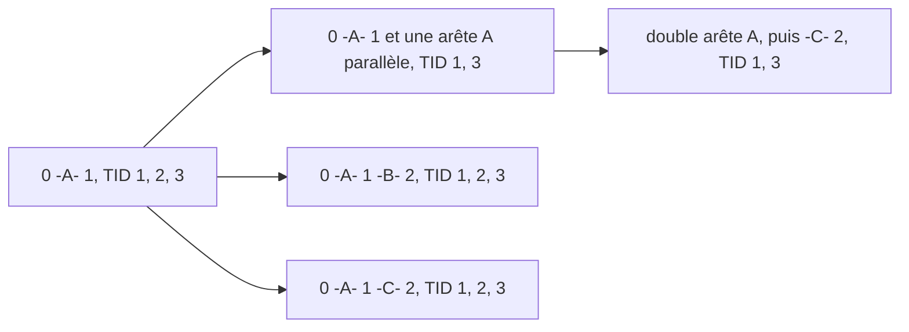

#dmv-graph_mining

# Définition

L'approche par croissance de motifs étend les motifs fréquents en examinant les extensions possibles de leurs plongements : un motif fréquent est prolongé par les arêtes et les sommets qui apparaissent autour de ses plongements, sans fusion de motifs.

# Propriétés

L'approche corrige les défauts des [[Algorithmes par fusion de motifs|algorithmes par fusion]] :

- aucune fusion de motifs n'est nécessaire, donc le test d'[[Isomorphisme de sous-graphe|isomorphisme de sous-graphe]] est évité, avec un gain de temps ;
- aucun stockage de tous les $k$-motifs n'est nécessaire pour engendrer les $(k+1)$-motifs, avec un gain de mémoire ;
- seuls des motifs fréquents sont engendrés, donc les candidats non fréquents ne sont jamais testés, avec un gain de temps.

La plupart des algorithmes de cette famille génèrent les motifs par recherche en profondeur d'abord : ce sont les algorithmes DFS, recensés dans le [[Panorama des algorithmes de croissance de motifs de graphes|panorama des algorithmes de croissance]], comme gSpan dont les [[Code canonique d'un graphe|codes canoniques]] servent de clé de comparaison.

# Interprétation

Sur la base de trois transactions de l'exemple, le motif d'une seule arête $A$ entre deux sommets numérotés 0 et 1 est présent dans les trois transactions. Ses extensions fréquentes s'obtiennent en ajoutant une arête depuis un sommet déjà présent, ou vers un nouveau sommet numéroté à la suite :

- une seconde arête $A$ parallèle ne conserve que les transactions 1 et 3 ;
- une arête $B$ vers un nouveau sommet ne conserve que les transactions 1, 2 et 3 ;
- une arête $C$ vers un nouveau sommet ne conserve que les transactions 1, 2 et 3.

Chacune de ces extensions est prolongée à son tour de la même façon. L'arbre de recherche se développe donc de motif fréquent en motif fréquent : chaque nœud est un motif effectivement fréquent, et les branches s'arrêtent quand aucune extension ne l'est plus.

# Exemple

La base compte trois transactions $T_1$, $T_2$, $T_3$, dont les arêtes sont étiquetées $a$, $b$, $c$. $T_1$ et $T_3$ contiennent une paire de sommets reliée par deux arêtes $a$ parallèles, $T_2$ une paire reliée par deux arêtes $c$.

Les premières étapes de l'arbre de recherche partent d'un motif d'une seule arête, notée $A$, entre deux sommets 0 et 1, présent dans les trois transactions.

Chaque nœud porte le motif atteint et l'ensemble TID des transactions qui le contiennent. Les extensions ajoutent une arête depuis un sommet déjà présent, ou vers un nouveau sommet numéroté à la suite.

# Remarque

Les arêtes du motif étendu sont notées en majuscules ($A$, $B$, $C$) alors que celles des trois transactions sont notées en minuscules ($a$, $b$, $c$). La correspondance entre les deux notations n'est pas affichée, si bien que les ensembles TID ne peuvent pas être vérifiés directement sur la base. Les motifs et leurs ensembles TID sont reproduits tels qu'ils apparaissent.

Le prolongement d'un motif reprend les principes de la [[Principe de la croissance de motifs FP-growth|croissance de motifs]] : plutôt que d'énumérer des candidats puis de les tester, on ne développe que des motifs dont la fréquence est déjà acquise. La difficulté propre aux graphes reste d'éviter d'engendrer plusieurs fois le même motif, ce que règlent les codes canoniques et leur [[Élagage par codes canoniques|élagage]].
