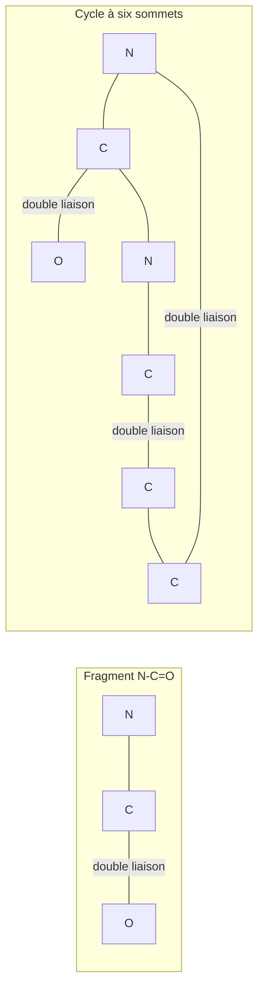

#dmv-graph_mining

# Exemple

Une collection de graphes moléculaires illustre la [[Fouille de motifs de graphes]] : chaque molécule est un graphe dont les sommets sont les atomes et les arêtes les liaisons, et les motifs recherchés sont des fragments récurrents.

Le jeu de données réunit trois graphes :

- (A) un cycle aromatique à six sommets portant un groupe méthyle et un groupe sulfo ;
- (B) une molécule où deux sous-graphes candidats sont encadrés : un cycle à six sommets contenant deux atomes d'azote et un carbonyle, et le fragment N-C=O formé de deux sommets de ce cycle et de l'oxygène exocyclique ;
- (C) une molécule qui porte les deux mêmes sous-graphes encadrés, accompagnés d'une chaîne éther.

Les motifs extraits sont donc :

- un cycle à six sommets comportant deux azotes et un carbonyle ;
- le fragment N-C=O, composé de deux sommets du cycle, un azote et le carbone carbonylé, et de l'oxygène exocyclique doublement lié à ce carbone.

Ces deux sous-graphes sont fréquents au sens où le nombre de graphes de la collection qui les contiennent dépasse le seuil minimal : leur [[Support d'un motif dans une collection de graphes|support]] se mesure en proportion des graphes de la collection, si bien qu'un fragment présent dans une seule molécule ne serait pas retenu.

# Remarque

Le bilan de la fouille de motifs de graphes tient en quelques constats.

- Un graphe est une structure générique, capable d'exprimer une grande quantité de données structurées : molécules, phrases, réseaux sociaux, web sémantique.
- Les graphes restent plus complexes que les itemsets ou les séquences : la recherche d'un motif est un problème d'[[Isomorphisme de sous-graphe|isomorphisme de sous-graphe]] NP-complet.
- S'y ajoutent le calcul du support et la mesure de similarité entre deux graphes, deux opérations sans équivalent direct sur des itemsets.
- Les approches de fouille de graphes reprennent les bases de la fouille d'itemsets, l'[[Algorithme Apriori|Apriori]] et la croissance de motifs, en y ajoutant des concepts propres comme les [[Code canonique d'un graphe|codes canoniques]], destinés à éviter trop de complexité.

La difficulté suit la généricité du langage de motifs : plus le langage de motifs et de données est générique, plus il est expressif, et plus la fouille tend à être difficile. C'est la limite que met en évidence la [[Complexité de la fouille sur des données structurées]], et qui motive les algorithmes de [[Croissance de motifs de graphes]], lesquels engendrent un motif en étendant un motif déjà trouvé au lieu d'énumérer des candidats.
