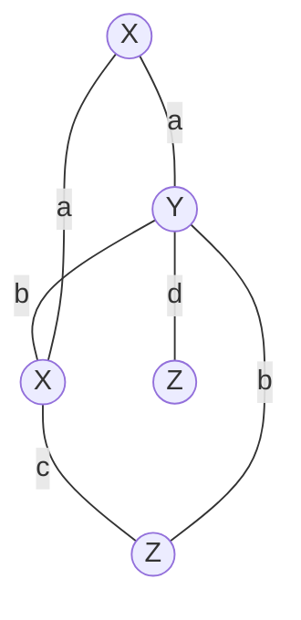

#dmv-graph_mining

# Définition

Un même graphe admet plusieurs [[Code DFS d'un graphe|codes DFS]], selon le sommet choisi comme point de départ du parcours et selon l'ordre des arêtes.

Sur l'ensemble des codes d'un graphe, on définit l'ordre lexicographique des éléments du code : un code précède un autre si son premier élément qui diffère est plus petit. Le plus petit code DFS d'un graphe pour cet ordre est son Min DFS-Code, c'est-à-dire son code DFS minimal.

# Exemple

Le graphe suivant, étiqueté sur les sommets et sur les arêtes, donne trois codes DFS distincts selon que le parcours part du sommet $X$ du haut, du sommet $Y$ ou du sommet $X$ du bas.

| # | (a) | (b) | (c) |
| :--- | :--- | :--- | :--- |
| 1 | $(0, 1, X, a, Y)$ | $(0, 1, Y, a, X)$ | $(0, 1, X, a, X)$ |
| 2 | $(1, 2, Y, b, X)$ | $(1, 2, X, a, X)$ | $(1, 2, X, a, Y)$ |
| 3 | $(2, 0, X, a, X)$ | $(2, 0, X, b, Y)$ | $(2, 0, Y, b, X)$ |
| 4 | $(2, 3, X, c, Z)$ | $(2, 3, X, c, Z)$ | $(2, 3, Y, b, Z)$ |
| 5 | $(3, 1, Z, b, Y)$ | $(3, 0, Z, b, Y)$ | $(3, 0, Z, c, X)$ |
| 6 | $(1, 4, Y, d, Z)$ | $(0, 4, Y, d, Z)$ | $(2, 4, Y, d, Z)$ |

*(b)* *(c)* *(a)*

Le minimum des trois codes est la colonne (c). La suite $(b)$, $(c)$, $(a)$ figure sous le tableau, dans cet ordre, sans préciser s'il s'agit de l'ordre des colonnes ou de celui des codes.

# Interprétation

Lorsqu'un motif est produit au cours de la recherche en profondeur d'abord, on décide s'il pourrait avoir un code DFS plus petit :

- oui : on n'étend pas le motif, car le développement de cette branche ne produirait que des doublons du motif atteint par un autre chemin ;
- non : on étend la branche de recherche dans laquelle le motif a son code minimal.

Le code minimal sert ainsi de représentant unique du motif au cours de la génération, ce qui fonde l'[[Élagage par codes canoniques]].

# Remarque

La colonne (c) est retenue comme Min DFS-Code du graphe. La suite $(b)$, $(c)$, $(a)$ affichée sous le tableau, lue comme l'ordre croissant des codes, contredit ce choix : avec $X < Y$, les premiers éléments donnent

$$(0,1,X,a,X) < (0,1,X,a,Y) < (0,1,Y,a,X)$$

soit l'ordre $(c) < (a) < (b)$, et non $(b)$, $(c)$, $(a)$. Le minimum reste bien la colonne (c), et c'est cet ordre lexicographique, et non la suite affichée, qui décide de l'élagage.
