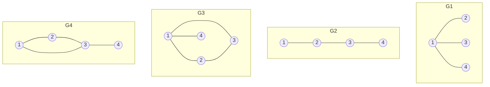

#dmv-graph_mining

# Définition
Soient $D$ une collection de graphes et $P$ un motif de graphe. Le support de $P$ dans $D$ est la proportion des graphes de la collection dont $P$ est un sous-graphe, à isomorphisme près :

$$\text{Support}(P) = \frac{|\{g \in D \mid P \text{ est un sous-graphe isomorphe à } g\}|}{|D|}$$

Le motif $P$ est fréquent lorsque son support est supérieur ou égal au seuil minimal $minsup$.

# Exemple
Quatre graphes d'une collection, notés G1 à G4, tous bâtis sur quatre sommets et considérés comme non étiquetés :

- G1 : un sommet central relié à trois feuilles ;
- G2 : un chemin de quatre sommets ;
- G3 : un sommet central relié à trois feuilles, plus une arête entre deux de ces feuilles ;
- G4 : un triangle et un sommet pendant.

Le motif examiné est un triangle dont l'un des sommets porte une arête vers un quatrième sommet, soit quatre sommets et quatre arêtes. Il est isomorphe à G4 tout entier, et aussi à G3, qui est un triangle muni d'un sommet pendant. G1 et G2, en revanche, ne contiennent aucun triangle : le support de ce motif vaut donc $2/4$.

Le triangle seul, sans le sommet pendant, apparaît dans G3 et dans G4 : son support vaut également $2/4$ et il reste sous le seuil. Le motif illustré n'est donc pas celui qui satisfait un seuil de $3/4$.

# Remarque
Chaque graphe de la collection contribue au plus une fois au support, même s'il contient plusieurs occurrences du motif : l'ensemble au numérateur est un ensemble de graphes, pas un multi-ensemble d'occurrences.

Le dénominateur étant le cardinal de la collection, le support est une proportion comprise entre $0$ et $1$, et le seuil $minsup$ s'exprime dans la même unité. Cette règle de contribution unique est ce qui distingue cette mesure du comptage des occurrences utilisé sur un graphe unique, voir [[Support d'un motif de graphe]] et [[Collection de graphes et graphe unique]]. Elle est aussi ce qui rend le support anti-monotone, voir [[Anti-monotonie du support dans une collection de graphes]].

La comparaison au seuil est inclusive : un motif dont le support vaut exactement $minsup$ est fréquent.

Le seuil ne désigne pas un motif unique : plusieurs motifs peuvent le satisfaire, et tout sous-graphe d'un motif fréquent l'est aussi.

Avec un support minimal de $3/4$, le motif qui satisfait le seuil est l'étoile à quatre sommets et trois arêtes : elle est sous-graphe isomorphe de G1, de G3 et de G4, mais pas de G2, dont tous les sommets sont de degré au plus $2$, et son support vaut $3/4$.

Le triangle avec sommet pendant compte quatre arêtes, l'étoile trois : c'est la présence d'un cycle dans le premier qui l'exclut, car ni G1 ni G2 n'en contient.

Le chemin de trois arêtes est lui aussi de support $3/4$, et le chemin de deux arêtes, présent dans les quatre graphes, a un support de $4/4$.
