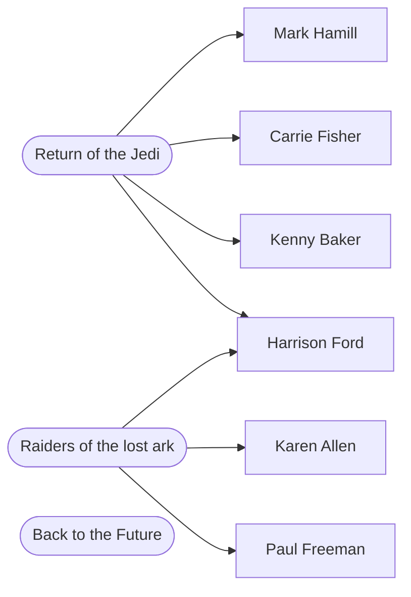

#dmv-graph_mining

# Définition

Dans un [[Collection de graphes et graphe unique|graphe unique]] $D$, le support naïf d'un motif $P$ est le nombre d'occurrences de $P$ dans $D$ : chaque occurrence distincte de $P$ compte pour une unité.

Une occurrence de $P$ dans $D$ est un [[Isomorphisme de sous-graphe|plongement]] de $P$ dans $D$, c'est-à-dire un sous-graphe de $D$ isomorphe à $P$.

# Exemple

Le graphe de films et d'acteurs est un graphe orienté étiqueté : les films sont les sommets ellipse, les acteurs les sommets rectangle, et une arête relie un film aux acteurs de son casting.

Les supports naïfs des trois motifs élémentaires se lisent alors directement sur le graphe.

| Motif | Occurrences | Support naïf |
| --- | --- | --- |
| sommet film (ellipse) | 3 films | 3 |
| sommet acteur (rectangle) | 6 acteurs | 6 |
| arête film → acteur | 7 couples film-acteur | 7 |

# Propriétés

Le support naïf n'est pas [[Anti-monotonie du support dans une collection de graphes|anti-monotone]] : un motif qui en contient un autre peut avoir un support plus grand.

### Démonstration

Le motif arête film → acteur contient le motif sommet film. Pourtant le support du premier vaut 7 et celui du second 3. L'extension d'un motif par une arête a donc augmenté son support, ce qui contredit la condition d'anti-monotonie.

# Remarque

La croissance du support vient du partage de sommets entre occurrences : les 7 occurrences du motif arête ne portent que 2 films et 6 acteurs, un même film apparaissant dans plusieurs occurrences. Compter chaque occurrence séparément revient à compter plusieurs fois le même sommet de données.

Un support qui n'est pas anti-monotone interdit l'élagage par [[Propriété d'anti-monotonie du support|anti-monotonie]] et rend la fouille exhaustive : toutes les extensions restent à examiner. Les mesures qui remplacent ce comptage sont le [[Support par chevauchement]], qui dénombre les plongements deux à deux disjoints, et le [[Support par image minimale]], qui borne le nombre d'images d'un sommet du motif.
