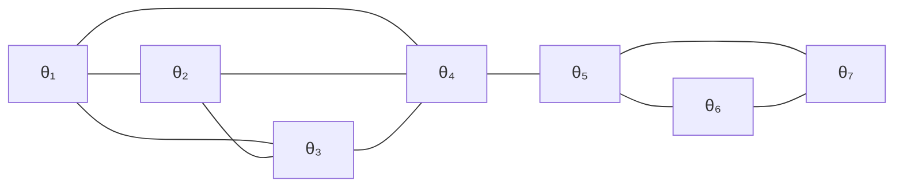

#dmv-graph_mining

# Définition

Soit $P$ un motif et $D$ un [[Collection de graphes et graphe unique|graphe unique]]. Le support par chevauchement de $P$ dans $D$ se calcule sur le graphe de chevauchement des plongements de $P$ dans $D$ :

- un sommet par plongement de $P$ dans $D$ ;
- une arête entre deux plongements dès qu'ils partagent au moins un sommet ou une arête de $D$.

Le support est la taille d'un ensemble indépendant de cardinal maximum (MIS) de ce graphe de chevauchement, c'est-à-dire le nombre maximal de plongements deux à deux non chevauchants.

# Exemple

Le graphe de films et d'acteurs contient 7 plongements du motif film → acteur :

- $\theta_1$ à $\theta_4$ sont les quatre occurrences autour de Return of the Jedi, une par acteur du casting ;
- $\theta_4$ et $\theta_5$ partagent Harrison Ford, acteur commun aux deux films ;
- $\theta_5$ à $\theta_7$ sont les trois occurrences autour de Raiders of the lost ark.

Le graphe de chevauchement porte donc un sommet par plongement et une arête par paire de plongements qui partagent un sommet.

Les plongements $\theta_1$ à $\theta_4$ forment une clique, et il en va de même de $\theta_5$, $\theta_6$, $\theta_7$ réunis par le même film. Un ensemble indépendant de cardinal maximum est par exemple $\{\theta_4, \theta_7\}$ : il ne peut pas dépasser 2, puisque deux plongements pris dans un même groupe se chevauchent. Le support par chevauchement vaut donc 2.

# Propriétés

- Le support par chevauchement est [[Anti-monotonie du support dans une collection de graphes|anti-monotone]].
- Le calcul du MIS est NP-complet.

# Remarque

Sur le même motif, le [[Support naïf par comptage d'occurrences|support naïf]] comptait 7 occurrences et le support par chevauchement vaut 2. La mesure ignore la multiplication des plongements autour d'un même sommet : seule compte la taille du plus grand paquet de plongements disjoints. Elle rend l'anti-monotonie au prix d'un problème NP-complet à chaque évaluation, ce que le [[Support par image minimale]] évite.
