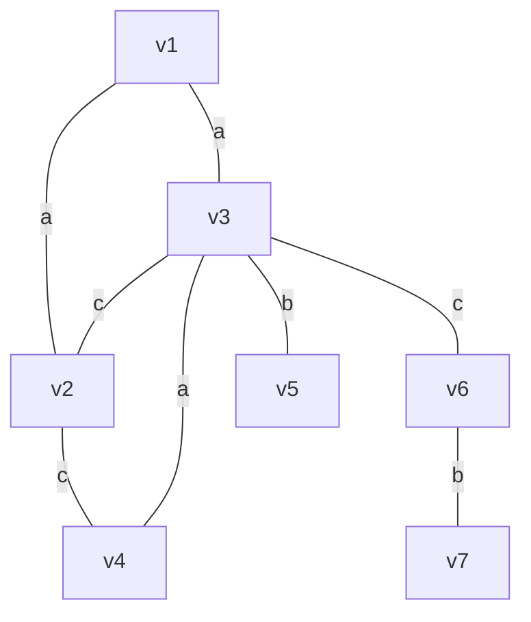

#dmv-graph_mining

# Définition

Un graphe non orienté est un graphe dont les arêtes sont symétriques : $(u, v)$ et $(v, u)$ désignent la même arête.

Un graphe étiqueté est un triplet $G = (V, E, l)$ où $l$ est une fonction d'étiquetage qui associe une étiquette aux sommets et aux arêtes.

Un graphe orienté est un graphe dont les arêtes sont ordonnées : l'ordre des extrémités distingue l'arête $(u, v)$ de l'arête $(v, u)$.

# Interprétation

Un [[Graphe|graphe]] se décline ainsi en plusieurs types, selon deux choix indépendants : l'orientation des arêtes et la présence d'étiquettes sur les sommets et les arêtes.

# Exemple

Graphe non orienté étiqueté à 7 sommets et 8 arêtes, les étiquettes portant ici sur les arêtes :

# Remarque

Les approches de fouille de graphes se concentrent sur les graphes non orientés étiquetés : le graphe orienté et les autres variantes n'y sont que mentionnés.

L'étiquetage fait partie de la structure comparée : deux graphes étiquetés ne sont isomorphes que si leurs étiquettes concordent (voir [[Isomorphisme de graphes]]).
