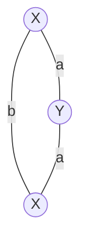
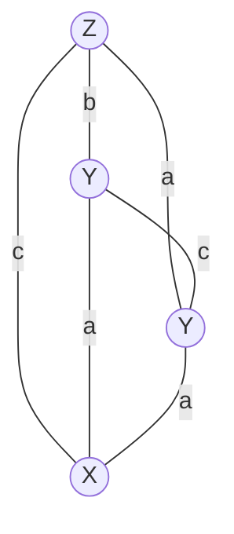
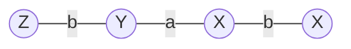
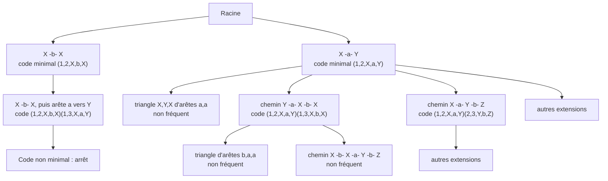

#dmv-graph_mining

# Algorithme

L'élagage par codes canoniques s'applique à la [[Croissance de motifs de graphes]] : l'arbre de recherche est parcouru en profondeur d'abord, chaque nœud étant un motif décrit par son [[Ordre et code DFS minimal|code DFS minimal]], c'est-à-dire par son [[Code canonique d'un graphe|code canonique]].

```text
explorer(motif):
    si le code du motif n'est pas son code minimal :
        arrêter la branche            # élagage par code canonique
    si le motif n'est pas fréquent :
        arrêter la branche            # élagage par le support
    pour chaque extension possible du motif :
        explorer(motif étendu)
```

Deux coupures s'enchaînent donc sur une même branche :

- une extension dont le code n'est pas minimal ne produit aucun motif nouveau, puisque le même motif est déjà atteint par le chemin où son code est minimal ;
- une extension non fréquente ne peut pas mener à un motif fréquent, par [[Anti-monotonie du support dans une collection de graphes|anti-monotonie du support]].

# Exemple

La base de motifs est constituée de trois graphes étiquetés.

Graphe 1, un triangle :



Graphe 2, un cycle à quatre sommets avec ses deux diagonales :



Graphe 3, un chemin :



L'arbre de recherche se présente ainsi : les nœuds portent, quand il est utile, le code du motif atteint, et les branches coupées le sont soit pour code non minimal, soit pour support insuffisant.



La branche de gauche, de code minimal $(1,2,X,b,X)$, est étendue en ajoutant une arête d'étiquette $a$ vers un sommet $Y$ : le code obtenu, $(1,2,X,b,X)(1,3,X,a,Y)$, n'est pas minimal, et la branche s'arrête là.

La branche de droite, de code minimal $(1,2,X,a,Y)$, développe ses extensions :

- le triangle d'arêtes $a$ et $a$ est non fréquent ;
- le chemin $Y$, $X$, $X$ d'arêtes $a$ et $b$ garde un code minimal, $(1,2,X,a,Y)(1,3,X,b,X)$, mais ses deux extensions, le triangle d'arêtes $b$, $a$, $a$ et le chemin $b$, $a$, $b$, sont non fréquentes ;
- le chemin $X$, $Y$, $Z$ d'arêtes $a$ et $b$ garde un code minimal, $(1,2,X,a,Y)(2,3,Y,b,Z)$, et ses extensions se poursuivent ;
- d'autres extensions de la branche restent à explorer.

# Remarque

L'élagage par code canonique et l'élagage par le support se complètent : le premier supprime les doublons d'un même motif atteint par plusieurs chemins, le second supprime les motifs dont le support est insuffisant. Une branche coupée pour code non minimal ne doit pas être explorée plus avant, puisque tous les motifs qu'elle contiendrait ont déjà été engendrés dans la branche où leur code est minimal.
