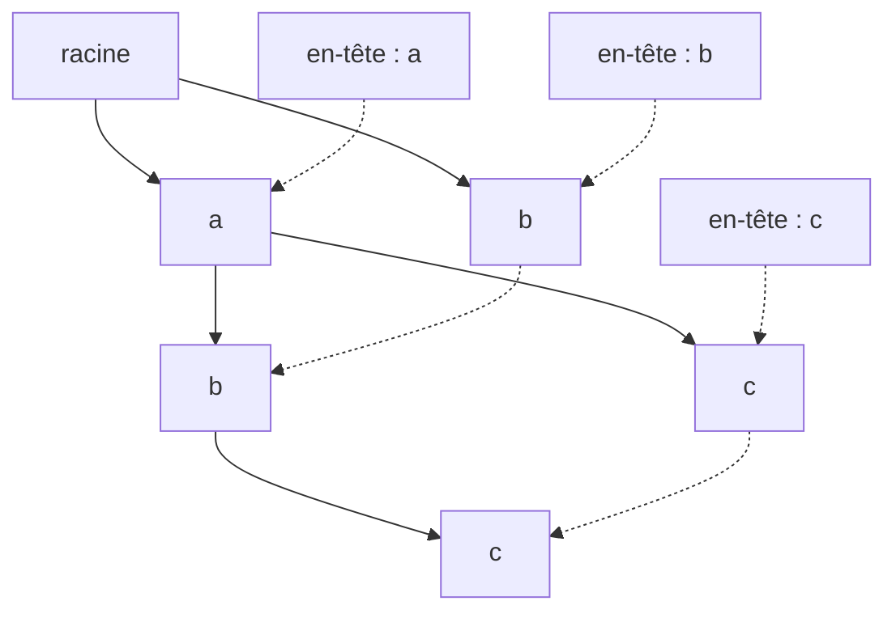

#dmv-frequent_itemsets_mining

# Définition

Un **arbre FP** (FP-tree, *frequent pattern tree*) est une structure compacte qui représente à la fois la [[Items, itemsets et base de transactions|base de transactions]] et les [[Itemset fréquent|itemsets fréquents]].

Il se compose de trois éléments :

- une racine ;
- des sous-arbres de préfixes d'items ;
- une table d'en-tête des items fréquents.

Un **nœud** de l'arbre porte :

- un nom d'item ;
- un compteur, égal au nombre de transactions contenant le chemin qui mène à ce nœud ;
- un lien de nœud, qui pointe vers le nœud suivant portant le même nom d'item.

Une **entrée** de la table d'en-tête porte :

- un nom d'item ;
- la tête de la chaîne de liens de nœuds, c'est-à-dire un pointeur vers le premier nœud portant ce nom d'item.

# Propriétés

L'arbre FP est à la fois une structure **horizontale** et une structure **verticale** :

- horizontalement, c'est un arbre de préfixes : chaque chemin issu de la racine décrit un préfixe d'itemset, et le compteur d'un nœud totalise les transactions qui empruntent ce chemin ;
- verticalement, les liens de nœuds forment, pour chaque item, une chaîne qui traverse les branches et relie toutes ses occurrences.

Il se construit à partir des transactions comme un arbre de préfixes, augmenté des liens entre branches pour un même item.

Les itemsets fréquents réduits à un seul item se lisent directement dans l'arbre : le support d'un item est porté par le compteur des nœuds de sa chaîne, donc par l'entrée correspondante de la table d'en-tête.

# Exemple

Schéma de l'articulation des deux chaînages, pour trois items $a$, $b$, $c$ ; les compteurs des nœuds ne sont pas indiqués, seul le câblage compte :

Les flèches pleines sont les liens de préfixe, de la racine vers les feuilles ; les flèches pointillées sont les liens de nœuds, qui sautent d'une branche à l'autre pour un même item.

# Remarque

Seuls les items fréquents figurent dans la table d'en-tête, d'où son nom de table des items fréquents : la base est d'abord filtrée et réordonnée par l'étape de [[Prétraitement de la base pour FP-growth|prétraitement]], puis l'arbre est construit à partir des transactions ainsi réduites, comme détaillé dans la [[Construction d'un arbre FP]].

L'arbre n'est pas une fin en soi : il est la structure de travail sur laquelle repose la [[Principe de la croissance de motifs FP-growth|croissance de motifs]] exécutée par l'[[Algorithme FP-growth]], qui le parcourt pour étendre les motifs par leur préfixe.
