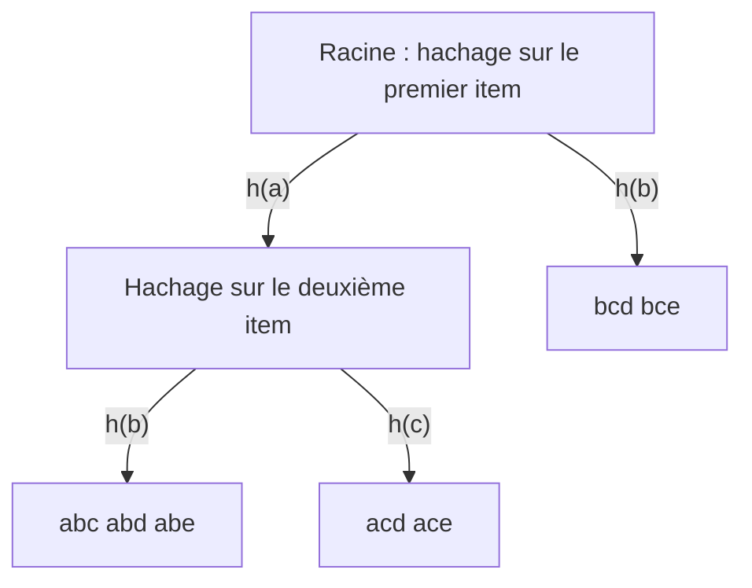
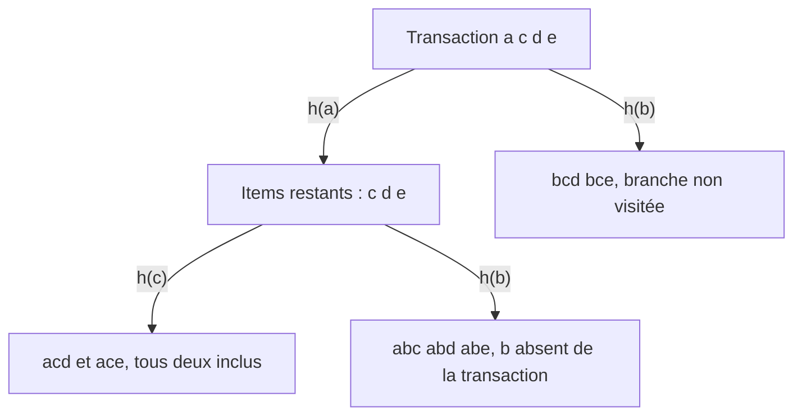

#dmv-frequent_itemsets_mining

# Définition

Étant donné l'ensemble $C_k$ des itemsets candidats de taille $k$ et la [[Items, itemsets et base de transactions|base de transactions]] $T$, le comptage du support des candidats consiste, pour chaque transaction $t \in T$, à retrouver tous les itemsets $c \in C_k$ tels que $c \subseteq t$, puis à incrémenter le compteur de [[Support d'un itemset|support]] de chacun d'eux.

# Algorithme

Le comptage s'appuie sur deux idées : ne jamais comparer une transaction à l'ensemble entier $C_k$, et borner le travail effectué sur chaque portion de $C_k$ examinée.

**Partition en seaux.** Les candidats de $C_k$ sont répartis en seaux dont la taille est bornée par une constante $b_{\max}$, la taille maximale de seau : aucun seau ne contient plus de $b_{\max}$ itemsets.

**Arbre de hachage.** Les seaux occupent les feuilles d'un arbre de hachage. Un nœud interne porte une fonction de hachage $h$ qui associe à un item un indice de fils, de sorte que l'arête d'indice $h(x)$ mène au sous-arbre regroupant les candidats dont l'item de la position courante est $x$.

**Construction.** Tous les candidats sont d'abord placés dans un seau unique, rattaché à la racine. Si ce seau dépasse $b_{\max}$, il devient un nœud interne dont les fils sont indexés par le hachage du premier item, chaque candidat rejoignant le fils $h$ de son premier item. Un fils obtenu reste une feuille tant que son seau tient dans $b_{\max}$ ; sinon il devient à son tour un nœud interne, qui hache sur le deuxième item, et le découpage se répète en avançant d'une position à chaque niveau.

**Parcours pour une transaction.** La recherche des candidats inclus dans une transaction $t$ part de la racine et suit toutes les décisions de hachage que la transaction autorise : à chaque niveau, on ne hache pas un seul item mais chaque item de $t$ situé à partir de la position courante, et l'on suit toutes les branches correspondantes. À la racine, tous les items de $t$ sont donc hachés ; dans un sous-arbre atteint par un item $x$, ce sont les items de $t$ qui suivent $x$. Ne hacher qu'un seul item par niveau raterait des candidats : pour $t = \{a,b,c,d\}$, s'en tenir au deuxième item de $t$ conduit à la branche $h(b)$, qui ne contient pas $\{a,c,d\}$, rangé sous $h(c)$. À chaque feuille atteinte, on teste $c \subseteq t$ pour chacun des candidats du seau et on incrémente le compteur de ceux qui sont inclus. Les seaux des branches non suivies ne sont jamais examinés.

# Exemple

**Construction de l'arbre.**

Soit $C_3$ l'ensemble des candidats de taille 3 construits sur les items $a, b, c, d, e$, et soit $b_{\max} = 3$ la taille maximale d'un seau.

$$C_3 = \{\{a,b,c\}, \{a,b,d\}, \{a,b,e\}, \{a,c,d\}, \{a,c,e\}, \{b,c,d\}, \{b,c,e\}\}$$

Le seau initial contient les sept candidats et dépasse donc largement $b_{\max}$ : l'arbre est encore réduit à une feuille unique, trop grosse pour être utile.

Un premier découpage hache les candidats sur leur premier item.

- La branche $h(a)$ reçoit les cinq candidats commençant par $a$, soit $\{a,b,c\}$, $\{a,b,d\}$, $\{a,b,e\}$, $\{a,c,d\}$ et $\{a,c,e\}$ : ce seau reste trop gros.
- La branche $h(b)$ reçoit $\{b,c,d\}$ et $\{b,c,e\}$ : ce seau tient dans $b_{\max}$ et devient une feuille.

Le seau de la branche $h(a)$ est alors éclaté à son tour en hachant sur le deuxième item.

- La branche $h(b)$ reçoit $\{a,b,c\}$, $\{a,b,d\}$ et $\{a,b,e\}$.
- La branche $h(c)$ reçoit $\{a,c,d\}$ et $\{a,c,e\}$.

Tous les seaux contiennent désormais au plus trois candidats, et la construction s'arrête.

**Parcours de l'arbre.**

Soit la transaction $t = \{a, c, d, e\}$.

- À la racine, on hache chaque item de $t$, soit $a$, $c$, $d$ et $e$. Seule la branche $h(a)$ existe dans l'arbre, aucun candidat ne commençant par $c$, $d$ ou $e$ ; le parcours y descend. La branche $h(b)$ de la racine, où se trouvent $\{b,c,d\}$ et $\{b,c,e\}$, n'est pas visitée, aucun de ces candidats ne pouvant être inclus dans $t$ faute de l'item $b$.
- Au nœud atteint, on hache les items de $t$ qui suivent $a$, soit $c$, $d$ et $e$. Seule la branche $h(c)$ existe sous ce nœud et elle mène à la feuille $\{a,c,d\}, \{a,c,e\}$ ; la branche $h(b)$ du même nœud n'est pas suivie, $b$ n'appartenant pas à $t$.
- Dans cette feuille, les deux candidats sont inclus dans $t$ : $\{a,c,d\} \subseteq \{a,c,d,e\}$ et $\{a,c,e\} \subseteq \{a,c,d,e\}$. Leurs deux compteurs sont incrémentés, après deux tests d'inclusion seulement.

# Remarque

Le parcours exhaustif teste tous les candidats contre toutes les transactions : pour chaque $t \in T$ et chaque $c \in C_k$, il faut décider si $c \subseteq t$. Le nombre de tests est donc proportionnel à $|T| \cdot |C_k|$, ce qui devient vite rédhibitoire puisque $|C_k|$ croît avec $k$ ; c'est ce coût que l'[[Algorithme Apriori|algorithme Apriori]] restreint fortement en indexant les candidats produits par [[Génération des candidats par apriori-gen|apriori-gen]], sans changer l'ordre de grandeur $O(|T| \cdot |C_k|)$ du comptage du support.

L'arbre ne modifie jamais le résultat du comptage : il ne fait que restreindre le nombre d'inclusions effectivement testées. La taille maximale de seau $b_{\max}$ est le paramètre qui borne le travail par feuille visitée, avec au plus $b_{\max}$ tests par seau ; un $b_{\max}$ plus petit produit un arbre plus profond et des seaux plus étroits, un $b_{\max}$ plus grand l'inverse. Le coût du parcours dépend en outre de la largeur des transactions, puisque chaque item supplémentaire d'une transaction ouvre une décision de hachage de plus à chaque niveau où il figure, ce que mesure la [[Complexité de l'algorithme Apriori|complexité de l'algorithme Apriori]].
