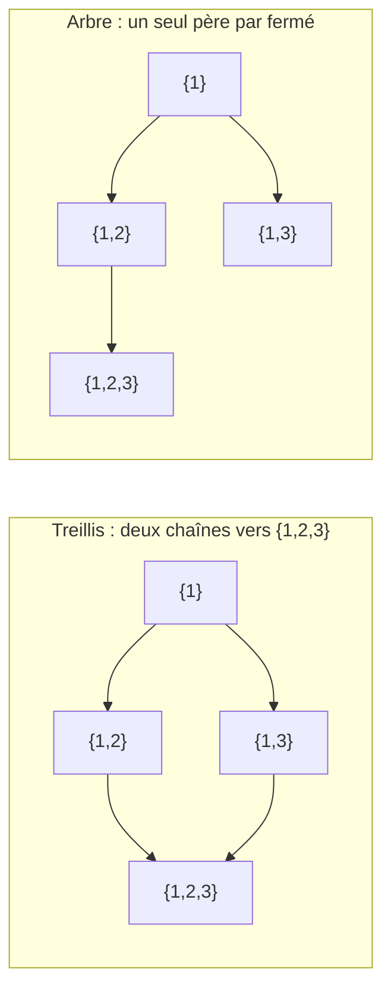

#dmv-frequent_itemsets_mining

# Définition

L'espace de recherche des [[Itemsets fréquents fermés|itemsets fermés fréquents]] n'est pas un arbre mais un **treillis** : c'est l'ensemble ordonné des itemsets fermés, restriction du [[Treillis des itemsets|treillis des itemsets]] aux seuls fermés, dont le diagramme de Hasse est un graphe orienté acyclique. Plusieurs chaînes d'extensions mènent au même fermé, et un parcours qui ne garde pas de mémoire y repasse par les mêmes nœuds.

Ramener ce treillis à un **arbre** consiste à imposer un **ordre d'exploration** : pour chaque fermé, l'ordre désigne un père unique, et l'ensemble des fermés muni de ces liens forme un arbre couvrant orienté. La règle qui fixe le père d'un fermé est la clé de cette réduction, puisqu'elle décide seule quelles arêtes du graphe sont conservées.

Les items sont rangés dans un ordre total, et $\mathrm{maxitem}(P)$ désigne le plus grand item d'un itemset $P$.

**Ordre d'Arimura et Uno.** Soient deux itemsets fermés fréquents $P$ et $Q$. Le fermé $Q$ est un **fils** de $P$ lorsque tous les items de $P$ sont inférieurs au plus grand item de $Q$ :

$$\forall a \in P,\ a < \mathrm{maxitem}(Q)$$

# Propriétés

Un ordre d'exploration n'est utilisable que s'il remplit deux exigences à la fois.

- **Suivre la stratégie d'énumération** : les fils calculés depuis un nœud doivent être ceux que l'algorithme veut visiter ensuite, sans quoi le parcours obtenu ne réalise pas l'énumération visée.
- **Rester peu coûteux à appliquer** : la décision de retenir ou d'écarter une arête doit se prendre à faible coût, faute de quoi le gain de l'énumération est perdu dans la vérification de l'ordre.

Sur ces deux points, la règle de filiation est locale. Elle ne met en jeu que $P$, $Q$ et l'ordre total choisi sur les items : elle se teste sans parcourir la base et sans calculer de fermeture supplémentaire, donc pour un coût négligeable devant celui de la transition qui produit $Q$.

L'ordre retenu ne laisse qu'un père à chaque fermé, ce qui transforme le graphe en arbre : une visite en profondeur devient possible sans mémoriser les fermés déjà visités, à la seule condition que le nœud courant sache calculer ses fils. C'est le mécanisme de la [[Recherche inverse des itemsets fermés|recherche inverse des itemsets fermés]], dont la [[Fermeture d'un itemset et extension par fermeture|fermeture par extension]] fournit la fonction de transition.

L'arbre dépend de l'ordre total choisi sur les items : changer cet ordre change $\mathrm{maxitem}$ pour chaque fermé, donc la règle de filiation et la forme de l'arbre, alors que l'ensemble des fermés énumérés reste le même.

# Exemple

Prenons trois items rangés $1 < 2 < 3$ et quatre fermés emboîtés : $\{1\}$, $\{1,2\}$, $\{1,3\}$ et $\{1,2,3\}$. Le treillis admet deux chaînes de $\{1\}$ à $\{1,2,3\}$, l'une passant par $\{1,2\}$, l'autre par $\{1,3\}$ : le fermé $\{1,2,3\}$ y a deux pères.

La règle de filiation tranche entre ces arêtes, une par une :

- $\{1\} \to \{1,2\}$ est retenue, car $1 < \mathrm{maxitem}(\{1,2\}) = 2$ ;
- $\{1\} \to \{1,3\}$ est retenue, car $1 < \mathrm{maxitem}(\{1,3\}) = 3$ ;
- $\{1,2\} \to \{1,2,3\}$ est retenue, car $1 < 3$ et $2 < 3$ ;
- $\{1,3\} \to \{1,2,3\}$ est écartée, car $3$ n'est pas inférieur à $\mathrm{maxitem}(\{1,2,3\}) = 3$.

Le fermé $\{1,2,3\}$ n'a plus qu'un père, $\{1,2\}$, et le graphe devient l'arbre de droite.

Le détour apparaît dès que deux fermés distincts sont contenus dans un même fermé : celui-ci s'atteint alors par deux chaînes d'extensions, et des deux arêtes entrantes, seule celle dont le père ne contient pas le plus grand item du fils satisfait la règle de filiation.

# Remarque

Le treillis et l'arbre portent les mêmes nœuds, mais pas les mêmes parcours : dans le treillis, atteindre un fermé par deux chaînes impose de mémoriser les nœuds déjà visités ; dans l'arbre, la filiation unique rend cette mémoire inutile, au prix de la règle d'ordre. L'[[Algorithme LCM]] est l'instanciation complète de ce dispositif, de la racine jusqu'aux feuilles.

Le sens de la règle de filiation est souvent écrit à l'envers. Un fils est produit par extension, donc il contient son père : le plus grand item est celui du fils, et c'est lui qui sert de borne. La forme « tous les items du fils sont inférieurs au plus grand item du père » n'est jamais satisfaite, car ce plus grand item appartient au fils lui-même ; la condition correcte est bien « tous les items du père sont inférieurs au plus grand item du fils ».
