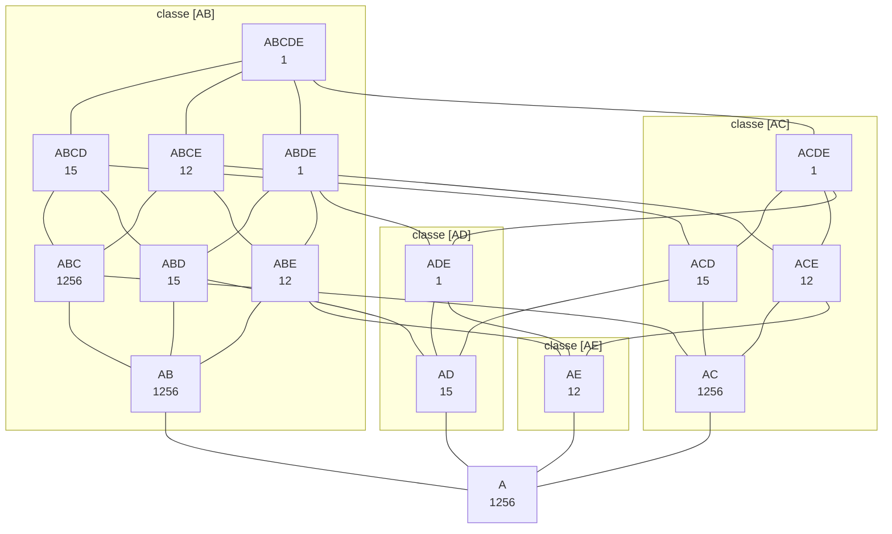

#dmv-frequent_itemsets_mining

# Définition

Le [[Treillis des itemsets|treillis des itemsets]] d'une base réunit tous les itemsets, chaque nœud portant l'itemset et son [[Support d'un itemset|tidset]]. Sur une base volumineuse, les tidsets des candidats deviennent trop nombreux pour tenir simultanément en mémoire ; la parade consiste à **partitionner le treillis en classes d'équivalence** et à ne traiter qu'une classe à la fois.

Une **classe d'équivalence** regroupe les itemsets qui partagent le même préfixe : deux itemsets sont équivalents lorsque l'un et l'autre commencent par la même suite d'items. C'est cette relation, le **partage du même préfixe**, que retient l'[[Algorithme Eclat|algorithme Eclat]]. La classe d'un itemset $P$ est notée $[P]$ : elle contient $P$ et tous les itemsets formés de $P$ suivi d'items postérieurs, l'ordre choisi sur les items fixant la notion de préfixe.

Les **classes initiales** sont indexées par les singletons : chaque classe rassemble les itemsets dont le premier item est ce singleton. L'itemset vide $\bot$ reste en dehors de la partition, en bas du treillis.

# Propriétés

- Le tidset du préfixe sert de base à sa classe. Tout itemset de $[P]$ contient $P$, donc son tidset est inclus dans celui de $P$ :
$$\mathrm{tidlist}(P \cup Q) \subseteq \mathrm{tidlist}(P)$$
- Une classe se décompose à son tour : les itemsets de $[P]$ qui se prolongent par un même item $i$ forment la classe $[P \cup \{i\}]$. La partition se raffine ainsi de niveau en niveau, jusqu'aux itemsets réduits à leur préfixe.
- Les classes sont deux à deux disjointes et, avec $\bot$, elles recouvrent le treillis entier : tout itemset non vide appartient à une et une seule classe initiale, puis à une et une seule classe de chaque niveau de raffinement.
- Une classe ne rassemble pas des itemsets de même support : des itemsets de même préfixe peuvent porter des tidsets différents, et donc des supports différents.
- Le nombre d'itemsets d'une classe ne croît pas quand son préfixe s'allonge, un préfixe plus long laissant moins d'items postérieurs pour le prolonger.

# Exemple

Sur la base de six transactions du [[Treillis des itemsets|treillis des itemsets]], le treillis complet se partitionne en cinq classes initiales, chacune annotée de ses tidsets :

- $[A]$ : $A$ de tidset $\{1,2,5,6\}$, $AB$ de tidset $\{1,2,5,6\}$, $AC$ de tidset $\{1,2,5,6\}$, $AD$ et $ABD$ et $ACD$ de tidset $\{1,5\}$, $AE$ et $ABE$ et $ACE$ de tidset $\{1,2\}$, $ABC$ de tidset $\{1,2,5,6\}$, $ADE$ et $ABDE$ et $ACDE$ et $ABCDE$ de tidset $\{1\}$, $ABCD$ de tidset $\{1,5\}$, $ABCE$ de tidset $\{1,2\}$.
- $[B]$ : $B$ et $BC$ de tidset $\{1,2,4,5,6\}$, $BD$ et $BCD$ de tidset $\{1,5\}$, $BE$ et $BCE$ de tidset $\{1,2\}$, $BDE$ et $BCDE$ de tidset $\{1\}$.
- $[C]$ : $C$ de tidset $\{1,2,3,4,5,6\}$, $CD$ de tidset $\{1,5\}$, $CE$ de tidset $\{1,2\}$, $CDE$ de tidset $\{1\}$.
- $[D]$ : $D$ de tidset $\{1,5\}$, $DE$ de tidset $\{1\}$.
- $[E]$ : $E$ de tidset $\{1,2\}$.

Ces cinq classes comptent respectivement $16$, $8$, $4$, $2$ et $1$ itemsets, dont la réunion avec $\bot$ donne les $32$ nœuds du treillis.

Avec le seuil de support minimum $\varepsilon = 2$, la classe $[A]$ contient, au niveau 2, les itemsets $AB$, $AC$, $AD$ et $AE$, et chacun d'eux ouvre sa propre classe à l'intérieur de $[A]$ :

- $[AB]$ : $AB$ et $ABC$ de tidset $\{1,2,5,6\}$, $ABD$ et $ABCD$ de tidset $\{1,5\}$, $ABE$ et $ABCE$ de tidset $\{1,2\}$, $ABDE$ et $ABCDE$ de tidset $\{1\}$ ;
- $[AC]$ : $AC$ de tidset $\{1,2,5,6\}$, $ACD$ de tidset $\{1,5\}$, $ACE$ de tidset $\{1,2\}$, $ACDE$ de tidset $\{1\}$ ;
- $[AD]$ : $AD$ de tidset $\{1,5\}$, $ADE$ de tidset $\{1\}$ ;
- $[AE]$ : $AE$ de tidset $\{1,2\}$.

La sous-structure de la classe $[A]$, groupée par classe, se lit du bas vers le haut : $A$ en bas, puis les quatre classes issues de ses extensions.

Le seuil $\varepsilon = 2$ laisse infréquents les quatre itemsets de support $1$ de la classe : $ADE$, $ABDE$, $ACDE$ et $ABCDE$.

# Remarque

Deux relations d'équivalence distinctes interviennent sur les itemsets et ne doivent pas être confondues : la **partition par préfixe**, celle de l'[[Algorithme Eclat|algorithme Eclat]], et la **partition par égalité de tidlist**, celle des [[Itemsets fréquents fermés|itemsets fermés]]. Ce ne sont pas deux écritures d'une même relation, mais deux découpages différents du treillis.

Dans la partition par préfixe, deux itemsets d'une même classe partagent leur préfixe, pas nécessairement leur tidlist. Dans la classe $[AB]$, $AB$ et $ABC$ portent le tidlist $\{1,2,5,6\}$, $ABD$ et $ABCD$ le tidlist $\{1,5\}$, $ABE$ et $ABCE$ le tidlist $\{1,2\}$, $ABDE$ et $ABCDE$ le tidlist $\{1\}$ : quatre tidlists distincts cohabitent dans une seule classe, ce qui est attendu et non une anomalie de découpage. La partition par tidlist est plus fine par endroits et plus grossière par d'autres : elle réunit des itemsets de préfixes différents, par exemple $AB$, $AC$ et $ABC$, tous de tidlist $\{1,2,5,6\}$, et sépare $ABD$ de $AB$.

La décomposition est le ressort de l'[[Algorithme Eclat|algorithme Eclat]] : au lieu de garder les tidlists de tous les candidats d'un niveau, elle ne retient en mémoire que celles du préfixe de la classe en cours et de ses extensions, ce qui borne la mémoire occupée. Chaque classe se prête au même traitement que le treillis entier, dont elle est une copie restreinte : l'exploration est récursive, une classe se redécomposant en classes plus petites jusqu'aux itemsets réduits à leur préfixe. Le calcul du support à l'intérieur d'une classe repose sur les intersections de [[Support par intersection de tidlists|tidlists]], chaque intersection avec la tidlist du préfixe restreignant la branche parcourue.
