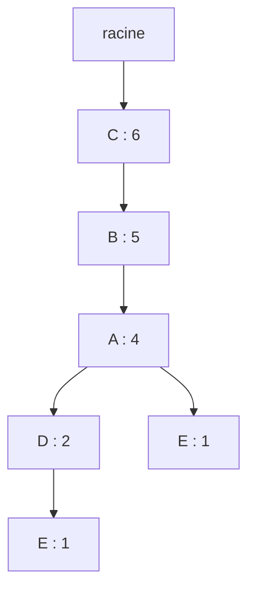
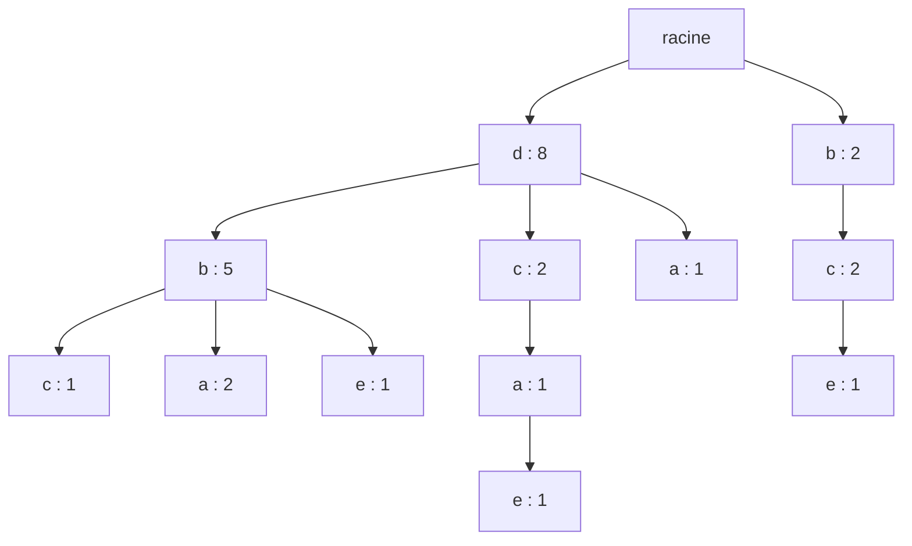

#dmv-frequent_itemsets_mining

# Algorithme

Une fois les fréquences comptées et les deux tris effectués, un [[Arbre FP|arbre FP]] s'obtient en une seule passe d'insertion des transactions. La fréquence d'un item est son [[Support d'un itemset|support]] en tant qu'itemset d'un seul élément :

$$\mathrm{fréquence}(i) = \mathrm{support}(\{i\})$$

La construction enchaîne les étapes suivantes.

1. Compter la fréquence de chaque item, c'est-à-dire le nombre de transactions qui le contiennent.
2. Écarter les items de fréquence inférieure à $minsup$ : aucun nœud de l'arbre ne les portera.
3. Trier les items de chaque transaction par fréquence décroissante.
4. Trier les transactions réduites dans l'ordre lexicographique de leurs items.
5. Insérer les transactions une à une depuis la racine de l'arbre.
6. Créer la table d'en-tête et chaîner les nœuds de chaque item.

L'insertion d'une transaction suit le chemin de préfixe déjà présent :

- chaque nœud traversé voit son compteur augmenté de 1 ;
- le premier nœud absent du chemin est créé avec le compteur 1, puis suivi des nœuds correspondant à la fin de la transaction ;
- une transaction qui épouse entièrement un chemin existant ne crée aucun nœud.

Le compteur d'un nœud vaut donc le nombre de transactions dont le préfixe s'arrête à cet item. La table d'en-tête porte, pour chaque item fréquent, sa fréquence totale, et chaque entrée contient la tête de la liste des nœuds de cet item.

# Interprétation

Le classement par fréquence décroissante place les items les plus fréquents près de la racine : les transactions partagent alors leurs préfixes le plus longtemps possible et l'arbre reste compact. Les nœuds créés ne sont que ceux qui manquent au chemin parcouru, si bien que le nombre de nœuds est bien inférieur au nombre total d'occurrences d'items.

La table d'en-tête est le point d'entrée pour un item donné : elle donne sa fréquence et le début de la chaîne de ses nœuds. Un item absent de tous les nœuds est exactement un item écarté à l'étape 2, donc non fréquent.

L'arbre combine deux lectures : horizontale par les chemins de préfixes, verticale par les node-links qui relient toutes les occurrences d'un même item. Les itemsets d'un seul élément se lisent directement sur l'arbre, par la fréquence portée dans la table d'en-tête.

# Exemple

Base de six transactions, avec $minsup = 2$ :

- `ABCDEF` ;
- `ABCE` ;
- `C` ;
- `BC` ;
- `ABCD` ;
- `ABC`.

Les fréquences valent `C:6`, `B:5`, `A:4`, `D:2`, `E:2`, `F:1`. L'item `F`, de fréquence 1, est écarté. Les transactions réordonnées par fréquence décroissante deviennent :

- `CBADE` ;
- `CBAE` ;
- `C` ;
- `CB` ;
- `CBAD` ;
- `CBA`.

Triées dans l'ordre lexicographique, elles donnent la suite d'insertion :

- `C` ;
- `CB` ;
- `CBA` ;
- `CBAD` ;
- `CBADE` ;
- `CBAE`.

L'insertion incrémente les compteurs comme suit :

- `C` crée le nœud `C` à 1 ;
- `CB` porte `C` à 2 et crée le nœud `B` à 1 ;
- `CBA` porte `C` à 3, `B` à 2 et crée le nœud `A` à 1 ;
- `CBAD` porte `C` à 4, `B` à 3, `A` à 2 et crée le nœud `D` à 1 ;
- `CBADE` porte `C` à 5, `B` à 4, `A` à 3, `D` à 2 et crée le nœud `E` à 1 ;
- `CBAE` porte `C` à 6, `B` à 5, `A` à 4 et crée un second nœud `E` à 1.

L'arbre obtenu est le suivant.

La table d'en-tête reprend les fréquences et chaîne les nœuds de chaque item :

| Item | Fréquence | Nœuds chaînés |
|---|---|---|
| `C` | 6 | `C:6` |
| `B` | 5 | `B:5` |
| `A` | 4 | `A:4` |
| `D` | 2 | `D:2` |
| `E` | 2 | `E:1` (branche de `D`), puis `E:1` (branche directe) |

Les deux nœuds `E` portent chacun le compteur 1 : leur somme redonne la fréquence de `E`, 2, qui est aussi le support de l'itemset $\{E\}$.

La même construction sur une base de dix transactions, avec $minsup = 3$, où les items `f` et `g` de fréquences 2 et 1 sont écartés :

- `a d f` ;
- `a c d e` ;
- `b d` ;
- `b c d` ;
- `b c` ;
- `a b d` ;
- `b d e` ;
- `b c e g` ;
- `c d f` ;
- `a b d`.

Après tri par fréquence décroissante puis tri lexicographique, la suite d'insertion est :

- `d b` ;
- `d b c` ;
- `d b a` ;
- `d b a` ;
- `d b e` ;
- `d c` ;
- `d c a e` ;
- `d a` ;
- `b c` ;
- `b c e`.

Les cinq premières transactions commencent par `d b` et construisent la branche `d`, `b` ; `d c` ouvre une seconde branche sous `d` ; `d a` une troisième ; les deux dernières transactions `b …` créent enfin une seconde branche à la racine. L'arbre obtenu est le suivant.

| Item | Fréquence | Nœuds chaînés |
|---|---|---|
| `d` | 8 | `d:8` |
| `b` | 7 | `b:5` (branche de `d`), puis `b:2` (branche racine) |
| `c` | 5 | `c:1` (sous `d b`), `c:2` (sous `d`), `c:2` (sous `b` racine) |
| `a` | 4 | `a:2` (sous `d b`), `a:1` (sous `d c`), `a:1` (sous `d`) |
| `e` | 3 | `e:1` (sous `d b`), `e:1` (sous `d c a`), `e:1` (sous `b c`) |

Chaque fréquence de la table d'en-tête est la somme des compteurs des nœuds de sa ligne : 8 pour `d`, 5 et 2 pour `b`, 1, 2 et 2 pour `c`, 2, 1 et 1 pour `a`, 1, 1 et 1 pour `e`. Les supports des itemsets d'un seul élément se lisent ainsi directement sur l'arbre, sans reparcourir la base.

# Remarque

Les node-links ne sont pas décoratifs : les occurrences d'un item sont dispersées dans plusieurs branches, et sans eux le comptage du support d'un item exigerait un parcours complet de l'arbre. En les suivant depuis la table d'en-tête, on atteint exactement les chemins où l'item apparaît, ce qu'exploite l'[[Algorithme FP-growth]] pour former les bases conditionnelles.

L'ordre lexicographique de la dernière étape n'est pas l'ordre alphabétique : la comparaison des items reprend l'ordre de fréquence décroissante établi auparavant, visible dans la liste triée `C`, `CB`, `CBA`, `CBAD`, `CBADE`, `CBAE` de l'exemple.

L'élagage des items non fréquents avant l'insertion et le tri par fréquence décroissante sont deux opérations distinctes : le second ne supprime aucun item, il ne fait que fixer l'ordre des nœuds. Les deux étapes préparent la base, la construction de l'arbre proprement dite commençant avec l'insertion ; leur déroulé complet est décrit dans [[Prétraitement de la base pour FP-growth]].
