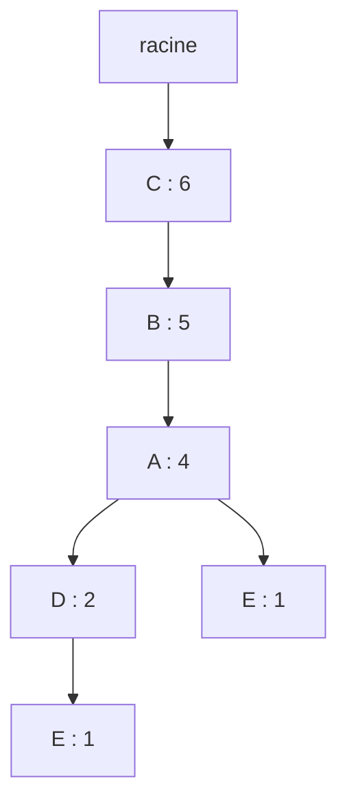

#dmv-frequent_itemsets_mining

# Exemple

Le déroulé part d'un [[Arbre FP]] dont la table d'en-tête donne les fréquences suivantes, par ordre décroissant :

- `C : 6` ;
- `B : 5` ;
- `A : 4` ;
- `D : 2` ;
- `E : 2`.

L'arbre ne comporte que deux chemins :

- `C:6 ← B:5 ← A:4 ← D:2 ← E:1` ;
- `C:6 ← B:5 ← A:4 ← E:1`.

Le seuil de l'exemple vaut $minsup = 2$.

L'[[Algorithme FP-growth|algorithme]] parcourt les items par fréquence croissante. `E` et `D` ont ici la même fréquence 2, si bien que cet ordre ne les départage pas : le déroulé retient `E`, de support 2, pour commencer.

**Sortie de `E`.**

1. Suivre la chaîne de liens du nœud `E` : elle traverse les deux nœuds `E`, qui portent chacun le compteur 1.
2. Cumuler les compteurs rencontrés.

$$\text{count}_E = 1 + 1 = 2$$

3. Le compteur atteint le seuil, donc `E` est un [[Itemset fréquent|itemset fréquent]] : sortie de `E`.

**Base conditionnelle de `E`.**

4. Ne retenir que les chemins qui passent par `E` et reporter sur chacun de leurs items le compteur du nœud `E` atteint, ici 1 :

- `C:1 ← B:1 ← A:1 ← D:1` ;
- `C:1 ← B:1 ← A:1`.

5. Retirer `E` des chemins obtenus : la base conditionnelle ne contient plus que les préfixes des transactions contenant `E`.

**Élagage de `D`.**

6. Dans cette base, `D` porte le compteur 1, inférieur au seuil : `D` n'y est pas fréquent et l'extension `DE` n'est pas considérée.
7. Les deux chemins restants partagent le préfixe `C, B, A` : leur agrégation en arbre conditionnel cumule les compteurs et laisse le seul chemin `C:2 ← B:2 ← A:2`.

**Extension par `A`.**

8. Dans cet arbre, `A`, `B` et `C` portent tous le compteur 2 : le déroulé retient `A`, dont le compteur vaut 2.

$$\text{count}_{AE} = 2$$

9. `AE` est fréquent : sortie de `AE`.
10. Son arbre conditionnel est `C:2 ← B:2`.

**Extension par `B`.**

11. Cet arbre ne contient que `B:2` et `C:2`, à égalité : le déroulé retient `B`, dont le compteur vaut 2.

$$\text{count}_{BAE} = 2$$

12. `BAE` est fréquent : sortie de `BAE`.
13. Son arbre conditionnel est le nœud unique `C:2`.

**Extension par `C`.**

14. Le dernier item de la chaîne est `C`, dont le compteur vaut 2.

$$\text{count}_{CBAE} = 2$$

15. `CBAE` est fréquent : sortie de `CBAE`.

Les quatre itemsets produits ont donc tous un compteur égal à 2, valeur du seuil :

- $\{E\}$ ;
- $\{A, E\}$ ;
- $\{B, A, E\}$ ;
- $\{C, B, A, E\}$.

# Interprétation

Le déroulé illustre le mécanisme récursif de la [[Principe de la croissance de motifs FP-growth|croissance de motifs]] : chaque sortie est un préfixe déjà validé auquel on ajoute l'item courant, et le compteur cumulé le long de la chaîne de cet item est le [[Support d'un itemset|support]] de l'itemset obtenu.

L'ordre de traitement suit la fréquence croissante à chaque niveau, sans départager les items à égalité :

- au premier niveau, `E` et `D` ont tous deux la fréquence 2 : le déroulé retient `E`, choix que l'ordre croissant ne tranche pas ;
- dans la base conditionnelle de `E`, `D` tombe à 1 et disparaît, puis `A`, `B` et `C`, tous à 2, sont pris dans l'ordre `A`, `B`, `C` retenu par le déroulé.

La base conditionnelle d'un item ne garde que les transactions qui passent par cet item, réduites à leur préfixe : elle est strictement plus petite que la base courante, et l'arbre conditionnel qui en est tiré décroît de la même façon. Ici, l'élagage de `D:1` laisse un arbre conditionnel formé d'un seul chemin, si bien que les extensions s'empilent linéairement : `E`, puis `AE`, puis `BAE`, puis `CBAE`, jusqu'à épuisement des items de la chaîne.

# Remarque

Un item fréquent dans la base entière peut ne plus l'être dans une base conditionnelle : `D` figure dans la table d'en-tête avec la fréquence 2, mais il ne porte plus que le compteur 1 dans la base conditionnelle de `E`. La fréquence se lit toujours relativement à la base courante, jamais dans l'absolu.

Le déroulé ne détaille qu'une branche de l'énumération. Les autres extensions de `E`, ainsi que les motifs obtenus à partir des autres entrées de la table d'en-tête, se traitent par le même mécanisme, avec la même construction de base conditionnelle et le même test de seuil à chaque niveau.

Chaque étape réutilise l'arbre comme structure de travail et n'énumère aucun candidat : la base conditionnelle est extraite par les liens de nœuds, sans parcours de la [[Items, itemsets et base de transactions|base de transactions]] d'origine, comme le décrit la [[Construction d'un arbre FP|construction de l'arbre]].
