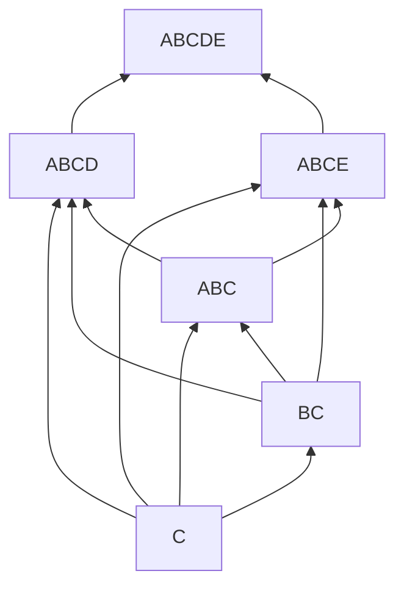

#dmv-frequent_itemsets_mining

# Définition

La **fermeture** d'un itemset $P$ est l'[[Itemsets fréquents fermés|itemset fermé]] qui a la même dénotation que $P$, autrement dit le plus grand itemset qui apparaît dans exactement les mêmes transactions que $P$. Elle s'obtient en intersectant les transactions qui contiennent $P$ :

$$\mathrm{cl}(P) = \bigcap_{j \in \mathrm{tidlist}(P)} t_j$$

où $t_j$ désigne la transaction de numéro $j$ et $\mathrm{tidlist}(P)$ la liste des numéros des transactions qui contiennent $P$. La formule vaut pour $\mathrm{tidlist}(P) \neq \varnothing$ : sur un tidlist vide, l'intersection indexée par l'ensemble vide vaut l'univers des items et ne donne pas une fermeture.

L'intersection porte sur les transactions elles-mêmes, prises comme ensembles d'items : elle ne retient que les items présents dans toutes les transactions où $P$ apparaît, c'est-à-dire exactement les items dont l'ajout à $P$ ne modifie pas sa dénotation. La fermeture de $P$ est donc le maximum de la classe d'équivalence de tidlist de $P$, dont elle est l'unique fermé.

# Propriétés

- La fermeture contient l'itemset de départ : $P \subseteq \mathrm{cl}(P)$.
- Elle conserve la dénotation : $\mathrm{tidlist}(\mathrm{cl}(P)) = \mathrm{tidlist}(P)$.
- Elle est idempotente : $\mathrm{cl}(\mathrm{cl}(P)) = \mathrm{cl}(P)$, un itemset fermé étant sa propre fermeture.
- Deux itemsets ont la même fermeture si et seulement s'ils ont le même tidlist : la fermeture ne dépend que de la classe d'équivalence, et en donne le plus grand élément.
- Tout itemset fermé $Q$ autre que $\mathrm{cl}(\varnothing)$ s'obtient à partir d'un autre itemset fermé $P$ par adjonction d'un item suivie d'une fermeture : il existe un item $i \notin P$ tel que $Q = \mathrm{cl}(P \cup \{i\})$.
- Cette opération est la seule transition nécessaire entre fermés : elle engendre tout l'ensemble des itemsets fermés à partir de $\mathrm{cl}(\varnothing)$.

L'opération « ajouter un item puis prendre la fermeture » définit une structure d'adjacence sur les itemsets fermés : un arc mène de $P$ à $\mathrm{cl}(P \cup \{i\})$ pour chaque item $i$ absent de $P$. L'énumération des fermés devient alors un parcours de graphe sur cette structure, mené avec de la mémoire.

- Chaque arc va vers un sur-ensemble strict, $P \subset \mathrm{cl}(P \cup \{i\})$, ce qui interdit tout cycle : le graphe est un graphe orienté acyclique sur les fermés.
- Plusieurs chemins peuvent conduire au même itemset fermé, un même fermé s'obtenant par ajout d'items différents.
- L'exploration reste locale : depuis un fermé, seules les fermetures des ajouts d'un item sont calculées, chacune par une intersection de tidlists.

# Remarque

Le retour arrière ordinaire, celui qui progresse d'un itemset à un itemset voisin en ajoutant un item à la fois, ne convient pas à l'énumération des itemsets fermés : il existe de grands écarts entre deux fermés, un fermé et le fermé suivant obtenu par ajout d'un item pouvant être séparés par de nombreux itemsets intermédiaires qui ne sont pas fermés. Un parcours qui avance item par item traverse donc toute cette masse d'itemsets sans intérêt avant d'atteindre le fermé visé. C'est pourquoi l'opération « ajouter un item puis prendre la fermeture » enjambe directement ces intermédiaires : chaque pas du parcours aboutit à un fermé.

Le parcours du graphe d'adjacence doit mémoriser les fermés déjà visités, faute de quoi l'exploration d'un fermé atteint par deux chemins serait répétée. Réduire ce graphe à un [[Recherche inverse des itemsets fermés|arbre couvrant orienté]] supprime le besoin de cette mémoire, au prix d'une règle d'ordre fixant un unique parent pour chaque fermé.

La dénotation d'un itemset et son tidlist sont un seul et même objet, l'ensemble des transactions qui le contiennent ; la fermeture s'exprime aussi bien comme l'intersection des occurrences de $P$ que comme l'intersection des transactions indexées par son tidlist. Le vocabulaire retenu ici est celui du tidlist, pour rester cohérent avec le [[Support par intersection de tidlists|comptage du support par intersection]].

La fermeture est calculée une fois par candidat d'extension, à chaque appel de `expand`, y compris ceux que le test de premier parent écarte : l'[[Algorithme LCM]] l'utilise comme transition élémentaire de son parcours, l'intersection portant sur la base réduite restreinte aux transactions contenant l'item d'extension.

# Exemple

Base de six transactions sur cinq items :

| Tid | Transaction |
| :--- | :--- |
| 1 | A B C D E |
| 2 | A B C E |
| 3 | C |
| 4 | B C |
| 5 | A B C D |
| 6 | A B C |

Les fermetures des itemsets rencontrés dans le parcours se calculent par intersection des transactions :

- $\mathrm{cl}(\varnothing) = \{C\}$, car $C$ est le seul item présent dans les six transactions ;
- $\mathrm{cl}(\{A, C\}) = \{A, B, C\}$, les transactions $1$, $2$, $5$ et $6$ contenant toutes $A$, $B$ et $C$ ;
- $\mathrm{cl}(\{B, C\}) = \{B, C\}$, la transaction $4$ réduisant la classe au seul $C$ et $B$ ;
- $\mathrm{cl}(\{C, D\}) = \{A, B, C, D\}$, les deux transactions contenant $C$ et $D$ étant $1$ et $5$ ;
- $\mathrm{cl}(\{C, E\}) = \{A, B, C, E\}$, les deux transactions contenant $C$ et $E$ étant $1$ et $2$.

Le graphe d'adjacence des fermés, parcouru depuis $\mathrm{cl}(\varnothing)$ :

- Ajouter $B$ à $C$ donne $BC$, déjà fermé.
- Ajouter $A$ à $C$ donne $AC$, non fermé, dont la fermeture est $ABC$.
- Ajouter $D$ à $C$ donne $CD$, dont la fermeture est $ABCD$ : le pas saute les itemsets $ACD$ et $BCD$, qui ne sont pas fermés.
- Ajouter $E$ à $C$ donne $CE$, dont la fermeture est $ABCE$.
- Depuis $BC$, l'ajout de $A$, de $D$ et de $E$ mène à $ABC$, à $ABCD$ et à $ABCE$ ; depuis $ABCD$ et $ABCE$, l'ajout du dernier item mène à $ABCDE$.
- Les fermés $ABCD$ et $ABCDE$ sont chacun atteints par plusieurs chemins : sans mémoire des nœuds visités, ils seraient explorés plusieurs fois.

Les quatre fermés obtenus par ajout à $C$ montrent l'écart entre fermés : le pas $C \to ABCD$ enjambe $ACD$ et $BCD$, itemsets intermédiaires du [[Treillis des itemsets|treillis]] qui ne sont pas fermés. À l'inverse, $C$ et $BC$ diffèrent d'un seul item, donc sont voisins dans le treillis, et la classe de tidlist de $C$ se réduit à $C$ lui-même, déjà fermé.

