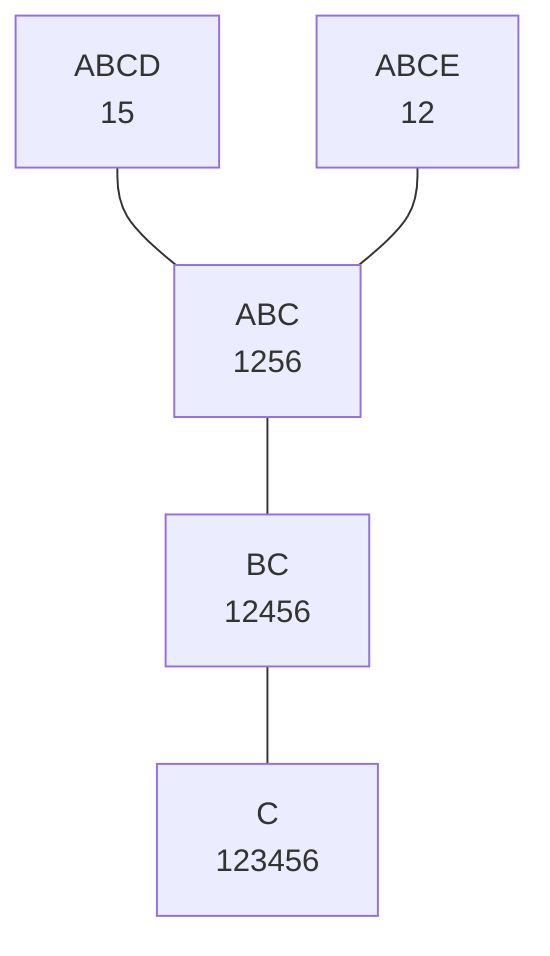

#dmv-frequent_itemsets_mining

# Définition

Deux itemsets d'une base sont **équivalents** lorsqu'ils apparaissent exactement dans les mêmes transactions, autrement dit lorsqu'ils partagent le même [[Support d'un itemset|tidlist]]. Cette relation partitionne les [[Itemset fréquent|itemsets fréquents]] en **classes d'équivalence de tidlist** : tous les itemsets d'une classe ont le même support, et la réunion de deux itemsets d'une même classe reste dans la classe, son tidlist étant l'intersection de deux tidlists égaux. Chaque classe admet donc un plus grand élément pour l'inclusion, réunion de tous ses membres.

Un **itemset fréquent fermé** est le maximum d'une de ces classes, c'est-à-dire un [[Itemset fréquent|itemset fréquent]] dont aucun itemset fréquent de même tidlist n'est un sur-ensemble strict. L'ensemble $CFI$ des itemsets fréquents fermés s'écrit :

$$CFI = \{ I \in FI \mid \nexists I' \in FI,\ \mathrm{tidlist}(I') = \mathrm{tidlist}(I),\ I \subset I' \}$$

où $FI$ désigne l'ensemble des itemsets fréquents de la base pour le seuil $minsup$ retenu.

Chaque classe possède un et un seul maximum, donc $CFI$ contient exactement un itemset par classe d'équivalence de tidlist non vide. Les trois familles d'itemsets s'emboîtent par inclusion, du plus compact au plus détaillé : $MFI \subseteq CFI \subseteq FI$, où $MFI$ est l'ensemble des [[Itemsets fréquents maximaux|itemsets fréquents maximaux]].

# Propriétés

- Tout itemset fermé est fréquent : $CFI \subseteq FI$.
- Tout itemset maximal est fermé : $MFI \subseteq CFI$, car un itemset maximal n'a aucun sur-ensemble fréquent, donc aucun sur-ensemble fréquent de même tidlist.
- Dans une classe d'équivalence, le maximum est unique : si deux itemsets $I$ et $I'$ de même tidlist sont tous deux maximaux dans leur classe, chacun contient l'autre, d'où $I = I'$.
- Un itemset fermé peut posséder des sur-ensembles fréquents : $C$ est fermé et $C \subset BC$ avec $BC$ fréquent, car $BC$ a un tidlist strictement plus petit. L'emboîtement de deux itemsets fermés est donc possible, contrairement au cas des itemsets maximaux.
- Le support de tout itemset fréquent se lit sur le fermé de sa classe : les deux itemsets ont le même tidlist, donc le même [[Support d'un itemset|support]].
- Le nombre d'itemsets décroît de $FI$ à $CFI$ puis de $CFI$ à $MFI$ : la compression est intermédiaire entre l'énumération complète et les seuls maximaux ; les ordres de grandeur comparés figurent dans [[Nombre d'itemsets par type]].

# Exemple

Base de six transactions sur cinq items :

| Tid | Transaction |
| :--- | :--- |
| 1 | A B C D E |
| 2 | A B C E |
| 3 | C |
| 4 | B C |
| 5 | A B C D |
| 6 | A B C |

Avec le seuil $\varepsilon = 2$, les itemsets de support $1$ sont écartés et les $23$ itemsets fréquents restants se répartissent en cinq classes de tidlist :

| Tidlist | Itemsets fréquents de la classe | Fermé |
| :--- | :--- | :--- |
| $\{1,2,3,4,5,6\}$ | $C$ | $C$ |
| $\{1,2,5,6\}$ | $A$, $AB$, $AC$, $ABC$ | $ABC$ |
| $\{1,2,4,5,6\}$ | $B$, $BC$ | $BC$ |
| $\{1,5\}$ | $D$, $AD$, $BD$, $CD$, $ABD$, $ACD$, $BCD$, $ABCD$ | $ABCD$ |
| $\{1,2\}$ | $E$, $AE$, $BE$, $CE$, $ABE$, $ACE$, $BCE$, $ABCE$ | $ABCE$ |

Les itemsets fermés sont donc $C$, de support $6$, $BC$, de support $5$, $ABC$, de support $4$, puis $ABCD$ et $ABCE$, de support $2$. Les itemsets maximaux se réduisent à $ABCD$ et $ABCE$ : $ABC$, $BC$ et $C$ sont fermés mais ne sont pas maximaux, car ils admettent des sur-ensembles fréquents.

Les cinq itemsets fermés pour ce seuil, annotés de leur tidlist, se lisent dans le [[Treillis des itemsets|treillis des itemsets]] ; réduit à ces seuls nœuds, le sous-graphe de leurs relations d'inclusion est le suivant :

Les arêtes suivent l'inclusion : $C \subset BC \subset ABC \subset ABCD$ et $ABC \subset ABCE$. Les itemsets fermés ne forment pas une chaîne, deux fermés pouvant être incomparables, ici $ABCD$ et $ABCE$.

# Interprétation

$CFI$ répond à la perte d'information des itemsets maximaux : un itemset maximal ne dit rien du [[Support d'un itemset|support]] de ses sous-ensembles, alors qu'un itemset fermé le donne pour toute sa classe, puisque tous ses membres ont le même tidlist et donc le même support. La réduction tient à l'hérédité de la fréquence : par la [[Propriété d'anti-monotonie du support|monotonie du support]], tout sous-ensemble d'un itemset fréquent est fréquent, et les itemsets d'une même classe de tidlist se résument à leur maximum, comme le montre la redondance décrite dans [[Limites des itemsets fréquents]].

L'énumération de $FI$ suivie du filtrage des fermés reste possible mais coûteuse dès que $FI$ est grand ; le calcul passe alors par des opérations de fermeture, décrites dans [[Fermeture d'un itemset et extension par fermeture]].

# Remarque

La définition d'un itemset fermé repose sur un maximum, non sur un minimum : écrire la condition avec $I' \subset I$ au lieu de $I \subset I'$ retient les éléments minimaux de chaque classe, c'est-à-dire des itemsets dont le tidlist coïncide avec celui d'un sur-ensemble, et non le fermé ; une classe peut en compter plusieurs, incomparables, même si cet exemple n'en offre qu'un par classe. Sur l'exemple, une telle écriture sélectionnerait $A$, $B$, $C$, $D$ et $E$ au lieu de $C$, $BC$, $ABC$, $ABCD$ et $ABCE$. La formulation correcte énonce qu'aucun itemset fréquent de même tidlist n'est strictement plus grand.

Les classes d'équivalence de tidlist ne doivent pas être confondues avec les [[Classes d'équivalence des itemsets|classes de préfixe]] de l'[[Algorithme Eclat|algorithme Eclat]] : la première partition peut réunir des itemsets de préfixes différents qui apparaissent dans les mêmes transactions, la seconde réunit des itemsets de même préfixe, dont les tidlists ne coïncident pas nécessairement.

À l'échelle du volume total de motifs, cette représentation condensée est l'une des quatre familles d'approches recensées dans les [[Familles d'approches pour maîtriser le nombre de motifs]] : elle agit motif par motif, en écartant ceux qu'un autre résume. Le volume qu'elle réduit est celui de l'[[Explosion du nombre de motifs]].
