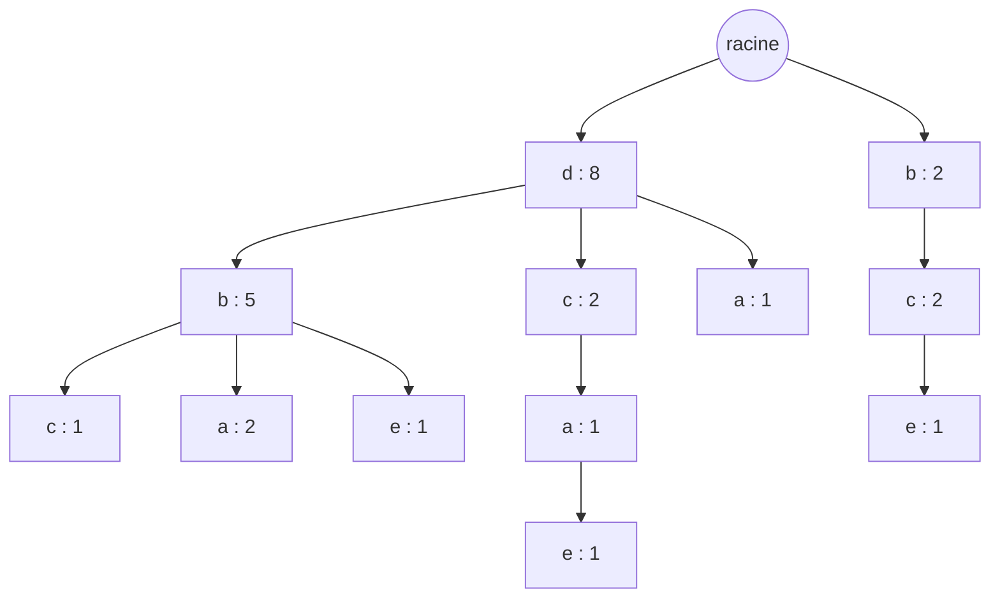

#dmv-frequent_itemsets_mining

# Algorithme

Un [[Arbre FP]] ne se construit pas directement sur la base brute : les transactions sont d'abord transformées en suites ordonnées d'items fréquents. Le prétraitement se déroule en cinq étapes.

1. La [[Items, itemsets et base de transactions|base de transactions]] d'origine.
2. Le support absolu de chaque item, compté sur l'ensemble de la base.
3. Chaque transaction est réduite à ses items de [[Support d'un itemset|support]] au moins $s_{\min}$, rangés par support décroissant.
4. Les transactions réduites sont rangées dans l'ordre lexicographique croissant, la comparaison de deux items suivant le même ordre qu'à l'étape précédente.
5. La base réordonnée sert de matériau à la construction de l'arbre.

Trois effets se combinent dans cette préparation.

Le tri par support décroissant place en tête de chaque transaction les items les plus partagés par la base : ces items occupent donc les premiers niveaux de l'arbre, où les chemins sont communs au plus grand nombre de transactions. Leur fréquence se lit directement dans l'arbre : en un seul nœud pour l'item le plus fréquent, en sommant les comptes des nœuds chaînés pour les suivants ($b : 5$ et $b : 2$ donnent $7$ pour $b$ dans l'exemple ci-dessous), ou dans la table d'en-tête.

Le retrait des items de support inférieur à $s_{\min}$ supprime d'emblée les branches qui ne peuvent appartenir à aucun [[Itemset fréquent|itemset fréquent]] ; ces items n'apparaissent nulle part dans l'arbre.

Le tri lexicographique rend voisines les transactions identiques, qui se réunissent alors en une seule branche affectée d'un compte égal au nombre de transactions fusionnées.

Le filtrage des items infréquents et l'unification des transactions identiques, qui constituent les [[Réductions de la base de transactions|réductions de base]], ramènent la base à ce qui est utile pour les niveaux profonds de la fouille. L'unification se fait en temps linéaire, en une passe sur la base, et l'arbre obtenu reste compact lorsque la base est dense et grande.

# Exemple

Base de dix transactions sur les items $a$, $b$, $c$, $d$, $e$, $f$, $g$, avec $s_{\min} = 3$. Les quatre colonnes donnent les étapes successives du prétraitement ; l'arbre FP qui en résulte est donné plus bas.

| ① base | ② fréquences | ③ tri par fréquence | ④ tri lexicographique |
| :--- | :--- | :--- | :--- |
| a d f | d : 8 | d a | d b |
| a c d e | b : 7 | d c a e | d b c |
| b d | c : 5 | d b | d b a |
| b c d | a : 4 | d b c | d b a |
| b c | e : 3 | b c | d b e |
| a b d | f : 2 | d b a | d c |
| b d e | g : 1 | d b e | d c a e |
| b c e g | | b c e | d a |
| c d f | | d c | b c |
| a b d | | d b a | b c e |

Les items $f$ et $g$ ont un support de $2$ et de $1$, inférieur à $s_{\min} = 3$ : ils disparaissent à l'étape ③, ce qui vide les transactions de leurs items non fréquents et laisse $a\,d\,f$ devenir $d\,a$, $c\,d\,f$ devenir $d\,c$ et $b\,c\,e\,g$ devenir $b\,c\,e$. Les supports restants, $d : 8$, $b : 7$, $c : 5$, $a : 4$, $e : 3$, fixent l'ordre de comparaison $d < b < c < a < e$ utilisé aux étapes ③ et ④.

Le tri lexicographique rapproche les deux occurrences de la transaction $d\,b\,a$, qui se réunissent ensuite en une seule branche de compte $2$. L'arbre construit sur cette base ordonnée, avec le compte de chaque nœud :

La racine a deux enfants : $d : 8$, car huit des dix transactions contiennent $d$, et $b : 2$, pour les deux transactions $b\,c$ et $b\,c\,e$ qui n'ont pas $d$. Sous le nœud $d : 8$, les préfixes se répartissent en $b : 5$ (les cinq transactions $d\,b$), $c : 2$ (les deux transactions $d\,c$) et $a : 1$ (la transaction $d\,a$). Le nœud $b : 5$ porte lui-même $a : 2$, compte des deux transactions $d\,b\,a$ fusionnées, $c : 1$ pour $d\,b\,c$ et $e : 1$ pour $d\,b\,e$ ; le nœud $c : 2$ se prolonge en $a : 1$ puis $e : 1$ pour la transaction $d\,c\,a\,e$.

# Remarque

Le retrait des items de support inférieur à $s_{\min}$ est sans perte pour la fouille des itemsets fréquents : un itemset fréquent ne peut contenir un item infréquent, puisque le support d'un sur-ensemble ne dépasse jamais celui de ses parties ([[Propriété d'anti-monotonie du support]]). Le prétraitement peut donc supprimer ces items avant même de construire l'arbre.

L'ordre décroissant des supports n'est qu'un ordre total parmi d'autres : ce qui compte est qu'il soit le même pour le tri des items dans les transactions et pour le tri lexicographique des transactions. Un ordre différent donne un arbre de forme différente, mais qui représente la même base et se lit avec les mêmes comptes.

L'[[Algorithme FP-growth]] travaille ensuite sur cet arbre : la base y est déjà compactée, et les itemsets fréquents se cherchent par croissance de préfixes sur les branches, sans revenir aux transactions d'origine.
