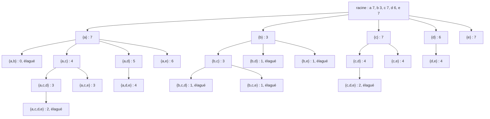

#dmv-frequent_itemsets_mining

# Algorithme

[[Algorithme Eclat|Eclat]] construit un arbre de recherche dont chaque nœud est un itemset candidat et dont la racine porte les singletons ; seuls les nœuds dont le support atteint $minsup$ sont des [[Itemset fréquent|itemsets fréquents]]. L'exploration part d'une [[Classes d'équivalence des itemsets|classe d'équivalence]] de préfixe $P$ et la traite par un appel à `compute_frequent`, décrit dans [[Algorithme de fouille d'une classe d'équivalence]] : la classe est décomposée en classes filles, et `compute_frequent` se rappelle sur chacune d'elles.

Une classe de préfixe $P$ réunit les itemsets $P \cup \{y\}$ fréquents. Pour une extension $x$, le support de l'itemset plus long s'obtient par [[Support par intersection de tidlists|intersection de tidlists]] :

$$\mathrm{support}(P \cup \{y, x\}) = |\mathrm{tidlist}(P \cup \{y\}) \cap \mathrm{tidlist}(P \cup \{x\})|$$

Les tidlists intersectées sont celles des nœuds du niveau courant ; le résultat forme la tidlist du nœud fils, qui sert de point de départ à l'intersection suivante.

La descente suit trois règles.

- Les items sont pris dans l'ordre où ils figurent dans la liste des singletons de la racine.
- Dans une classe, les extensions sont traitées de gauche à droite ; chaque extension fréquente est développée récursivement avant que la suivante ne soit examinée.
- Un nœud n'est quitté qu'une fois ses extensions épuisées ; l'exploration remonte alors d'un niveau (retour arrière) et reprend chez l'ancêtre dont il reste une extension non testée.

Un nœud dont le support tombe sous $minsup$ est écarté et sa branche est abandonnée, par [[Propriété d'anti-monotonie du support|anti-monotonie du support]]. La récursion s'arrête aussi lorsqu'il ne reste plus qu'une seule tidlist à intersecter, aucune nouvelle intersection n'étant alors possible : le parcours remonte. Les itemsets fréquents rencontrés sur la descente sont écrits au fil de l'eau, et l'exploration se termine lorsque les extensions de la racine sont épuisées.

# Exemple

La base compte dix transactions, pour un seuil de support de trois transactions.

| Transaction | Items |
|---|---|
| 1 | a, d, e |
| 2 | b, c, d |
| 3 | a, c, e |
| 4 | a, c, d, e |
| 5 | a, e |
| 6 | a, c, d |
| 7 | b, c |
| 8 | a, c, d, e |
| 9 | b, c, e |
| 10 | a, d, e |

Les singletons fréquents, avec leur support, sont $a : 7$, $b : 3$, $c : 7$, $d : 6$ et $e : 7$ ; chacun est muni de sa tidlist, et la base de transactions n'est plus parcourue ensuite.

Le déroulement du parcours est le suivant.

1. L'itemset $\{a\}$ est intersecté avec $b$, $c$, $d$ et $e$ : $\{a, b\}$ a pour support $0$ et il est élagué, tandis que $\{a, c\}$, $\{a, d\}$ et $\{a, e\}$ ont pour supports $4$, $5$ et $6$.
2. La descente reprend sur $\{a, c\}$, intersecté avec $d$ puis $e$ : $\{a, c, d\}$ et $\{a, c, e\}$ ont pour support $3$.
3. L'itemset $\{a, c, d\}$ est prolongé par $e$ : $\{a, c, d, e\}$ a pour support $2$, il est élagué et la branche est abandonnée.
4. Retour au niveau de $\{a, c\}$, puis au niveau des paires : $\{a, d\}$ intersecté avec $\{a, e\}$ donne $\{a, d, e\}$, de support $4$. Il ne reste qu'une tidlist, donc le parcours remonte.
5. Retour au niveau des singletons : $b$ est intersecté avec $c$, $d$ et $e$, ce qui donne les itemsets $\{b, c\}$ (support $3$), $\{b, d\}$ (support $1$) et $\{b, e\}$ (support $1$). Seul $\{b, c\}$ atteint le seuil.
6. Le prolongement de $\{b, c\}$ par $d$ puis par $e$ donne $\{b, c, d\}$ et $\{b, c, e\}$, tous deux de support $1$ : tous les sous-arbres de la branche sont élagués et le parcours remonte.
7. $c$ est intersecté avec $d$ puis $e$ : $\{c, d\}$ a pour support $4$ et $\{c, e\}$ pour support $4$.
8. $\{c, d\}$ intersecté avec $\{c, e\}$ donne $\{c, d, e\}$, de support $2$ ; l'itemset est élagué et le parcours remonte.
9. $d$ est intersecté avec $e$, ce qui donne $\{d, e\}$ de support $4$ : la recherche est terminée.

Les itemsets retenus sont donc les singletons, les paires $\{a, c\}$, $\{a, d\}$, $\{a, e\}$, $\{b, c\}$, $\{c, d\}$, $\{c, e\}$ et $\{d, e\}$, puis les triplets $\{a, c, d\}$, $\{a, c, e\}$ et $\{a, d, e\}$ : ce sont exactement ceux que trouve l'[[Algorithme Apriori]] sur la même base.

# Interprétation

Le parcours est dit en profondeur parce qu'un nœud est développé jusqu'à ses plus longs descendants avant que ses frères ne soient examinés : $\{a\}$ mène à $\{a, c\}$, puis à $\{a, c, d\}$ et à $\{a, c, d, e\}$ avant que $\{a, d\}$ ne soit seulement intersecté. L'arbre n'est donc jamais matérialisé en entier, seule la branche courante étant ouverte.

Chaque intersection crée une nouvelle tidlist, celle du nœud fils, et cette tidlist reste utile tant que le parcours est dans la branche correspondante. Comme la descente ne garde qu'un chemin, les tidlists vivantes se limitent à celles des ancêtres du nœud courant, plus celle du nœud lui-même ; en remontant, les tidlists des branches abandonnées sont libérées. Le pic de mémoire est ainsi fixé par la longueur du plus long chemin, et non par le nombre total d'itemsets visités.

Chaque tidlist est écrite comme un vecteur de bits indicé par les transactions : l'intersection de deux tidlists se fait bit à bit, et le support se lit en comptant les bits restés à un. Une tidlist occupe donc un bit par transaction, même lorsque l'itemset n'apparaît que dans quelques transactions, si bien qu'une tidlist de niveau profond, plus courte en support, ne pèse pas moins lourd qu'une tidlist de niveau haut.

Le gain de la profondeur est double : les tidlists se déduisent l'une de l'autre par intersection sans jamais reparcourir la base de transactions, et une branche dont le support s'effondre est fermée immédiatement, sans que ses descendants soient construits.

# Remarque

La comparaison avec le parcours en largeur d'Apriori porte sur la mémoire et sur l'élagage.

- Un parcours en largeur traite un niveau entier avant de passer au suivant : tous les candidats du niveau et leurs supports sont conservés simultanément, et l'arbre de recherche complet reste en mémoire principale.
- Un parcours en profondeur n'a qu'une branche ouverte à la fois et se contente, en pratique, d'écrire les itemsets fréquents trouvés au fil de la descente au lieu de garder l'arbre.
- Le parcours en largeur connaît, avant de compter un candidat, tous ses sous-ensembles du niveau précédent : $\{a, c, d, e\}$ peut ainsi être élagué sans calcul dès que $\{c, d, e\}$ est connu comme infréquent.
- Le parcours en profondeur ne connaît que les sous-ensembles situés sur sa branche : il intersecte d'abord, obtient un support de $2$ pour $\{a, c, d, e\}$, puis l'écarte. Le même élagage redevient possible si l'arbre des préfixes est parcouru de droite à gauche et si les supports déjà calculés sont mémorisés, mais le stockage de ces supports coûte de la mémoire, et le gain attendu ne justifie pas nécessairement ce coût.

Sur la branche de $b$, les extensions ne sont étiquetées que par leur support, $d : 1$ et $e : 1$ étant barrés sans que l'itemset testé soit nommé : il s'agit de $\{b, d\}$ et $\{b, e\}$, tous deux de support $1$ pour un seuil de $3$, donc infréquents. Barrer une étiquette signifie que l'itemset correspondant n'atteint pas le seuil ; seul $\{b, c\}$, de support $3$, survit à ce niveau.

Le parcours en profondeur est la raison d'être de la décomposition en [[Classes d'équivalence des itemsets|classes d'équivalence]] : les tidlists d'une classe fille se calculent à partir de celles de la classe mère, et c'est cette dépendance locale qui rend la descente possible. Les itemsets ne sont pas visités dans l'ordre du [[Treillis des itemsets|treillis]], qui irait par niveaux, mais dans l'ordre des préfixes, en profondeur : $\{a, c, d, e\}$ est atteint avant $\{a, d\}$, et $\{a, d\}$ avant $\{c\}$ ; une classe d'équivalence n'est ouverte qu'à l'arrivée sur son préfixe.
