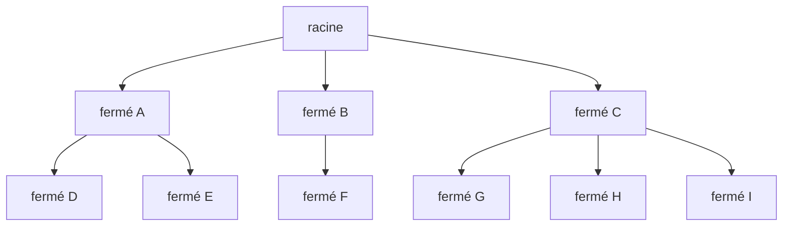

#dmv-frequent_itemsets_mining

# Définition

La recherche inverse est un cadre d'énumération des [[Itemsets fréquents fermés|itemsets fermés fréquents]] qui les organise en un **arbre couvrant orienté** plutôt qu'en graphe libre.

L'espace des itemsets fermés fréquents n'est pas un arbre : un même fermé peut s'obtenir par plusieurs chaînes d'extensions, ce qui en fait un graphe avec des chemins multiples. La recherche inverse choisit, pour chaque fermé, un **père unique**, de sorte que l'ensemble des fermés et ces liens forment un arbre couvrant dont les arêtes sont orientées du père vers les fils.

Depuis un nœud de cet arbre, il faut une **fonction de transition** qui calcule ses fils, c'est-à-dire les itemsets fermés dont ce nœud est le père.

# Interprétation

La conséquence est qu'un parcours en profondeur devient possible.

La visite part de la racine, descend dans le premier fils, puis dans le premier fils de celui-ci, et ne remonte qu'une fois une feuille atteinte. Aucune mémoire globale n'est nécessaire : à chaque nœud, la fonction de transition recalcule les fils à partir du nœud courant.

Il suffit donc de conserver le chemin courant, pas la liste des itemsets fermés déjà énumérés, ni un ensemble de candidats à tester.

C'est là la différence avec les méthodes qui engendrent et stockent des candidats avant de les confronter à la base, comme la génération de candidats d'[[Génération des candidats par apriori-gen|apriori-gen]] : la recherche inverse ne produit que des fermés, un par nœud de l'arbre, et n'a rien à mémoriser entre deux branches.

# Exemple

Allure schématique de l'arbre : chaque nœud est un itemset fermé, chaque arête relie un fermé à l'un de ses fils.

# Remarque

L'arbre n'est pas donné par la base : il résulte d'un **ordre d'exploration** imposé au graphe des fermés, choisi pour suivre la stratégie d'énumération et rester peu coûteux à vérifier. Le détail de cet ordre est traité dans [[Arbre des itemsets fermés et ordre d'exploration]].

Les fils d'un nœud s'obtiennent en ajoutant un item puis en prenant la fermeture de l'itemset obtenu : c'est le mécanisme de [[Fermeture d'un itemset et extension par fermeture]] qui fournit la fonction de transition.
