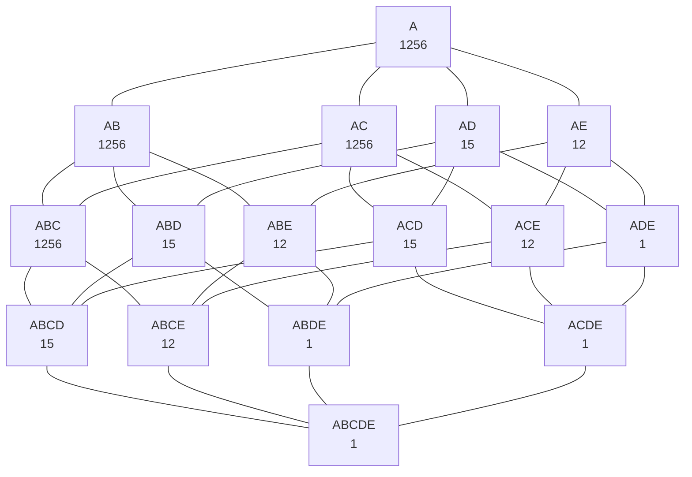

#dmv-frequent_itemsets_mining

# Définition

Le **treillis des itemsets** d'une base d'items $A$ est le graphe dont les sommets sont tous les itemsets $I \subseteq A$, et dont les arêtes expriment l'inclusion immédiate entre itemsets.

- Le **niveau** $k$ du treillis rassemble les $k$-itemsets : les itemsets y sont rangés par taille croissante, du bas vers le haut.
- Le niveau $0$ contient l'unique itemset vide, noté $\bot$ ; le niveau $n$ contient l'itemset $A$ tout entier.
- Une arête relie $I$ et $J$ exactement lorsque $J$ est un **sur-ensemble immédiat** de $I$, c'est-à-dire lorsque $J = I \cup \{a\}$ pour un item $a \notin I$ ; la même arête fait de $I$ un **sous-ensemble immédiat** de $J$.
- Les arêtes ne relient donc que des niveaux consécutifs : tout itemset de taille $k$ est relié à ses $k$ sous-ensembles immédiats, au niveau $k-1$, et aux itemsets du niveau $k+1$ obtenus en lui ajoutant un item absent.

Chaque nœud du treillis porte l'itemset et son [[Support d'un itemset|tidset]], c'est-à-dire la liste des transactions qui le contiennent ; le support d'un itemset est le cardinal de ce tidset. Une base d'items à $n$ items déploie ainsi l'espace complet des itemsets, chaque itemset y apparaissant une seule fois.

# Propriétés

- Monter d'un niveau revient à ajouter un item à l'itemset, donc à restreindre l'ensemble des transactions qui le contiennent : le tidset décroît au sens de l'inclusion.
- Le support étant le cardinal du tidset, il décroît quand on monte dans le treillis et croît quand on descend ; deux itemsets reliés par une arête vérifient l'inégalité des supports dans le sens de l'inclusion.
- Pour tous itemsets $I$ et $J$, le tidset de l'union est l'intersection des tidsets, ce qui rend le support d'un sur-ensemble calculable sans reparcourir la base :
$$\mathrm{tidlist}(I \cup J) = \mathrm{tidlist}(I) \cap \mathrm{tidlist}(J)$$
- Si un itemset n'est pas fréquent, aucun de ses sur-ensembles ne l'est : le cône ascendant d'un nœud infréquent est entièrement infréquent, par la [[Propriété d'anti-monotonie du support|propriété d'anti-monotonie du support]]. Réciproquement, les itemsets fréquents occupent le bas du treillis, fermé vers le bas.

# Exemple

Base d'items $A = \{A, B, C, D, E\}$ et base de transactions $T = (t_1, \dots, t_6)$ :

| Transaction | A | B | C | D | E |
| :-: | :-: | :-: | :-: | :-: | :-: |
| **1** | X | X | X | X | X |
| **2** | X | X | X |   | X |
| **3** |   |   | X |   |   |
| **4** |   | X | X |   |   |
| **5** | X | X | X | X |   |
| **6** | X | X | X |   |   |

Le treillis associé se dessine du bas vers le haut : $\bot$ en bas, puis les cinq singletons $A, B, C, D, E$, puis les dix paires, puis les dix triplets, puis les cinq quadruplets, et $ABCDE$ au sommet. Chaque nœud y est annoté de son tidset, et une arête descendante relie chaque itemset à chacun de ses sous-ensembles immédiats.

Niveau 1, les singletons :

- $A$ : tidset $\{1, 2, 5, 6\}$, support $4$ ;
- $B$ : tidset $\{1, 2, 4, 5, 6\}$, support $5$ ;
- $C$ : tidset $\{1, 2, 3, 4, 5, 6\}$, support $6$ ;
- $D$ : tidset $\{1, 5\}$, support $2$ ;
- $E$ : tidset $\{1, 2\}$, support $2$.

Niveau 2, les paires :

- $AB$ : tidset $\{1, 2, 5, 6\}$, support $4$ ;
- $AC$ : tidset $\{1, 2, 5, 6\}$, support $4$ ;
- $BC$ : tidset $\{1, 2, 4, 5, 6\}$, support $5$ ;
- $AD$, $BD$, $CD$ : tidset $\{1, 5\}$, support $2$ ;
- $AE$, $BE$, $CE$ : tidset $\{1, 2\}$, support $2$ ;
- $DE$ : tidset $\{1\}$, support $1$.

Niveau 3, les triplets :

- $ABC$ : tidset $\{1, 2, 5, 6\}$, support $4$ ;
- $ABD$, $ACD$, $BCD$ : tidset $\{1, 5\}$, support $2$ ;
- $ABE$, $ACE$, $BCE$ : tidset $\{1, 2\}$, support $2$ ;
- $ADE$, $BDE$, $CDE$ : tidset $\{1\}$, support $1$.

Niveau 4, les quadruplets :

- $ABCD$ : tidset $\{1, 5\}$, support $2$ ;
- $ABCE$ : tidset $\{1, 2\}$, support $2$ ;
- $ABDE$, $ACDE$, $BCDE$ : tidset $\{1\}$, support $1$.

Niveau 5 :

- $ABCDE$ : tidset $\{1\}$, support $1$.

Extrait du treillis, restreint aux itemsets qui contiennent $A$ (chaque nœud porte l'itemset et son tidset) :

Sur cet extrait se lit la double lecture des arêtes : $AB$ est un sur-ensemble immédiat de $A$ et un sous-ensemble immédiat de $ABC$, et son support vaut $4$. Le long du chemin ascendant $A \to AB \to ABCD \to ABCDE$, les supports valent $4$, puis $4$, puis $2$, puis $1$ : ils ne remontent jamais.

Avec un seuil de support minimum $\varepsilon = 2$, les itemsets de support $1$ sont infréquents : $DE$, $ADE$, $BDE$, $CDE$, $ABDE$, $ACDE$, $BCDE$ et $ABCDE$. Tous les autres itemsets, de support au moins $2$, sont fréquents et forment le bas du treillis : aucun itemset n'y a de sur-ensemble fréquent sans être fréquent lui-même.

# Remarque

Le treillis matérialise l'espace de recherche de l'[[Algorithme Apriori|algorithme Apriori]], qui le parcourt niveau par niveau en partant des singletons : l'élagage y suit les arêtes, un nœud infréquent supprimant tout son cône ascendant par la [[Propriété d'anti-monotonie du support|anti-monotonie du support]]. La [[Recherche bidirectionnelle des itemsets maximaux|recherche bidirectionnelle]] ajoute à ce parcours ascendant un parcours descendant, les deux se rejoignant sur les itemsets effectivement fréquents.

Sa taille interdit l'énumération exhaustive de tous les nœuds, ce qui condamne l'approche par [[Limites de l'approche brute force|force brute]] et impose des parcours guidés.

L'[[Algorithme Eclat|algorithme Eclat]] exploite l'annotation des nœuds par les tidsets : il partitionne le treillis en [[Classes d'équivalence des itemsets|classes d'équivalence]] d'itemsets partageant le même préfixe, afin de ne pas garder simultanément en mémoire les tidsets de tous les itemsets d'un niveau.
