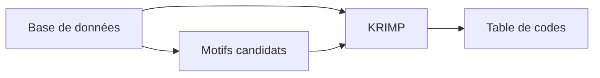

#dmv-pattern_mining_with_information_theory

# Algorithme

KRIMP construit une [[Table de codes]] pour une base de transactions $D$ en s'appuyant sur le principe MDL et sur des heuristiques.

**Entrées** : une base de transactions $D$ et un ensemble de candidats $\mathcal{F}$, tous deux sur un ensemble d'items $\mathcal{I}$.

**Sortie** : une solution heuristique du problème de l'ensemble de codes minimal, c'est-à-dire une table de codes $CT$.

```
1  CT ← Standard Code Table(D)
2  F_o ← F rangé dans l'ordre standard des candidats
3  pour tout F dans F_o hors items singletons faire
4      CT_c ← (CT union F) rangé dans l'ordre standard de couverture
5      si L(D, CT_c) < L(D, CT) alors
6          CT ← CT_c
7      fin si
8  fin pour
9  retourner CT
```

Les deux ordres d'examen sont fixés par les données :

- l'ordre standard des candidats classe les itemsets par support décroissant, puis par taille décroissante, puis par ordre lexicographique croissant,
- l'ordre standard de couverture, appliqué à la table augmentée, classe ses entrées par taille décroissante, puis par support décroissant, puis par ordre lexicographique croissant ; c'est l'ordre dans lequel les codes sont attribués et dans lequel le [[Couverture d'une transaction par une table de codes|cover]] parcourt la table.

# Interprétation

La boucle décrit un parcours glouton de l'espace des tables : à chaque étape, un motif candidat est ajouté à la table, la base est réencodée avec la table augmentée, puis l'ajout est accepté ou rejeté selon que la [[Taille totale d'un modèle et des données encodées|taille totale]] diminue ou non.



Le déroulement de la boucle interne se lit ainsi :

- sélectionner un motif dans l'ordre standard des candidats,
- l'ajouter à la table de codes,
- recompresser la base avec la table augmentée,
- accepter l'ajout si la compression s'améliore, le rejeter sinon.

Les singletons sont exclus du parcours, puisqu'ils figurent déjà dans la table de départ. La couverture est gloutonne et sans chevauchement, si bien qu'un itemset ajouté peut reprendre à son compte des items que plusieurs entrées couvraient séparément, et faire ainsi baisser l'usage, donc allonger le code, des entrées qu'il recouvre : un candidat peut rester dans la table tout en rendant un ancien élément indésirable, ce que traite l'[[Élagage après acceptation d'une table de codes]].

# Remarque

La table de départ est la [[Table de codes standard]], seule table dont les longueurs de code sont déterminées sans ambiguïté par les seules données. Un schéma récapitulatif de la démarche figure parfois la boucle partant d'une table de codes vide ; c'est la table standard qu'il faut lire à cette place, une table vide ne fournissant aucun code et ne permettant donc pas d'encoder la base pour mesurer la taille totale.

L'algorithme ne garantit pas l'optimum de la [[Recherche de la table de codes optimale]] : l'ordre d'examen est fixé une fois pour toutes, et un candidat rejeté à une étape n'est pas réexaminé plus tard, alors que l'ajout d'un itemset plus long aurait pu le rendre avantageux. C'est ce que corrige l'élagage, puis les variantes progressives telles que l'[[Algorithme SLIM]].

Le résultat dépend de l'ensemble $\mathcal{F}$ : KRIMP ne construit pas ses candidats, il les reçoit, et la qualité de la table finale est bornée par la richesse de cet ensemble.
