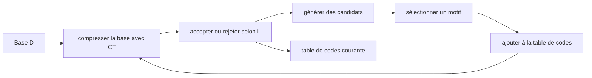

#dmv-pattern_mining_with_information_theory

# Définition

**SLIM** est un algorithme de construction d'une [[Table de codes]] par compression, conçu comme la version any-time de l'[[Algorithme KRIMP]]. Il travaille en **generate-and-select** (générer puis sélectionner au fil de la construction) là où KRIMP travaille en generate-then-select (tout générer, puis sélectionner).

**Entrée** : une base de transactions $\mathcal{D}$ sur un ensemble d'items $I$.

**Sortie** : une solution heuristique du problème de l'ensemble de codes minimal, c'est-à-dire une table de codes $CT$, utilisable ensuite pour la classification.

Le critère d'évaluation reste la [[Taille totale d'un modèle et des données encodées]] $L(\mathcal{D}, CT)$, somme de la longueur de description du modèle et de celle des données encodées avec lui.

# Interprétation

Un modèle MDL est compressé puis évalué en boucle. À chaque itération :

- des candidats sont générés,
- un motif est sélectionné,
- le motif est ajouté à la table de codes,
- la base est recompressée,
- l'ajout est accepté ou rejeté selon le gain de compression obtenu.

Ce déroulement permet d'interrompre le processus à tout moment et de retourner le meilleur modèle courant, au lieu d'attendre l'examen d'un ensemble de candidats fixé d'avance.



# Algorithme

```
1  CT ← Standard Code Table(D)
2  pour F dans {X union Y : X, Y ∈ CT} dans l'ordre du gain faire
3      CT_c ← (CT union F) dans l'ordre standard de couverture
4      si L(D, CT_c) < L(D, CT) alors
5          CT ← post-prune(CT_c)
6      fin si
7  fin pour
8  retourner CT
```

Le principe de chaque étape :

- la table part de la [[Table de codes standard]], seule table dont les longueurs de code se déduisent des seules données,
- les candidats ne sont pas extraits d'avance : ce sont les réunions $X \cup Y$ de deux entrées déjà présentes dans la table courante, examinées dans l'ordre du gain,
- la table augmentée est rangée dans l'ordre standard de couverture, qui classe les entrées par taille décroissante, puis par support décroissant, puis par ordre lexicographique croissant ; cet ordre fixe le [[Couverture d'une transaction par une table de codes|cover]], donc les usages et les longueurs de code,
- l'ajout n'est retenu que si la taille totale diminue, et la table acceptée est alors élaguée par [[Élagage après acceptation d'une table de codes|post-prune]],
- une liste des $k$ meilleurs candidats est conservée pour la ligne 2, au cas où le candidat choisi échoue au test de la ligne 4.

# Exemple

Ensemble d'items $I = \{A, B, C, D\}$ et base de transactions :

| Transaction | Description |
| --- | --- |
| $T_1$ | A B C |
| $T_2$ | B C D |
| $T_3$ | A B |
| $T_4$ | B C |
| $T_5$ | B D |

La longueur d'un code dépend de son usage :

$$L(c \mid CT) = -\log_2 \left( \frac{usage(c)}{\sum_{y \in CT} usage(y)} \right)$$

avec les valeurs de référence suivantes :

| Rapport d'usages | Longueur (bits) |
| --- | --- |
| $-\log_2(5/12)$ | 1,26 |
| $-\log_2(3/12)$ | 2 |
| $-\log_2(2/12)$ | 2,58 |
| $-\log_2(3/9)$ | 1,58 |
| $-\log_2(2/9)$ | 2,16 |
| $-\log_2(1/9)$ | 3,16 |

Deux étapes de la boucle, sans élagage pour simplifier.

La table de départ est la table standard : un singleton par item, d'usage égal à son support, soit une somme d'usages de $2 + 5 + 3 + 2 = 12$, qui correspond aux trois premières lignes du tableau de longueurs.

| Motif | Support | Usage |
| --- | --- | --- |
| {A} | 2 | 2 |
| {B} | 5 | 5 |
| {C} | 3 | 3 |
| {D} | 2 | 2 |

Première étape : le candidat est la réunion de deux entrées de la table, par exemple $F = \{B, C\}$. La table augmentée se lit dans l'ordre standard de couverture, le motif de taille 2 passant en tête :

- $T_1$ a pour cover $\{B, C\}$ puis $\{A\}$,
- $T_2$ a pour cover $\{B, C\}$ puis $\{D\}$,
- $T_3$ a pour cover $\{B\}$ puis $\{A\}$,
- $T_4$ a pour cover $\{B, C\}$,
- $T_5$ a pour cover $\{B\}$ puis $\{D\}$.

Usages et longueurs de code de la table augmentée, la somme des usages valant $3 + 2 + 2 + 2 = 9$ :

| Motif | Usage | Longueur (bits) |
| --- | --- | --- |
| {B, C} | 3 | 1,58 |
| {A} | 2 | 2,16 |
| {B} | 2 | 2,16 |
| {D} | 2 | 2,16 |

L'entrée $\{C\}$ n'est plus utilisée : d'usage nul, elle ne reçoit aucun code et ne pèse plus dans la somme des usages, ni dans la [[Longueur de description d'une table de codes|longueur de description de la table]]. La comparaison $L(\mathcal{D}, CT_c) < L(\mathcal{D}, CT)$ décide de l'acceptation : un candidat dont le raccourcissement des données ne compense pas l'allongement de la table est rejeté, et le candidat suivant de la liste est essayé.

La seconde étape répète l'opération sur la table ainsi obtenue, avec un nouveau candidat formé de deux de ses entrées.

# Propriétés

- **Any-time** : l'algorithme peut être arrêté à toute itération et rend la meilleure table de codes construite jusque-là.
- **Raffinement de plus fort gain** : à chaque étape, il considère le raffinement de la table courante qui apporte le gain le plus fort, choix guidé par des heuristiques.
- **Sans paramètre** : aucun seuil de support minimal n'est requis, le critère MDL jouant le rôle de seuil.

# Remarque

Le coût de cette souplesse est une exploration moins systématique : rien ne garantit que la table atteinte soit optimale au sens de la [[Recherche de la table de codes optimale]], et le résultat dépend de l'ordre dans lequel les candidats sont examinés.
