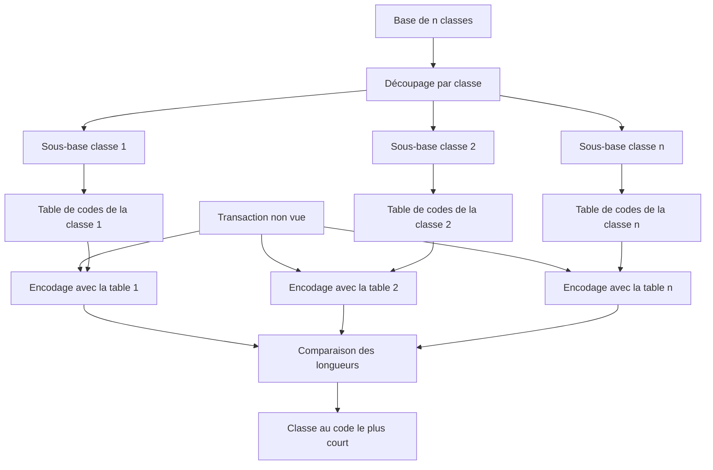

#dmv-pattern_mining_with_information_theory
# Algorithme

Le classifieur par compression s'appuie sur l'[[Algorithme KRIMP]] et se déroule en trois temps : découper la base par classe, apprendre une table de codes par classe, puis classer une transaction non vue par la longueur de son encodage.

```
Entrée : base D étiquetée en n classes, transaction non vue t
Sortie : classe prédite pour t

1  découper D en une sous-base D_k par classe k
2  pour chaque classe k faire
3      CT_k ← KRIMP(D_k)
4  fin pour
5  pour chaque classe k faire
6      calculer L(t | CT_k)
7  fin pour
8  retourner la classe k dont la table donne le code le plus court
```

# Interprétation

Chaque table de codes n'a vu que les transactions d'une seule classe : elle en a retenu les combinaisons d'items caractéristiques. Encoder une transaction inconnue avec la table d'une classe mesure donc à quel point cette transaction ressemble aux régularités de cette classe.

La décision se prend par comparaison des longueurs d'encodage d'une même transaction. Le modèle est déjà appris et ne varie plus : ce qui distingue les classes est uniquement le coût d'encodage des données, au sens de la [[Longueur de description d'une base encodée]]. La classe gagnante est celle dont la table donne le code le plus court.



# Remarque

La classification est l'une des [[Applications des tables de codes]] : elle transforme une table apprise sans étiquette en un prédicteur supervisé, sans changer la procédure d'apprentissage. Le découpage par classe est la seule adaptation nécessaire, puisqu'il restreint la base d'apprentissage aux transactions d'une classe.

Un encodage court signale une transaction bien décrite par la table, donc proche des combinaisons d'items de la classe. Ce critère hérite des [[Propriétés des tables de codes de KRIMP]] : des tables petites et spécifiques y jouent le rôle de modèle de classe, chaque entrée longue correspondant à une combinaison d'items plutôt qu'à un item isolé.

Le classement ne demande pas de règle de décision supplémentaire : la comparaison des longueurs d'encodage suffit à trancher entre les classes.
