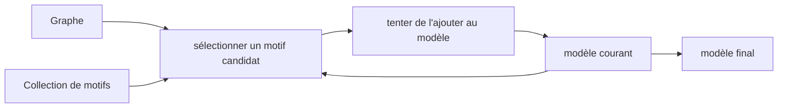

#dmv-pattern_mining_with_information_theory

# Définition

GraphMDL compresse un graphe à l'aide d'un ensemble de motifs de graphes, par le [[Principe de la longueur minimale de description|principe de longueur de description minimale]] déjà employé pour les itemsets et les séquences.

**Entrées** :

- un graphe ;
- une collection de motifs de graphes, extraite du graphe par une méthode de [[Fouille de motifs de graphes|fouille de motifs de graphes]].

**Processus** : sélectionner un nouveau motif candidat, tenter de l'ajouter au modèle, répéter.

**Sortie** : le modèle, c'est-à-dire une [[Table de codes de motifs de graphes|table de codes de motifs de graphes]].

# Interprétation

Le graphe joue le rôle de la base de données à décrire, et chaque motif de la collection celui d'une entrée possible de la table de codes : un motif présent dans le modèle permet d'encoder ses occurrences dans le graphe par un code court, au prix de la place occupée par sa description dans la table.

Le mot tenter signale que l'ajout est évalué avant d'être conservé : un candidat n'entre dans le modèle que si la description totale, modèle compris, diminue. Le modèle grossit donc par retouches successives, chaque motif retenu modifiant les occurrences disponibles pour les suivants.

Le nombre de modèles possibles est bien trop grand pour être énuméré, comme pour les itemsets : la construction procède par sélection gloutonne de candidats plutôt que par [[Recherche de la table de codes optimale|recherche de la table de codes optimale]]. Le résultat dépend donc de l'ordre dans lequel les candidats sont proposés.

# Remarque

Le principe ne fixe ni la façon dont le motif candidat est choisi dans la collection, ni le nombre de tours : ce sont les variantes de l'algorithme qui décident si les candidats sont tous extraits d'avance, comme dans l'[[Algorithme KRIMP|approche generate-then-select]], ou produits au fil de la construction, comme dans l'[[Algorithme SLIM]] et dans l'[[Algorithme de recherche progressive de SQS]] pour les séquences.

La description de la sortie suppose que les motifs d'un graphe peuvent se recoller pour reconstituer ce graphe : c'est le rôle des [[Ports d'un motif de graphe|ports]].
