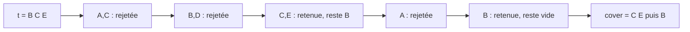

#dmv-pattern_mining_with_information_theory
# Définition

Soit $D$ une base de transactions, $CT$ une [[Table de codes]] et $t$ une transaction de $D$. Le cover de $t$ par $CT$, noté $cover(t, CT)$, est la suite des entrées de $CT$ retenues pour encoder $t$.

Il se construit en parcourant les entrées de $CT$ dans l'ordre de leurs codes : une entrée est retenue si son itemset est inclus dans les items de $t$ encore non couverts, et ses items sont alors retirés des items restants.

Le cover ainsi obtenu vérifie deux conditions :

- les itemsets retenus sont deux à deux disjoints,
- leur réunion est exactement l'ensemble des items de $t$.

Chaque entrée retenue voit son usage augmenté de un, c'est-à-dire que pour tout $c \in cover(t, CT)$ :

$$usage(c) \leftarrow usage(c) + 1$$

# Exemple

Transaction $t = \{B, C, E\}$ et table de codes de huit entrées, toutes d'usage nul au départ.

| Itemset | Usage |
| --- | --- |
| {A, C} | 0 |
| {B, D} | 0 |
| {C, E} | 0 |
| {A} | 0 |
| {B} | 0 |
| {C} | 0 |
| {D} | 0 |
| {E} | 0 |

Parcours dans l'ordre des codes :

- $\{A, C\}$ : $A \notin t$, entrée rejetée,
- $\{B, D\}$ : $D \notin t$, entrée rejetée,
- $\{C, E\}$ : $C \in t$ et $E \in t$, entrée retenue, items restants $\{B\}$,
- $\{A\}$ : $A$ n'est plus à couvrir, entrée rejetée,
- $\{B\}$ : $B \in t$, entrée retenue, items restants $\emptyset$,
- $\{C\}$, $\{D\}$, $\{E\}$ : items déjà couverts, entrées rejetées.

Le cover vaut donc $C\ E$ puis $B$.

Les usages mis à jour portent la trace de l'encodage : l'entrée $\{C, E\}$ passe de $0$ à $0 + 1$, l'entrée $\{B\}$ passe de $0$ à $0 + 1$, les six autres restent à $0$.

# Remarque

Le cover dépend de l'ordre des codes : deux entrées dont les itemsets sont inclus dans $t$ et se chevauchent ne peuvent pas être retenues toutes les deux, et c'est la première rencontrée qui l'emporte. Permuter deux entrées de la table peut donc changer le cover, les usages, et par suite la [[Longueur de description d'une base encodée|longueur de description des données]].

Avec la [[Table de codes standard]], dont toutes les entrées sont des singletons, le cover d'une transaction est unique et coïncide avec ses items : chaque item est couvert par sa propre entrée, sans chevauchement possible.
