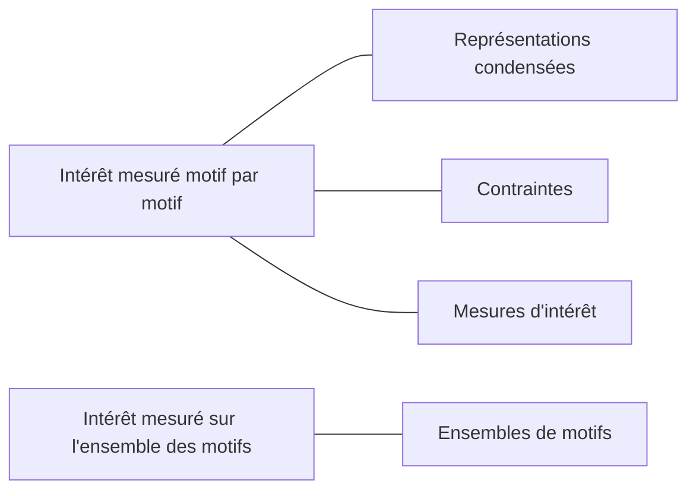

#dmv-pattern_mining_with_information_theory

# Modèle

Deux axes classent les approches qui maîtrisent le volume de motifs constaté dans l'[[Explosion du nombre de motifs|explosion du nombre de motifs]] :
- mesurer l'intérêt de chaque motif individuellement ;
- mesurer l'intérêt de l'ensemble des motifs.

Les quatre familles se distinguent par ce sur quoi elles agissent :

| Famille | Principe | Exemples |
| :--- | :--- | :--- |
| Représentations condensées | réduire la collection en écartant les motifs redondants : les fermés retiennent le maximum de chaque classe de tidlist, les maximaux les itemsets sans sur-ensemble fréquent | motifs fermés, motifs maximaux |
| Contraintes | restreindre le langage des motifs admis | longueur des motifs, expressions régulières |
| Mesures d'intérêt | filtrer ou classer chaque motif par une mesure | support, confiance, taux de croissance |
| Ensembles de motifs | évaluer la collection entière, et non ses membres isolés | tuiles, compression, randomisation par échange |

# Interprétation

Les trois premières familles statuent motif par motif. Une représentation condensée écarte un motif parce qu'un autre le résume : l'ensemble des [[Itemsets fréquents fermés|itemsets fréquents fermés]] garde le maximum de chaque classe de tidlist et conserve ainsi le [[Support d'un itemset|support]] de tous les membres de la classe, tandis que les [[Itemsets fréquents maximaux|itemsets maximaux]] sont les plus compacts mais perdent cette information de support. Une contrainte écarte tout motif qui ne satisfait pas une condition de forme. Une mesure d'intérêt écarte ou ordonne un motif selon un score qui ne dépend que de lui et de la base.

La quatrième famille change d'objet : elle juge la collection, par ce qu'elle couvre, ce qu'elle comprime ou ce qu'elle explique, ce qui permet de traiter la redondance entre motifs au lieu de la constater motif par motif. C'est la voie suivie par les approches par compression décrites dans [[Panorama des approches par compression en fouille de motifs]].

# Remarque

Le rattachement des représentations condensées à l'axe de l'intérêt mesuré motif par motif n'est pas déterminé par la seule famille : fermeture et maximalité sont des propriétés d'un motif vis-à-vis des autres motifs de la base, et non des scores calculés sur le motif seul. La classification les place néanmoins sur cet axe parce que la décision de conserver ou d'écarter porte sur chaque motif pris séparément, et non sur l'ensemble produit, qui est alors seulement réduit.
