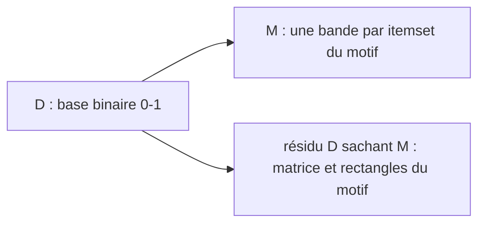

#dmv-pattern_mining_with_information_theory

# Interprétation

Un motif identifie des propriétés locales des données, par exemple des itemsets.

Une base binaire jouet se lit à travers trois objets :

- $D$ : une base de données 0-1, lue comme une matrice de cases noires et blanches (voir [[Items, itemsets et base de transactions]]) ;
- $M$ : un empilement de bandes horizontales colorées, chaque bande codant un itemset du motif ;
- $D \mid M$ : la même matrice, recouverte des rectangles du motif, qui marquent les transactions couvertes localement.

Le motif ne décrit donc pas la base dans son ensemble : il se lit sur un groupe de lignes et de colonnes de la matrice, et laisse intact tout le reste des données.

# Remarque

Les trois objets sont les trois états d'une même idée : le motif est d'abord une propriété locale de la base $D$, il devient le modèle $M$ une fois empilé, et il laisse un résidu $D \mid M$ une fois appliqué. Cette lecture prépare la [[Factorisation des données en modèle et en données couvertes|factorisation]] de la base en modèle et en données couvertes, et c'est elle qui autorise à décrire une base entière par une [[Table de codes]].
