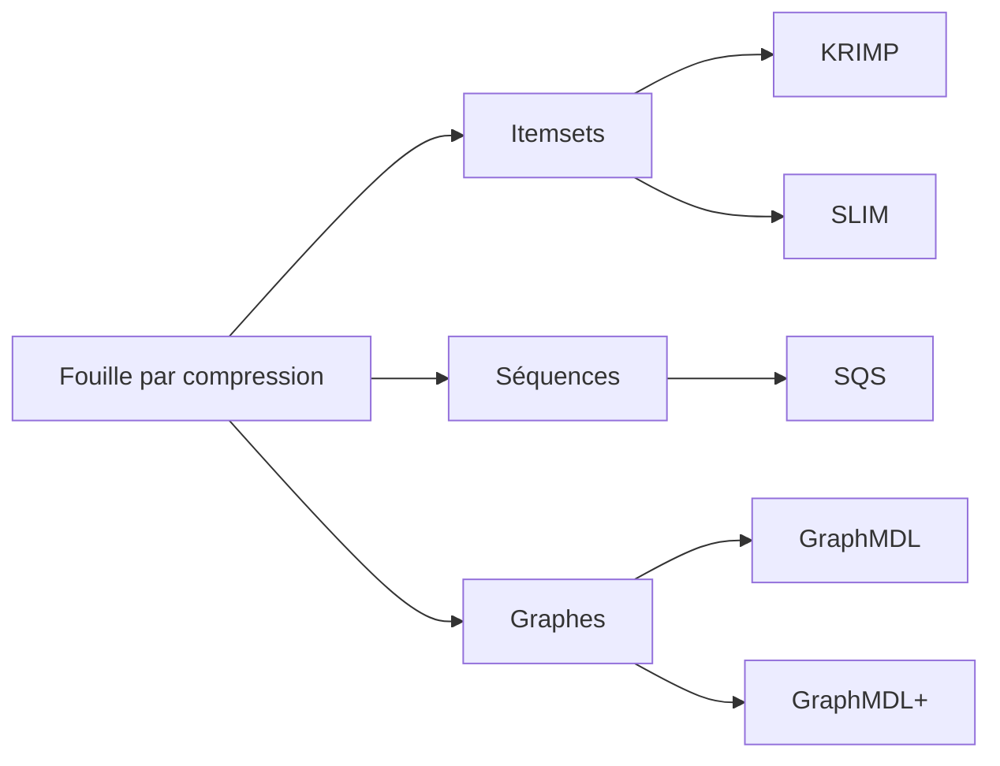

#dmv-pattern_mining_with_information_theory

# Interprétation

L'objectif d'une approche par compression est de **réduire le nombre de motifs extraits** : au lieu d'énumérer tous les motifs satisfaisant un jeu de contraintes (voir [[Énoncé standard de la fouille de motifs]]), on cherche un petit [[Ensemble de motifs|ensemble de motifs]] qui suffit à décrire les données.

Les approches existantes se déclinent par langage de motifs :

- itemsets : [[Algorithme KRIMP|KRIMP]] et [[Algorithme SLIM|SLIM]] ;
- séquences : [[Table de codes pour séquences d'événements|SQS]] ;
- graphes : [[Compression d'un graphe par un ensemble de motifs|GraphMDL]] et [[Version progressive de GraphMDL|GraphMDL+]].

# Remarque

Les trois familles partagent le même cadre : un modèle de type [[Table de codes|table de codes]], jugé sur la longueur totale de description, données encodées comprises.

La nature des données impose la forme de la table : les itemsets se couvrent par des itemsets, les séquences demandent en plus un codage des trous entre les positions couvertes (voir [[Longueur des codes de motifs et de trous]]), les graphes demandent des motifs de graphe munis de [[Ports d'un motif de graphe|ports]] pour recoller leurs occurrences.
