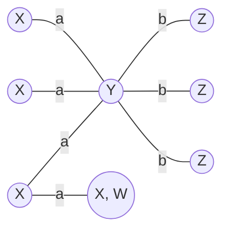

#dmv-pattern_mining_with_information_theory

# Définition

Une table de codes de motifs de graphes est le modèle produit par la [[Compression d'un graphe par un ensemble de motifs|compression d'un graphe par un ensemble de motifs]] : chaque ligne associe à un motif de graphe un code, et ce code remplace les occurrences du motif dans le graphe encodé.

Chaque ligne porte deux éléments :

- la structure du motif, écrite comme un petit graphe dont les sommets sont étiquetés par les nœuds qu'ils peuvent recouvrir et dont les arêtes sont étiquetées par leur type ;
- le code du motif, symbole qui se substitue à une occurrence dans les données encodées.

# Interprétation

Les motifs d'une même table se combinent : l'entrée la plus grande décrit une portion étendue du graphe, les entrées plus petites décrivent ce qui reste, et les codes sont attribués de façon que les entrées les plus utilisées coûtent le moins.

La table est donc le modèle au sens de la compression : elle porte à la fois la description des régularités du graphe et les codes qui remplacent ces régularités dans les données.

# Exemple

Le graphe à décrire est une étoile décentrée :

- un nœud central $Y$ ;
- trois nœuds $X$ à gauche, reliés à $Y$ par des arêtes étiquetées $a$ ;
- trois nœuds $Z$ à droite, reliés à $Y$ par des arêtes étiquetées $b$ ;
- un nœud supplémentaire, étiqueté $X$ et $W$, relié par une arête étiquetée $a$ au nœud $X$ inférieur gauche.

Le modèle retenu comporte quatre entrées :

| Motif | Structure du motif | Code du motif |
| --- | --- | --- |
| P1 | $v_1 \xrightarrow{a} v_2 \xrightarrow{b} v_3$ avec $X$ sur $v_1$, $Y$ sur $v_2$, $Z$ sur $v_3$ | `P` au-dessus de `1` |
| Pa | $v_1 \xrightarrow{a} v_2$ | `Pa` |
| Pw | $v_1$ avec $W$ | `Pw` |
| Px | $v_1$ avec $X$ | `Px` |

Le motif P1 est le plus riche : un chemin de deux arêtes qui traversent le centre de l'étoile, d'un nœud $X$ à un nœud $Z$. Pa code une seule arête $a$, Pw et Px codent un sommet isolé portant l'étiquette $W$ ou $X$.

Les occurrences retenues se marquent sur le graphe par des encadrements en pointillés, une couleur par entrée de la table :

- une occurrence de P1 en haut du graphe, de couleur bleue ;
- une seconde occurrence de P1 en bas à droite, de couleur rouge ;
- une occurrence de Pa en bas à gauche, de couleur verte.

Le code de P1 s'écrit sur deux glyphes superposés, `P` et `1`, là où les trois autres codes tiennent sur un seul glyphe.

# Remarque

Les sommets $v_1$, $v_2$, $v_3$ d'une structure de motif ne désignent aucun sommet particulier du graphe : ce sont les positions du motif, et une occurrence est une correspondance entre ces positions et des sommets du graphe, à [[Isomorphisme de sous-graphe|isomorphisme près]]. Un même motif peut donc couvrir plusieurs endroits différents, comme P1 qui apparaît deux fois.

La table à elle seule ne dit pas comment les occurrences se raccordent entre elles : deux occurrences du même motif peuvent se rattacher au reste du graphe par des sommets différents sans que la table distingue ces cas, ce qui motive l'ajout de [[Ports d'un motif de graphe|ports]] aux entrées.

La superposition des deux glyphes du code de P1 est une disposition typographique du tableau, le code se lisant `P1`.
