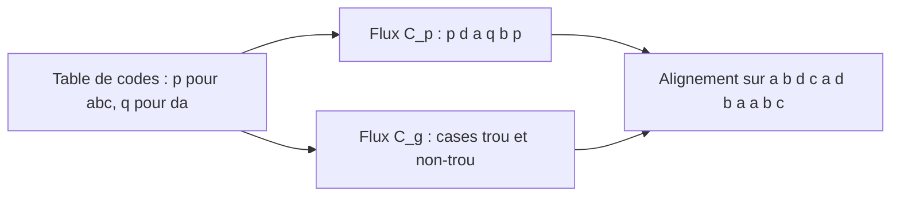

#dmv-pattern_mining_with_information_theory

# Définition

Une **table de codes pour séquences d'événements** est la transposition de la [[Table de codes]] au cas d'une [[Base de séquences]] : le modèle est un ensemble de motifs, chacun muni d'un code, et une séquence se reconstruit à partir de l'encodage.

Les entrées s'écrivent sur quatre colonnes :

- le motif, c'est-à-dire une sous-séquence d'événements,
- le code du motif, symbole émis pour chaque occurrence du motif,
- le code de trou (en anglais *gap code*),
- le code de non-trou (en anglais *no gap code*).

La base encodée se lit en deux flux :

- $C_p$, le flux des motifs (en anglais *pattern stream*), qui aligne les codes des motifs retenus,
- $C_g$, le flux des trous (en anglais *gap stream*), qui marque, pour les occurrences de motifs de plusieurs événements, si leurs événements se suivent directement ou s'ils sont séparés par un événement étranger au motif.

Cette forme de modèle est celle de SQS, prononcé « squeeze », l'approche MDL consacrée aux séquences.

# Exemple

Base constituée d'une séquence de onze événements :

$$D = a,\ b,\ d,\ c,\ a,\ d,\ b,\ a,\ a,\ b,\ c$$

Première table de codes, réduite aux singletons :

| Motif | Code |
| --- | --- |
| a | a |
| b | b |
| c | c |
| d | d |

Deuxième table de codes, qui ajoute deux motifs à la première :

| Motif | Code | Code de trou | Code de non-trou |
| --- | --- | --- | --- |
| a | a | | |
| b | b | | |
| c | c | | |
| d | d | | |
| abc | p | ■ | □ |
| da | q | ■ | □ |

Le motif $abc$ reçoit le code $p$, le motif $da$ le code $q$ ; le carré noir ■ est le code de trou, le carré blanc □ le code de non-trou. Les singletons n'ont ni trou ni non-trou à signaler, leurs deux dernières cellules restent vides.

Encodage avec les seuls singletons : le flux des motifs reproduit la séquence événement par événement, soit onze codes.

$$C_p = a\ b\ d\ c\ a\ d\ b\ a\ a\ b\ c$$

Encodage avec les motifs : six codes dans le flux des motifs et les cases de trou correspondantes dans le flux des trous.

$$C_p = p\ d\ a\ q\ b\ p$$

$$C_g = \square\ \blacksquare\ \square\ \blacksquare\ \square\ \square\ \square$$

La lecture conjointe des deux flux se fait par alignement sur la séquence : les codes de $C_p$ recouvrent des segments de la séquence, et les cases de $C_g$ indiquent comment chaque segment se raccorde au suivant.

L'alignement se lit en trois segments de motifs : une occurrence de $p$, une occurrence de $q$, une occurrence de $p$. Un motif peut enjamber des positions : quand un événement qui ne lui appartient pas s'intercale entre deux de ses événements, l'occurrence reste valide et le flux des trous le signale, ce qui distingue un motif séquentiel d'une simple [[Sous-séquence contiguë|sous-séquence contiguë]].

# Propriétés

- Un motif d'un seul événement n'utilise que sa colonne de code : les colonnes de trou et de non-trou ne servent qu'aux motifs d'au moins deux événements.
- Les longueurs des codes ne sont pas arbitraires : elles se déduisent des usages, comme dans toute [[Table de codes]], selon la règle de la [[Probabilité et longueur optimale d'un code|longueur optimale]] ; les codes de trou et de non-trou ont leurs propres longueurs, décrites dans [[Longueur des codes de motifs et de trous]].
- La qualité d'une table se mesure par la [[Longueur de description d'une base de séquences|longueur totale de description de la base]], qui additionne le coût des deux flux et celui de la description des séquences elles-mêmes.

# Remarque

Les deux flux sont indissociables : le flux des motifs seul ne dit pas où placer les événements qu'un motif saute, et le flux des trous seul ne dit pas quels événements sont attendus. C'est leur lecture simultanée qui reconstruit la séquence.

Un motif de séquence est une [[Motif séquentiel|sous-séquence]], pas nécessairement un bloc contigu : les deux colonnes de trou et de non-trou sont précisément ce qui permet de coder cette liberté sans ambiguïté, au prix d'un flux supplémentaire.
